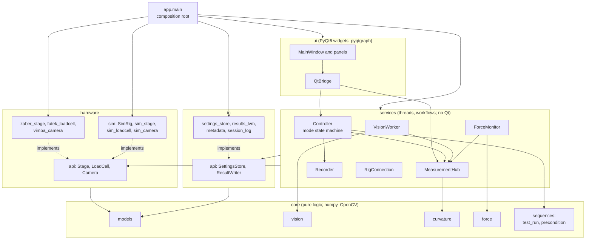
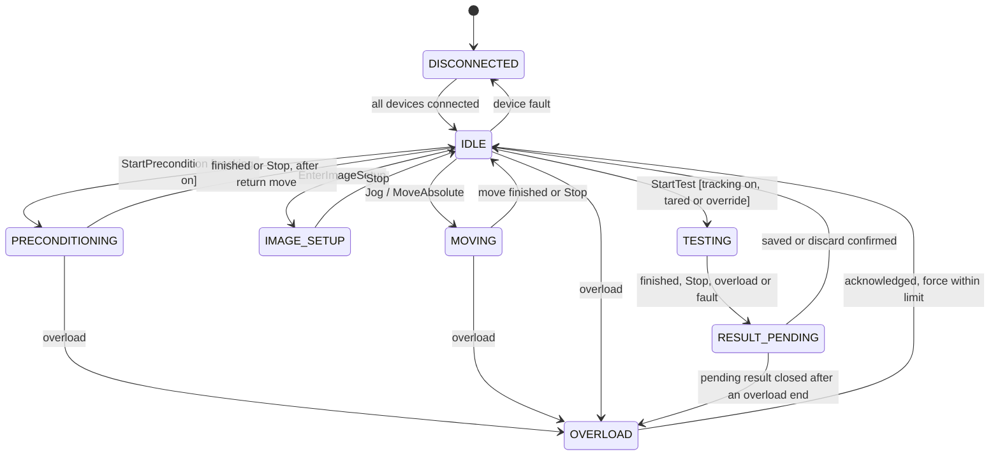
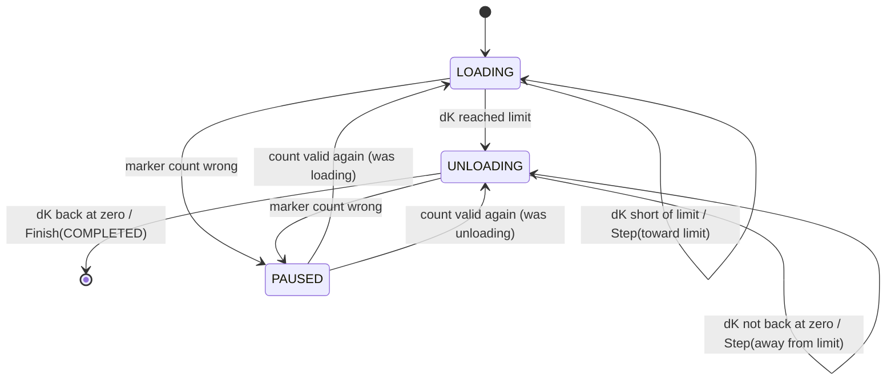
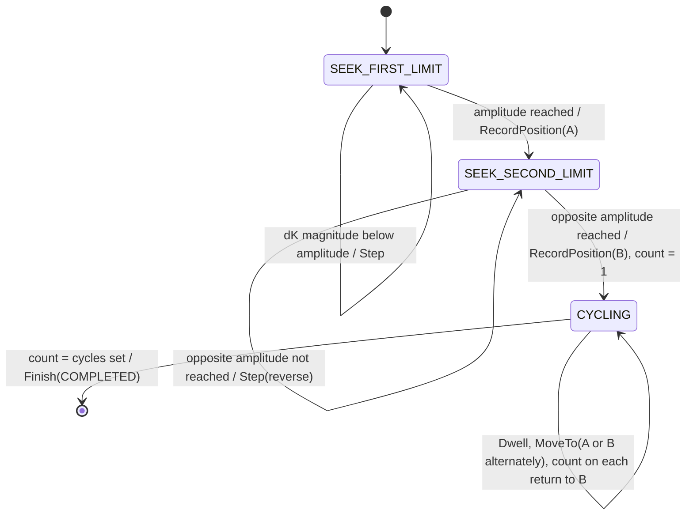

# Target architecture: Bending test application

Inputs: `docs/00_legacy_inventory.md` ("inventory") and `docs/01_requirements.md` ("requirements"). Python 3.11, PyQt6 GUI, pyqtgraph plotting, Windows 10/11 64-bit (NFR-010).

The design covers the requirements marked KEEP or IMPROVE. The dropped items FR-900 to FR-905 have no counterpart here. Requirements flagged UNVERIFIED are each implemented in one named place so a later correction touches one module (listed in §10, decision A12).

The brief left "other fixed choices" open. The hardware libraries chosen are in §9; `nidaqmx` and `pyvisa` are not used because the inventory found no DAQmx and the only VISA use is the Zaber serial port, which the vendor library handles directly.

ACR-1 through ACR-9 and the simplifications accepted on 2026-11-14 are recorded in
[`03_spec/README.md`](03_spec/README.md). Module specs take precedence over this
overview. Saving uses the controller thread, and discovery functions are bound in
`app.main` and injected into the UI bridge.

## 1. Overview

Package name: `bendtest`. Five packages plus a composition root.



Dependency rules:

- `ui` imports `services` and `core.models`. It is the only package that imports PyQt6 or pyqtgraph.
- `services` imports `core`, `hardware.api` and `io.api`. It never imports a concrete driver or file module.
- `core` imports only the standard library, numpy and OpenCV. It has no threads, no clocks and no I/O.
- `hardware` and `io` import `core.models` for shared value types and nothing from `services` or `ui`.
- `app.main` is the only place that names concrete classes. It chooses real or simulated drivers and injects them.

## 2. Mapping from LabVIEW constructs

The inventory found no parallel loops, queues, notifiers, event structures, functional globals or global variables (inv. §4.1), so those rows describe what is introduced, not what is replaced.

| LabVIEW construct (inventory) | VIs concerned | Python replacement | Deliberate divergence |
|---|---|---|---|
| Top-level flat sequence: Init, Main, Stop, Cleanup | `Flex Main Program - GM.vi` | `RigConnection.connect()` / `disconnect()` called from `app.main`; cleanup in `finally` | Devices connect individually and report by name (FR-002) |
| While loop + 7-case structure state machine with enum in a shift register | MAIN | `services.controller.Controller`: explicit `Mode` enum and a command queue, on its own thread | Initialize, Save Data and Close are no longer states. Connecting, saving and exiting are operations, not places the program sits in |
| Shift registers carrying session, images, COM port, settings, tare, dK, output array | MAIN | Object attributes with one owner each: drivers own handles, `MeasurementHub` owns tare and latest values, `Recorder` owns samples | No bundle of state threaded through every case |
| 77 local variables sharing data between nested loops | MAIN | Typed method calls and published events; settings passed as immutable `Settings` snapshots | Front-panel controls are not a data store |
| Hidden Boolean controls used as state (`Test Up`, `Go Back`, `Precond Up`) | MAIN | Phase enums inside `core.sequences.test_run` and `core.sequences.precondition` | Legacy three-phase test is not mirrored; see FR-071 and decision A9 |
| Nested blocking while loops (manual jog, image setup, precondition, test) | MAIN | Workflows run on the controller thread; every wait is cancellable | GUI never blocks (NFR-003) |
| Polling of buttons every 50 ms | MAIN (Idle) | Qt signals from widgets, forwarded as command objects | No polling |
| Image chain repeated in three cases (grab, cast, rotate, threshold, invert, find markers; rotation dropped) | MAIN, `Imaging -- Find Marker.vi`, `IMAQ Count Objects 2 cEE.vi` | One `VisionWorker` thread calling `core.vision` for every frame, in every mode | One copy instead of three; runs continuously |
| Force read once per loop pass; overload ends program | `LoadReadSafe.vi`, MAIN | `ForceMonitor` thread at a fixed rate; overload latches and stops the stage | Independent of workflow timing (NFR-004); application stays open (FR-101) |
| Curvature subVI | `Imaging -- Find K and F.vi` | `core.curvature.compute_curvature()` pure function | Force is not part of it; marker subset is a parameter (FR-042) |
| Error cluster wired through every node; Simple Error Handler at exit | all | Exceptions: `DeviceError` hierarchy carrying the device name; caught at thread boundaries and turned into `Fault` events | Errors surface when they happen (FR-103) |
| Clusters (`input cluster`, `Settings`, `Image Threshold`, IMAQ Rectangle, Object Info) | MAIN, FM, KF, LRS, CO | Frozen dataclasses in `core.models`; `Settings` as a pydantic model | See §6 |
| Enum typedef (state) | MAIN | `enum.Enum` (`Mode`, `TestPhase`, `PrecondPhase`, `EndReason`) | |
| .NET constructor and invoke nodes | MAIN, LRS, `test_futek.vi` | `hardware.futek_loadcell` via pythonnet | |
| Instrument-driver VIs over VISA | Zaber A Series library | `hardware.zaber_stage` | |
| IMAQdx and NI Vision VIs | MAIN, FM, CO | `hardware.vimba_camera` (vmbpy, Vimba X) for acquisition; OpenCV in `core.vision` for processing | No NI runtime needed (NFR-011) |
| Express VIs: Write To Measurement File, Write Delimited Spreadsheet | MAIN | `io.results_lvm`, `io.metadata` | Format written explicitly (IR-010) |
| Express dialogs (Display Message, two-button dialog) | MAIN | `ui.dialogs` | |
| Wait (ms) primitives (50, 400, 3000) | MAIN | `CancelToken.wait(seconds)`; durations from `Settings` | Interruptible |
| Waveform chart with history cleared through a property node | MAIN | `ui.chart.LiveChart` (pyqtgraph) fed by events | |
| "Reinit All to Default" at start; defaults saved in the VI | MAIN | `io.settings_store` loads the last session (FR-006) | |
| Separate `NO_rotate` build | builds folder | None: one build, no rotation (FR-021 dropped) | Camera mounted with the sample horizontal |
| Standalone test VI | `test_futek.vi` | Not ported; simulated drivers and the connection report cover its purpose | |

## 3. Modules

"Depends on" lists project packages only.

### 3.1 `bendtest.core`

| Module | Responsibility | Depends on | Serves |
|---|---|---|---|
| `models` | Value types (§6): `Settings`, `Roi`, `Marker`, `MarkerSet`, `ForceReading`, `Measurement`, `Sample`, `TareState`, `TestRecord`, enums | none | all |
| `errors` | `RigError`, `DeviceError(device)`, `StageError`, `MotionInterrupted`, `LoadCellError`, `CameraError`, `SaveError` | none | FR-002, FR-103 |
| `vision` | `prepare(frame)` (validation only); `binarise(image, lower, upper, invert)`; `find_markers(binary, roi, min_area, max_area)` with border rejection and hole filling; returns centres sorted by X plus a count status against N | `models` | FR-022 to FR-027, FR-030 |
| `curvature` | `compute_curvature(markers, resolution, fit_subset)` returning absolute curvature in 1/mm; evaluation-point rule | `models` | FR-040 to FR-043, NFR-007 |
| `force` | `to_display(raw)` (sign convention), `apply_tare`, `is_overload(raw, limit)` | `models` | FR-045, FR-046, FR-100 |
| `sequences.test_run` | Pure state machine: given the latest `Measurement` and settings, returns the next action (`Step(mm)`, `Hold`, `Finish(reason)`) and phase | `models` | FR-071, FR-073, FR-030 |
| `sequences.precondition` | Pure state machine for first-cycle limit search, later position cycling, cycle counting | `models` | FR-061 to FR-064 |

The sequences contain no timing and no device calls. They are driven by the controller and can be tested with a list of synthetic measurements.

### 3.2 `bendtest.hardware`

| Module | Responsibility | Depends on | Serves |
|---|---|---|---|
| `api` | Abstract base classes `Stage`, `LoadCell`, `Camera` (§3.6) | `core.models`, `core.errors` | IR-001 to IR-005 |
| `zaber_stage` | Real `Stage` over the serial port | `api` | IR-001, IR-002, FR-001 |
| `futek_loadcell` | Real `LoadCell` through `FUTEK.Devices.dll` | `api` | IR-003 |
| `vimba_camera` | Real `Camera` over vmbpy / Vimba X (Allied Vision GigE); newest-frame acquisition, 8-bit mono | `api` | IR-004, IR-005, FR-001 |
| `sim.rig_model` | `SimRig`: one shared physical model. Stage position determines sample curvature; curvature determines marker positions and force; adds noise. Supports fault injection (overload, lost marker, device loss) | `core.models` | NFR-013 |
| `sim.sim_stage`, `sim.sim_loadcell`, `sim.sim_camera` | Simulated drivers reading and writing `SimRig`; the camera renders a synthetic greyscale image with N dark blobs | `api`, `sim.rig_model` | NFR-013 |
| `discovery` | List serial ports and cameras; `app.main` binds functions for injection into the bridge | vendor libraries (lazy), `vimba_camera` | FR-001 |

### 3.3 `bendtest.io`

A subpackage, so it does not shadow the standard `io` module.

| Module | Responsibility | Depends on | Serves |
|---|---|---|---|
| `api` | Protocols `SettingsStore`, `ResultWriter` | `core.models` | |
| `settings_store` | Load and save `Settings` as JSON in the user's application-data folder; separate protected file for the overload limit | `api` | FR-006, FR-102 |
| `results_lvm` | Write a `TestRecord` in the legacy results layout; refuse to overwrite unless told to | `api` | FR-090, FR-092, IR-010 |
| `metadata` | Write the per-test metadata file | `api` | FR-091, IR-011 |
| `session_log` | Configure Python logging: one timestamped file per session plus console | none | NFR-008 |

### 3.4 `bendtest.services`

No Qt imports. Threads use the standard library.

| Module | Responsibility | Depends on | Serves |
|---|---|---|---|
| `events` | Event dataclasses (`MeasurementUpdated`, `ModeChanged`, `PhaseChanged`, `PositionChanged`, `CycleCounted`, `OverloadTripped`, `Fault`, `ResultPending`, `ConnectionReport`) and a small thread-safe publisher | `core` | FR-103, NFR-008 |
| `cancel` | `CancelToken` wrapping `threading.Event` with `wait(seconds)` and `raise_if_cancelled()` | none | FR-004, NFR-003 |
| `rig` | `RigConnection`: connect each device, report per device, start and stop the worker threads, release devices | `hardware.api`, `events` | FR-001, FR-002, FR-005, FR-103 |
| `vision_worker` | Camera thread: grab newest frame, run `core.vision`, hand frame, binary image and `MarkerSet` to the hub; measure frame rate | `hardware.api`, `core.vision`, `hub` | FR-020, FR-022 to FR-028, FR-031, NFR-001, NFR-002 |
| `force_monitor` | Force thread: read at a fixed rate, keep a short timestamped history, check overload on every reading, on overload call `stage.stop()` and latch | `hardware.api`, `core.force`, `hub` | FR-045, FR-100, FR-101, NFR-004 |
| `hub` | `MeasurementHub`: latest frame, markers, force, dK; owns `TareState`; pairs each frame with the nearest force reading; `wait_for_measurement(after=t)` | `core.curvature`, `core.force`, `events` | FR-040 to FR-049, FR-074, NFR-005 |
| `controller` | Workflow thread and `Mode` state machine (§5). Executes commands: jog, absolute move, enter and leave image setup, precondition, test, stop. Enforces start preconditions. Drives `core.sequences`; owns all stage motion except emergency stop | `hardware.api`, `core.sequences`, `hub`, `recorder`, `cancel`, `events` | FR-003, FR-004, FR-010 to FR-013, FR-029, FR-030, FR-048, FR-060 to FR-065, FR-070 to FR-073, FR-076, FR-103, IR-002 |
| `recorder` | Collect `Sample`s for the running test; hold the finished `TestRecord` until saved or discarded; save through `ResultWriter` | `io.api`, `events` | FR-074, FR-075, FR-077, FR-078, FR-090 to FR-093, NFR-009 |

### 3.5 `bendtest.ui` and `bendtest.app`

| Module | Responsibility | Depends on | Serves |
|---|---|---|---|
| `ui.bridge` | `QtBridge(QObject)`: subscribes to service events and re-emits them as Qt signals on the GUI thread; exposes slots that enqueue controller commands. Coalesces image and measurement updates to the display rate | `services` | NFR-001, NFR-002, NFR-003 |
| `ui.main_window` | Window layout, enabling and disabling panels by `Mode`, close handling | `bridge` | FR-003, FR-005, NFR-012 |
| `ui.connection_panel` | Port and camera selection, connect, per-device status | `bridge` | FR-001, FR-002 |
| `ui.stage_panel` | Jog up and down, step in mm, absolute move, position display | `bridge` | FR-010 to FR-013 |
| `ui.imaging_panel` | Live view and binary view (pyqtgraph `ImageItem`), ROI drawing, threshold bounds, invert, rotation, size limits, N, tracking switch, marker overlays, frame rate, marker-count warning | `bridge` | FR-020 to FR-031 |
| `ui.measure_panel` | Force and dK readouts, resolution, tare buttons and tare indicators | `bridge` | FR-043, FR-044, FR-046, FR-047 |
| `ui.precondition_panel` | Amplitude, cycles, dwell time, start, stop, cycle count | `bridge` | FR-060, FR-063, FR-064 |
| `ui.test_panel` | Curvature limit, step, settle time, start, stop, phase display | `bridge` | FR-070, FR-072, FR-073 |
| `ui.chart` | `LiveChart`: force and dK against time on two axes; clear on request | `bridge` | FR-049 |
| `ui.dialogs` | Refusal messages, tare override prompt, save question with discard confirmation, file chooser with overwrite prompt, overload and fault messages | `bridge` | FR-029, FR-048, FR-077, FR-090, FR-092, FR-093, FR-101, FR-103 |
| `app.main` | Parse `--sim`; set up logging; load settings; build drivers, stores, services, bridge, window; run; shut down in order | everything | FR-005, FR-006, NFR-010, NFR-011, NFR-013 |

### 3.6 Hardware interfaces

```python
class Stage(ABC):
    def connect(self, port: str) -> None: ...
    def disconnect(self) -> None: ...
    def position_mm(self) -> float: ...
    def move_relative(self, delta_mm: float) -> None: ...   # blocks until motion ends
    def move_absolute(self, target_mm: float) -> None: ...  # blocks until motion ends
    def stop(self) -> None: ...                              # callable from any thread

class LoadCell(ABC):
    def connect(self) -> None: ...                           # first detected device
    def disconnect(self) -> None: ...
    def read_raw(self) -> float: ...                         # channel 0, device units

class Camera(ABC):
    def connect(self, camera_id: str) -> None: ...
    def disconnect(self) -> None: ...
    def grab_latest(self, timeout_s: float) -> Frame: ...    # newest frame, 8-bit mono
```

Contract points that matter to the rest of the design:

- A move returns only when the stage reports it is idle (IR-002). A move interrupted by `stop()` raises `MotionInterrupted`.
- `Stage.stop()` is the single method any thread may call on a device it does not own.
- Every failure raises a `DeviceError` subclass naming the device.
- Upward direction (toward the stage's home) is a negative `delta_mm`, matching the legacy sign (inv. §4.3). Confirmed; `ProtectedSettings.stage_up_sign`.

## 4. Concurrency model

### 4.1 Threads

| Thread | Owns | Loop |
|---|---|---|
| GUI (Qt main) | All widgets, `QtBridge` | Qt event loop. Never touches a device, a file or a blocking wait |
| Vision (`VisionWorker`) | The `Camera` | Grab newest frame, process, publish to hub. Runs at camera rate (≥ 15 frames/s, IR-004) in every mode |
| Force (`ForceMonitor`) | The `LoadCell` | Read every 20 ms, check overload, publish to hub |
| Controller | The `Stage` (except `stop()`), the running workflow, the `Recorder` | Block on the command queue; run one command, workflow or result write at a time |

Four long-lived threads. The image chain and the force read are separated from the controller so that overload detection and the live view keep running while the stage is moving or dwelling (NFR-002, NFR-004). numpy, OpenCV and the device libraries release the interpreter lock during their work, so threads are sufficient; no processes.

Discovery uses a short-lived daemon thread in the bridge, calling functions injected by
`app.main`. Saving is synchronous on the controller: no save thread, `SAVING` recorder
state, or completion notice back into the controller queue. A slow write delays later
commands and fault cleanup but never the direct emergency stop. Pending data is cleared
only after success. Fault/overload notices are handled before later commands or selecting
the resting mode after saving.

### 4.2 Data crossing threads

| From → to | Mechanism | Content |
|---|---|---|
| GUI → Controller | `queue.Queue` of immutable command objects | `Connect`, `Disconnect`, `Jog`, `MoveAbsolute`, `EnterImageSetup`, `LeaveImageSetup`, `StartPrecondition`, `StartTest`, `TareCurvature`, `TareForce`, `ApplySettings(Settings)`, `SaveResult`, `DiscardResult`, `AcknowledgeOverload` |
| GUI → any running workflow | `CancelToken.set()` | Stop request; does not wait for the queue |
| Vision, Force → Hub | Method call under one lock; hub stores latest values only | Frame, `MarkerSet`, `ForceReading` |
| Hub → Controller | `hub.wait_for_measurement(after=t, timeout)` using a condition variable | A `Measurement` whose frame was captured after time `t` |
| Services → GUI | Publisher callback → `QtBridge` → Qt signal with queued connection | Events from `services.events` |
| Hub → GUI images | Latest-only slot read by a 15 Hz `QTimer` in the bridge | Intermediate frames are dropped, never queued |
| Force → Stage | Direct `stage.stop()` call | Overload only |

Settings are immutable snapshots. The GUI sends a whole new `Settings`; each worker picks up the new snapshot at the start of its next iteration. A running test keeps the snapshot it started with, which is also what goes into the metadata.

### 4.3 Taking a sample after a step (FR-072, FR-074, NFR-005)

1. Controller calls `stage.move_relative()`; it returns when motion has ended.
2. Controller waits the settle time on the cancel token.
3. Controller records the time `t` and calls `hub.wait_for_measurement(after=t)`.
4. Hub returns the first measurement from a frame captured after `t`, paired with the force reading nearest that frame's timestamp from the force history.
5. Controller passes it to the sequence, and to the recorder if the marker count is valid.

### 4.4 Cancellation

- Each workflow gets a fresh `CancelToken`. Stop sets it.
- All waits (settle, dwell, waiting for a measurement) are `token.wait()` and return at once when set.
- A short workflow step in progress is allowed to finish, except on overload, fault or
  exit. Stop during manual motion or a return move calls `stage.stop()` directly (ACR-8).
- After cancellation the controller runs the workflow's end actions: return to the start position (FR-065, FR-076), then publish the end reason.

### 4.5 Overload (FR-100, FR-101, NFR-004)

1. `ForceMonitor` sees a raw reading beyond the limit.
2. In the same iteration it calls `stage.stop()`, sets the overload latch, sets the current cancel token and publishes `OverloadTripped`.
3. The controller's blocked move raises `MotionInterrupted`; the workflow ends with reason `OVERLOAD` and performs no return move.
4. Samples already recorded become a pending result as usual.
5. While the latch is set the controller refuses all motion commands. The operator clears the latch with an explicit acknowledge once the reading is back inside the limit.

Worst-case latency is one force period (20 ms) plus the stop command, well inside 250 ms.

### 4.6 Device loss

A `DeviceError` in any worker is caught at the top of that thread's loop. The worker calls `stage.stop()` where possible, sets the cancel token, publishes `Fault(device, message)` and stops its own loop. The controller ends the workflow with reason `FAULT`, keeps recorded samples and moves to `DISCONNECTED` for that device. Reconnecting goes through `RigConnection.connect()` again.

### 4.7 Shutdown (FR-005)

1. Window close is refused while a result is pending unless the operator saves or confirms discard.
2. Set the cancel token and a global stop flag; `stage.stop()`.
3. Join controller, vision and force threads with a timeout.
4. Disconnect stage, load cell, camera, in that order, each in its own `try`.
5. Save settings; close the log.

## 5. State machines

### 5.1 Application mode (`Controller`)



- Exactly one of `MOVING`, `IMAGE_SETUP`, `PRECONDITIONING`, `TESTING` can be active (FR-003). Commands that do not fit the current mode are rejected with a reason the GUI shows.
- `IMAGE_SETUP` exists so the ROI can be drawn on a frozen frame; threshold, size and tracking settings can also be changed in `IDLE`.
- Tare is accepted in `IDLE` only.
- Divergence from legacy: no Initialize, Save Data or Close states; `RESULT_PENDING` and `OVERLOAD` are new and come from FR-077, FR-093 and FR-101.

### 5.2 Test run (`core.sequences.test_run`)



- "Reached limit" compares with the sign of the limit: for a negative limit, dK ≤ limit; for a positive one, dK ≥ limit. "Back at zero" is dK crossing zero from the limit's side.
- `PAUSED` returns `Hold`: no step, no sample (FR-030).
- The controller wraps this with: record start position and time, clear chart; per step, §4.3; at the end, wait settle, return to start position unless the reason is `OVERLOAD`, hand the record to `Recorder`.
- Step direction for loading is derived from the sign of the limit and one rig constant relating stage direction to curvature sign (`loading_stage_sign`). Confirmed: moving up makes dK negative.

### 5.3 Preconditioning (`core.sequences.precondition`)



- If the cycle count set is 1, the sequence finishes after `SEEK_SECOND_LIMIT`.
- Marker-count loss holds the seek phases as in §5.2. `CYCLING` moves between recorded positions and does not depend on markers.
- The controller wraps it with: record start position, clear chart, and at the end return to the start position unless overloaded.

## 6. Data models

Runtime values are frozen dataclasses in `core.models`. `Settings` and `TestMetadata` are pydantic models because they are validated on entry and serialised to JSON.

| Model | Fields | Replaces |
|---|---|---|
| `Roi` | `left, top, right, bottom: int` | IMAQ Rectangle (rotation dropped: never used) |
| `Settings` | `stage_port: str`, `camera_id: str`, `roi: Roi \| None`, `threshold_lower: int` (0–255), `threshold_upper: int` (0–255), `invert: bool`, `min_area_px: int`, `max_area_px: int`, `marker_count: int` (≥ 3), `tracking: bool`, `resolution_mm_per_px: float` (> 0), `fit_subset: FitSubset` (`ALL` or `EXCLUDE_OUTER`), `jog_step_mm: float`, `test_step_mm: float`, `settle_s: float` (default 0.4), `k_limit: float` (default −0.12), `pc_amplitude: float`, `pc_cycles: int`, `pc_dwell_s: float` (default 3.0) | Front-panel defaults; `Settings` and `Image Threshold` clusters |
| `ProtectedSettings` | `overload_limit_raw: float` (default 25.0), `stage_up_sign: int`, `force_sign: int` | Hard-coded constants |
| `Frame` | `image: ndarray (uint8, 2-D)`, `timestamp: float` | IMAQ image reference |
| `Marker` | `x: float`, `y: float`, `area: int` | Object Info element |
| `MarkerSet` | `markers: tuple[Marker, ...]` (ascending x), `expected: int`, `valid: bool`, `timestamp: float` | Sample X / Y Coords arrays |
| `ForceReading` | `raw: float`, `timestamp: float` | |
| `TareState` | `k_ref: float \| None`, `f_ref: float \| None` | `input cluster {K init, F init}` plus `K is set`, `F is set` |
| `Measurement` | `markers: MarkerSet`, `curvature: float \| None`, `dk: float \| None`, `force: float`, `force_raw: float`, `frame_time: float`, `force_time: float` | Values carried on wires per loop pass |
| `Sample` | `xs: tuple[float, ...]`, `ys: tuple[float, ...]`, `dk: float`, `force: float`, `t: float`, `stage_mm: float` | One row of Output Array |
| `TestRecord` | `samples: list[Sample]`, `started: datetime`, `settings: Settings`, `tare: TareState`, `end_reason: EndReason`, `start_position_mm: float` | Output Array, date string, time string |
| `TestMetadata` | Fields of IR-011 (§8.3) | `Config_File.xls` content |
| Enums | `Mode`, `TestPhase`, `PrecondPhase`, `EndReason` (`COMPLETED`, `STOPPED`, `OVERLOAD`, `FAULT`), `FitSubset` | State enum, hidden flags |

`Sample.t` and `Sample.stage_mm` are recorded but not written to the `.lvm` file, whose layout is fixed (IR-010). They go to the log.

## 7. Error handling and logging

### 7.1 Errors

- Drivers translate vendor errors into `DeviceError` subclasses with the device name and the vendor message.
- `core` raises `ValueError` only for programming mistakes. Expected conditions are values, not exceptions: a wrong marker count is `MarkerSet.valid = False`; an overload is a Boolean from `core.force`.
- Each worker thread has one top-level `try` per iteration. Nothing propagates out of a thread unreported.
- The controller converts every workflow ending into an `EndReason`; recorded samples are handed to the `Recorder` before any error is shown (NFR-009).
- The GUI shows faults as modal messages naming the device (FR-002, FR-103) and overload as "Force limit exceeded" (FR-101). Command rejections appear in a status line, not as dialogs, except the tracking and tare refusals which the requirements make explicit (FR-029, FR-048).
- Save failures leave the result pending and offer the save dialog again (FR-093).

### 7.2 Logging (NFR-008)

- Standard `logging`, one file per session: `logs/bendtest_YYYYMMDD_HHMMSS.log` in the application-data folder.
- INFO: connections and their results, every operator command, mode and phase changes, each stage command with distance and resulting position, each recorded sample's time and stage position, end reason, save path.
- WARNING: marker-count mismatch (first occurrence and recovery, not every frame), command rejections, overload.
- ERROR: device faults and save failures, with traceback.
- Per-frame data is not logged.

## 8. Configuration and persistence

### 8.1 Settings (FR-006)

- `settings.json` in `%APPDATA%\bendtest\`. Loaded at start, written on change and at exit. Missing or invalid entries fall back to the legacy defaults (inv. §2.1) with a logged warning.
- `rig.json` in the same folder holds `ProtectedSettings`. The application reads it and never writes it; changing the overload limit means editing this file (FR-102).

### 8.2 Results file (FR-090, FR-092, IR-010)

Written by `io.results_lvm`, byte-compatible with the legacy layout:

- ASCII, CRLF, no header, extension `.lvm`.
- One line per `Sample`: a leading tab, then `X1…XN`, `Y1…YN`, `K`, `F` separated by tabs.
- Numbers with six decimals; a non-zero magnitude below 1e-4 is written in the legacy exponent form (for example `6.283017E-5`).
- Results and metadata are prepared in temporary files in the target folder and replaced
  individually. This is not an atomic transaction across files: failure can leave final
  outputs already replaced. Remaining temporary files are cleaned up where possible,
  and the pending record is retained for a new path or a confirmed overwrite retry.
- An existing target is replaced only after the operator confirms.

### 8.3 Metadata (FR-091, IR-011)

- For `name.lvm`, a file `name.meta.json` beside it: start date and time, N, resolution at full precision, curvature limit, test step, settle time, fit subset, K and F tare references, end reason, sample count, software version.
- The legacy `Config_File.xls` is not written (requirements decision D7 resolved; IR-012 dropped).

### 8.4 Reading legacy files

No requirement asks the application to read `.lvm` or `Config_File.xls`. The test suite reads legacy `.lvm` files to check curvature against the saved K column (NFR-007); that reader lives with the tests.

## 9. Third-party dependencies

| Package | Use | Justification |
|---|---|---|
| PyQt6 | GUI | Fixed by the brief |
| pyqtgraph | Chart and image views | Fixed by the brief; fast enough for live images |
| numpy | Arrays, polynomial fit | Frame data and `polyfit` for FR-040 |
| opencv-python-headless | Rotation, thresholding, connected components, hole filling | Replaces NI Vision for FR-022 to FR-027 without a runtime licence |
| pydantic | `Settings` and metadata validation and JSON | Range checks and safe loading of a hand-editable file |
| zaber-motion | Stage driver | Vendor's own library for Zaber serial devices; includes wait-until-idle |
| pythonnet | Load `FUTEK.Devices.dll` | The load cell is only reachable through the vendor's .NET assembly (inv. §5.1) |
| vmbpy (with the Allied Vision Vimba X SDK) | Camera acquisition | Vendor library for the rig's Allied Vision GigE camera; avoids the NI acquisition runtime (NFR-011). Wheels for Windows and Linux only; platform-conditional dependency |
| pytest | Tests | Development only |
| PyInstaller | Installer build | Development only; meets NFR-011 |

The camera and stage choices depend on facts not yet confirmed (Open questions 1 and 2). Both sit behind `hardware.api`, so a change is confined to one module each.

## 10. Decisions log

| # | Decision | Alternative considered | Why |
|---|---|---|---|
| A1 | `services` is Qt-free and uses standard threads; one `QtBridge` adapts events to signals | QThread workers with signals throughout | Keeps services testable without Qt and matches the rule that only `ui` imports PyQt6; the bridge is the only extra piece |
| A2 | Three worker threads: vision, force, controller | One worker thread running everything in sequence, like the legacy loop | A single thread cannot detect overload within 250 ms during a stage move or a 3 s dwell (NFR-004), nor keep the image fresh (NFR-002) |
| A3 | Force thread calls `stage.stop()` directly on overload | Route the stop through the controller's queue | The controller may be blocked inside a move; a queued stop would wait for it |
| A4 | Vision runs on every frame in every mode | Process frames only when a workflow asks | Simpler, gives the live binary view for free, and the measured load is small at 15–18 frames/s |
| A5 | Test and preconditioning logic are pure state machines in `core`, driven by the controller | Write them as loops inside the controller | Lets FR-061 to FR-064 and FR-071 be tested with synthetic measurements and no threads (NFR-013); isolates the UNVERIFIED comparisons |
| A6 | Latest-value hub with `wait_for_measurement(after=t)` | Queue of all measurements | Consumers want the newest value; a queue would build lag when the GUI is slow |
| A7 | One `SimRig` model shared by the three simulated drivers | Independent simulated drivers | The workflows only make sense when stage motion changes what the camera and load cell see |
| A8 | OpenCV for image processing | scikit-image; keeping NI Vision through its runtime | OpenCV covers the needed operations in one dependency and needs no licence or runtime |
| A9 | Two-phase test (load, unload) | Mirror the legacy three hidden-flag phases | Follows FR-071; the legacy sequence is unverified |
| A10 | Initialize, Save Data and Close are operations, not states | Keep the seven legacy states | They are not places the application waits in; fewer modes to enable and disable |
| A11 | Dataclasses for runtime values, pydantic only for settings and metadata | pydantic everywhere; dataclasses everywhere | Validation is needed only where data comes from the user or a file |
| A12 | Each UNVERIFIED behaviour lives in one place: force sign and stage direction in `ProtectedSettings`; curvature formula and evaluation point in `core.curvature`; sequence comparisons in `core.sequences`; serial settings in `zaber_stage` | Spread through the workflows | A correction after verification is a one-module change |
| A13 | Settings as immutable snapshots | Shared mutable settings object with locks | No locking, and a test's metadata is exactly what it ran with |
| A14 | Overload limit in a separate read-only file | Password-protected dialog | Meets "deliberate step" (FR-102) with no extra GUI |
| A15 | Results written by explicit formatting code | A CSV library | The leading tab and exponent form are specific to the legacy layout |
| A16 | No plugin mechanism, no generic device registry, no database | | No requirement asks for other devices or for stored history |
| A17 | Save on the controller thread; retain pending data on failure | Separate save worker with shared recorder state and completion notices | GUI, camera and overload checks already have independent threads; normal window close waits for save/discard |
| A18 | Inject bound discovery functions from `app.main` into the bridge | Direct UI hardware import; discovery command/event pair | Preserves layering with no discovery service or additional controller messages |

## 11. Requirement coverage

| Requirement | Modules |
|---|---|
| FR-001 | `hardware.discovery`, `services.rig`, `ui.connection_panel` |
| FR-002 | `services.rig`, `core.errors`, `ui.connection_panel` |
| FR-003 | `services.controller`, `ui.main_window` |
| FR-004 | `services.cancel`, `services.controller` |
| FR-005 | `services.rig`, `app.main`, `ui.main_window` |
| FR-006 | `io.settings_store`, `app.main` |
| FR-010, FR-011 | `services.controller`, `ui.stage_panel` |
| FR-012 | `services.controller`, `ui.stage_panel` |
| FR-013 | `services.controller` (`PositionChanged`), `ui.stage_panel` |
| FR-020 | `services.vision_worker`, `ui.imaging_panel` |
| FR-022 | `core.vision`, `services.controller` (`SetRoi`), `ui.imaging_panel` |
| FR-023, FR-024 | `core.vision`, `ui.imaging_panel` |
| FR-025 | `core.vision` |
| FR-026 | `core.models` (`Settings.marker_count`), `ui.imaging_panel` |
| FR-027 | `core.vision` |
| FR-028 | `ui.imaging_panel` |
| FR-029 | `services.controller`, `ui.dialogs` |
| FR-030 | `core.vision`, `core.sequences`, `services.controller`, `ui.imaging_panel` |
| FR-031 | `services.vision_worker`, `ui.imaging_panel` |
| FR-040, FR-041, FR-042 | `core.curvature`, `services.hub` |
| FR-043 | `core.curvature`, `ui.measure_panel` |
| FR-044 | `services.hub`, `ui.measure_panel` |
| FR-045 | `core.force`, `services.force_monitor` |
| FR-046 | `core.force`, `services.hub`, `ui.measure_panel` |
| FR-047 | `services.hub`, `ui.measure_panel` |
| FR-048 | `services.controller`, `ui.dialogs` |
| FR-049 | `ui.chart`, `services.hub` |
| FR-060 | `ui.precondition_panel`, `services.controller` |
| FR-061, FR-062 | `core.sequences.precondition`, `services.controller` |
| FR-063 | `core.models`, `services.controller`, `ui.precondition_panel` |
| FR-064 | `core.sequences.precondition`, `ui.precondition_panel` |
| FR-065 | `services.controller` |
| FR-070 | `ui.test_panel`, `services.controller` |
| FR-071 | `core.sequences.test_run`, `services.controller` |
| FR-072 | `services.controller`, `ui.test_panel` |
| FR-073 | `core.sequences.test_run`, `ui.test_panel` |
| FR-074 | `services.hub`, `services.recorder` |
| FR-075 | `services.recorder` |
| FR-076 | `services.controller` |
| FR-077 | `services.recorder`, `ui.dialogs` |
| FR-078 | `services.recorder`, `services.controller` |
| FR-090 | `io.results_lvm`, `services.recorder`, `ui.dialogs` |
| FR-091 | `io.metadata`, `services.recorder` |
| FR-092 | `io.results_lvm`, `ui.dialogs` |
| FR-093 | `services.recorder`, `ui.dialogs` |
| FR-100 | `core.force`, `services.force_monitor` |
| FR-101 | `services.force_monitor`, `services.controller`, `services.recorder`, `ui.dialogs` |
| FR-102 | `io.settings_store` (`rig.json`) |
| FR-103 | `core.errors`, `services.events`, `services.rig`, `services.controller`, `ui.dialogs` |
| NFR-001 | `services.vision_worker`, `services.force_monitor`, `ui.bridge` |
| NFR-002 | `services.vision_worker`, `services.hub`, `ui.bridge` |
| NFR-003 | `services.cancel`, `services.controller`, `ui.bridge` |
| NFR-004 | `services.force_monitor` |
| NFR-005 | `services.hub` |
| NFR-006 | `services.hub` (latest-only), `services.recorder`, `ui.chart` (bounded history) |
| NFR-007 | `core.curvature` |
| NFR-008 | `io.session_log`, `services.events` |
| NFR-009 | `services.recorder`, `services.controller` |
| NFR-010 | `app.main`; dependency choices in §9 |
| NFR-011 | `app.main`; PyInstaller build |
| NFR-012 | `ui.main_window` |
| NFR-013 | `hardware.sim.*`, `core.sequences`, `app.main` (`--sim`) |
| IR-001, IR-002 | `hardware.api`, `hardware.zaber_stage` |
| IR-003 | `hardware.api`, `hardware.futek_loadcell` |
| IR-004, IR-005 | `hardware.api`, `hardware.vimba_camera` |
| IR-010 | `io.results_lvm` |
| IR-011 | `io.metadata` |
| IR-020 | No module; nothing in the design opens a network connection except the camera driver |

FR-900 to FR-905 are dropped requirements and have no module.

## Open questions

1. **Camera model and interface.** Resolved 2026-11-14: Allied Vision GigE camera, Vimba X SDK, `vmbpy` (spec README Q3).
2. **Zaber protocol.** Resolved 2026-11-14: current `zaber-motion`, ASCII protocol (spec README Q1, Q2).
3. **FUTEK assembly under Python.** Resolved 2026-11-14: loads and reads at 50 Hz (spec README Q4).
4. **Stage direction against curvature sign.** Resolved 2026-11-14: moving up (toward home, negative `delta_mm`) makes dK negative and force positive (spec README Q6).
5. **Force sampling rate.** 20 ms is a design choice. What rate does the USB225 deliver new values at, and is each read blocking?
6. **Overload acknowledgement.** The design latches overload until the operator acknowledges it. The requirements do not say how motion is re-enabled; confirm this is acceptable (links to requirements decision D6).
7. **Return move after an operator stop** Resolved: it always happens (spec README Q15).
8. **Stage travel limits.** Still open (spec README Q10).
9. **Metadata file name and format.** Resolved: `name.meta.json` accepted (spec README Q13).
10. All requirements-level open questions and decisions D1–D16 still stand; D2, D3 and D4 change `core.sequences` and `core.curvature` if reversed.

## Risks

| Risk | Effect | Mitigation |
|---|---|---|
| Marker detection differs from NI Vision at blob edges | Marker centres, and so K, shift slightly from legacy for the same scene | NFR-007 is tested on saved coordinates, not images; compare both programs on the same scene during commissioning |
| Vendor libraries are not safe to call from several threads | Crashes or hangs on overload stop | Each device has one owning thread; the only cross-thread call is `Stage.stop()`, to be verified early with the real stage |
| pythonnet cannot load or reliably call the FUTEK assembly | No force reading | Bench check first (Open question 3); fallback is a small helper process, which the `LoadCell` interface hides |
| Camera cannot be reached without the NI driver | No acquisition path | Resolved: Allied Vision camera through Vimba X / vmbpy (Open question 1) |
| Stage move blocks for long periods on large absolute moves | Stop feels slow | Stop during `MOVING` and return moves calls `stage.stop()`; only short test steps are allowed to finish |
| Unverified legacy behaviour is carried into safety-relevant motion (direction, limits) | Sample or load cell damaged on first run | First runs in simulation, then on the rig without a sample, with the overload limit active; direction constant checked before any sample test |
| Python thread scheduling delays the force loop | Overload detection slower than expected | 20 ms period against a 250 ms budget; latency measured in the acceptance test for NFR-004 |
| Operators rely on legacy quirks that were dropped (0.7794 factor, exit on overload) | Results or habits change | Listed as decisions D3 and D5 in the requirements; confirm before release |
