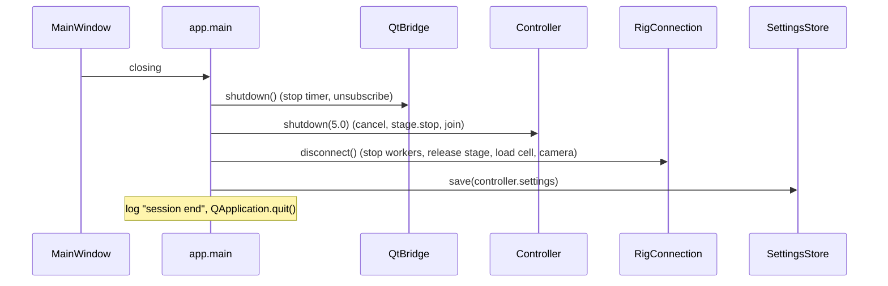

# app package

Module specifications for `bending_machine.app`. Each `##` section is one module or one part of a module; its subsections keep the usual order (responsibility, API, behaviour, errors, threading, test cases).

Contents:

- app.main

## app.main

### 1. Responsibility

The composition root and process entry point. Parses the command line, sets up logging, loads settings, builds the real or simulated drivers, wires services, bridge and window together, runs the Qt event loop and performs the ordered shutdown. The only module that names concrete driver and file classes. Implements FR-005 and FR-006 at process level and NFR-010, NFR-011, NFR-013; the system-level tests for NFR-006 and IR-020 live here.

Replaces the top-level flat sequence of `Flex Main Program - GM.vi` (Init, Main, Stop, Cleanup frames; inventory §4.1) and the two builds (`Main Program`, `NO_rotate`); there is one build and no rotation.

### 2. Public API

```python
def main(argv: Sequence[str] | None = None) -> int:
    """Entry point. Returns the process exit code."""

@dataclass(slots=True)
class App:
    """Everything built by build_app; exposed for tests."""
    publisher: Publisher; hub: MeasurementHub; controller: Controller
    rig: RigConnection; recorder: Recorder; settings_store: SettingsStore
    stage: Stage; loadcell: LoadCell; camera: Camera
    sim_rig: SimRig | None
    list_stage_ports: Callable[[], list[str]]
    list_cameras: Callable[[], list[str]]

def build_app(simulated: bool, settings_folder: Path | None = None,
              writer: ResultWriter | None = None) -> App:
    """Construct and wire all non-GUI objects; start the controller thread.
    Raises ValueError if rig.json is invalid."""

def shutdown_app(app: App) -> None:
    """Ordered shutdown (see 4.3). Never raises."""
```

Command line:

| Option | Meaning |
|---|---|
| `--sim` | Use simulated drivers (`SimRig` defaults). Window shows "SIMULATED" |
| `--settings-folder PATH` | Folder for `settings.json`, `rig.json` and `logs/` (default `%APPDATA%\bending_machine`) |
| `--version` | Print `bending_machine <version>` and exit 0 |

Exit codes: 0 normal; 2 invalid `rig.json` or command line; 3 unhandled start-up error.

### 3. Data models

`App` above. Version string: `bending_machine.__version__` (single source, also written to metadata and the log).

### 4. Behaviour

#### 4.1 Start-up order

1. Parse arguments.
2. `log_path = io.session_log.configure(folder / "logs")`; log `session start, version <v>, simulated=<bool>`.
3. `store = JsonSettingsStore(folder)`; `protected = store.load_protected()` (on `ValueError`: show a message box with the text, exit code 2); `settings = store.load()`.
4. Drivers. Simulated: one `SimRig()`, `SimStage`, `SimLoadCell`, `SimCamera`. Real: `ZaberStage(protected.zaber_baud, protected.zaber_device_address, protected.zaber_axis)`, `FutekLoadCell(protected.futek_dll_path)`, `VimbaCamera()`.
5. `publisher`, `hub`, `recorder = Recorder(LvmResultWriter(version), publisher)`.
6. `vision`, `force`, `rig`, `controller`, wiring `on_fault` → `controller.notify_fault` and `on_overload` → `controller.notify_overload` (the workers are created with forwarding callables so the controller can be created after them).
7. Bind `hardware.discovery.list_stage_ports(simulated)` and
   `hardware.discovery.list_cameras(simulated)` as zero-argument
   callables (for example with `functools.partial`) and store them on `App` as
   `list_stage_ports` and `list_cameras`. Binding does not run discovery. Start the
   controller thread.
8. `QApplication`; `bridge = QtBridge(..., list_stage_ports=app.list_stage_ports,
   list_cameras=app.list_cameras)`; `window = MainWindow(bridge, simulated)`;
   `window.closing` → shutdown; `window.show()`.
9. `app.exec()`.

Devices are not connected automatically; the operator presses Connect (FR-001). In simulated mode with empty `stage_port` / `camera_id`, the bridge preselects "SIM" and "SIM-CAM".

#### 4.2 Unhandled exceptions

`sys.excepthook` and `threading.excepthook` are set to log the traceback at ERROR. On the GUI thread a message box "Unexpected error: <text>. See <log_path>." is shown and the application continues. The stage is stopped (`stage.stop()`) in both hooks.

#### 4.3 Shutdown order



Each step is wrapped so a failure is logged and the next step still runs. Total time ≤ 12 s (5 s controller + 2 × 2 s workers + driver disconnects).

Normal window close is not accepted during saving: the pending record remains set
until the write finishes, and the save/discard flow must resolve before `closing` is
emitted. Filesystem I/O itself is not cancellable and may exceed the controller join
timeout if shutdown is called directly during a write; the normal close path avoids
that overlap.

#### 4.4 Packaging and platform

- Target: Windows 10 and Windows 11, 64-bit, Python 3.11 (NFR-010).
- Delivered as a PyInstaller one-folder build with an installer or zip; start menu entry "Bending test" and a second entry "Bending test (simulated)" that passes `--sim`.
- Separately installed prerequisites, listed in the install notes with versions: .NET Framework 4.8 (for the FUTEK assembly), the Allied Vision Vimba X SDK (GigE transport layer and Vimba X Viewer; `vmbpy` itself comes from PyPI with the application), the Zaber USB-serial driver only if Windows does not install one automatically. Python packages `zaber-motion` and `vmbpy` are bundled in the build. No LabVIEW or NI runtime (NFR-011).
- `FUTEK.Devices.dll` 1.11.5.0 is shipped inside the application folder.
- A default `rig.json` is installed only if none exists.

### 5. Error cases

| Case | Behaviour |
|---|---|
| Invalid `rig.json` | Message box naming the key; exit code 2; no devices touched |
| Log folder not writable | Console logging only (see `io.md` (io.session_log)) |
| Vendor library import fails in real mode (pythonnet, vmbpy or Vimba X, zaber-motion missing) | The driver object is still created; the import error surfaces as that device's connect error, so the other devices and simulated mode still work |
| Second instance started | Allowed to start; its Connect fails with "port in use" / device errors. No single-instance lock |
| Exception during start-up | Logged; message box; exit code 3 |
| Shutdown step fails | Logged; remaining steps run |

### 6. Threading

`main`, `build_app`, `shutdown_app` run on the main thread, which becomes the GUI thread.
Threads alive during a session: main/GUI, `controller`, `vision`, `force`, plus short-lived
discovery threads. Saving runs on the controller; there is no save thread.

### 7. Test cases

System tests. "Sim session" = `build_app(simulated=True, settings_folder=tmp)` driven through `controller.submit`, or the full GUI started with `--sim`.

| # | Input | Expected | Req |
|---|---|---|---|
| X1 | `main(["--sim"])` on a PC with no devices and no vendor drivers | window opens; Connect gives three green statuses | NFR-013 |
| X2 | sim session: change every setting, shut down, build again | all settings restored (`tracking` False) | FR-006 |
| X3 | sim session: connect, tracking on, tare both, `StartTest`, wait for completion, save to tmp | `.lvm` has ≥ 6 rows of 15 TAB-separated fields; `.meta.json` has `end_reason "completed"`; stage back at 10.0 mm; log contains the lines listed in `io.md` (io.session_log) G6 | FR-071, FR-090, NFR-008, NFR-013 |
| X4 | sim session: during a test `sim_rig.set_force_offset(30)` | stage stops within 250 ms; process alive; samples pending and savable | FR-101, NFR-004, NFR-009 |
| X5 | sim session: `shutdown_app` in `IDLE` | returns within 12 s; all three drivers `is_connected False`; only the main thread remains (apart from daemon discovery threads) | FR-005 |
| X6 | sim session: 8-hour soak, repeating X3 every 2 minutes with idle periods | every test saves; resident memory at the end within 50 MB of the value after the first hour; no thread count growth | NFR-006 |
| X7 | sim session: one test of 10 000 samples (`k_limit` unreachable, `settle_s=0.05`, stop after 10 000) | saved file has 10 000 rows; GUI update rate still ≥ 5 Hz at the end | NFR-006, NFR-001 |
| X8 | sim session with socket creation patched to raise | start-up, connect, test and save all succeed (no network use) | IR-020 |
| X9 | bench: installed build on the lab PC (Windows 10 or 11, 64-bit), real devices, full workflow: jog, ROI, threshold, tracking, tare, precondition 2 cycles, test, save | completes without error; saved file opens in the existing analysis | NFR-010, IR-010 |
| X10 | clean Windows PC without Python, LabVIEW or NI software; follow the install notes | application starts; `--sim` workflow works; with prerequisites installed, real devices connect | NFR-011 |
| X11 | `rig.json` containing `{"force_sign": 5}` | message box naming `force_sign`; exit code 2 | FR-102 |
| X12 | `main(["--version"])` | prints the version; exit code 0 | NFR-011 |
| X13 | bench: with the real camera and a visible stopwatch, Idle | on-screen image lags the stopwatch by ≤ 0.5 s; readouts update ≥ 5 times/s | NFR-001, NFR-002 |
| X14 | bench: real stage and load cell, no sample; press on the load cell beyond the limit during a 3 s preconditioning dwell | stage stop issued within 250 ms (from the log timestamps of `overload` and the preceding force readings) | NFR-004 |
| X15 | bench: log a test; compare `frame_time` and `force_time` of each sample | differ by ≤ 100 ms | NFR-005 |
| X16 | `build_app(simulated=True)`; call its two discovery callables | `["SIM"]`, `["SIM-CAM"]`; construction did not enumerate devices; bridge receives these callables without importing hardware | FR-001, NFR-013 |
