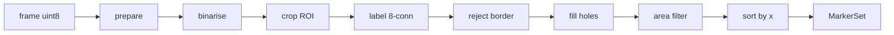
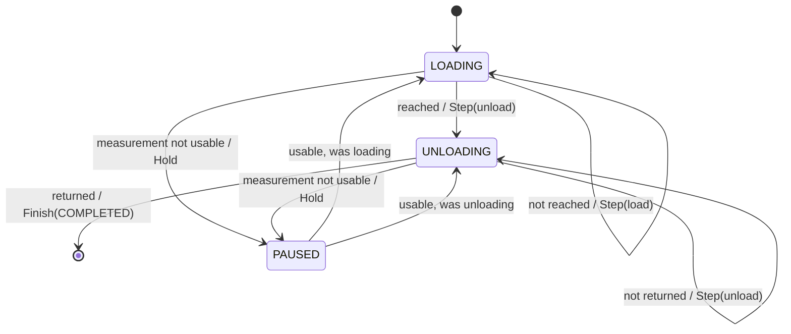
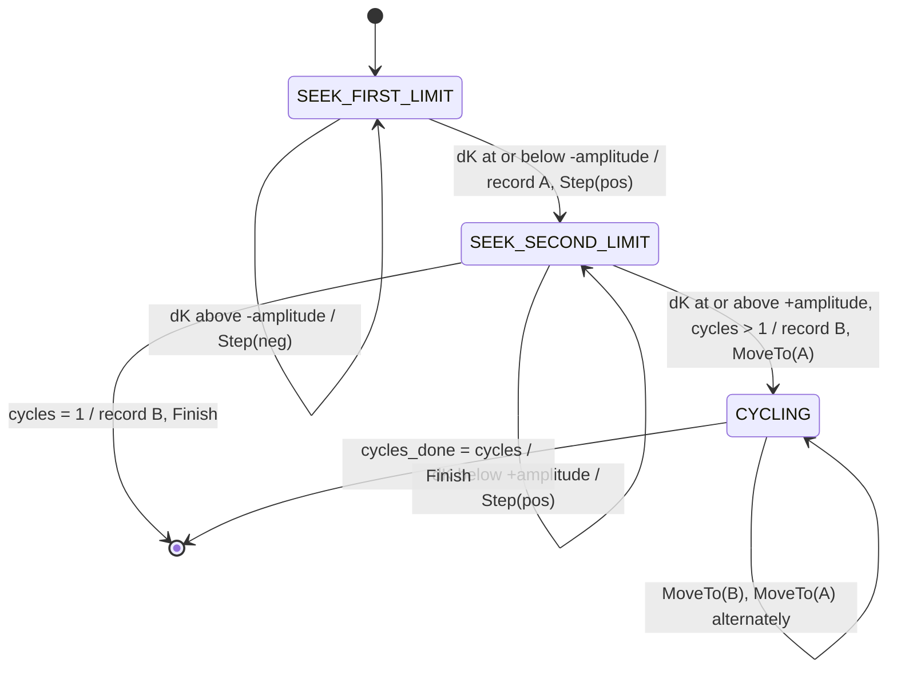

# core package

Module specifications for `bending_machine.core`. Each `##` section is one module or one part of a module; its subsections keep the usual order (responsibility, API, behaviour, errors, threading, test cases).

Contents:

- core.models
- core.errors
- core.vision
- core.measurement: curvature
- core.measurement: force
- core.sequences: test run
- core.sequences: preconditioning

## core.models

### 1. Responsibility

Value types shared by every layer. No behaviour beyond validation and small derived properties. Implements the data side of FR-026, FR-042, FR-043, FR-063, FR-072, FR-073, FR-102 and IR-011.

Imports: standard library, numpy (type only), pydantic. No Qt, no threads, no I/O.

### 2. Conventions

- Timestamps (`timestamp`, `frame_time`, `force_time`, `t`) are `time.monotonic()` seconds as `float`. Wall-clock times are `datetime` (local time, naive).
- Lengths in millimetres (`_mm`) or pixels (`_px`). Curvature in 1/mm. Force in load-cell device units, which are grams on the rig (displayed as "g").
- Image coordinates: origin top-left, x to the right, y downward, measured on the image as delivered by the camera (no rotation; the camera is mounted with the sample horizontal).
- Directions: "up" moves the sample toward the stage's home position. Moving up loads the sample: its concavity turns downward (dK becomes negative) and it pushes on the load-cell probe (displayed force becomes positive). The legacy results files show the same pairing (negative dK with positive force).
- All dataclasses are `@dataclass(frozen=True, slots=True)`.

### 3. Enums

```python
class Mode(Enum):
    DISCONNECTED = "disconnected"; IDLE = "idle"; MOVING = "moving"
    IMAGE_SETUP = "image_setup"; PRECONDITIONING = "preconditioning"
    TESTING = "testing"; RESULT_PENDING = "result_pending"; OVERLOAD = "overload"

class TestPhase(Enum):      LOADING = "loading"; UNLOADING = "unloading"; PAUSED = "paused"
class PrecondPhase(Enum):   SEEK_FIRST_LIMIT = "seek_first"; SEEK_SECOND_LIMIT = "seek_second"; CYCLING = "cycling"
class EndReason(Enum):      COMPLETED = "completed"; STOPPED = "stopped"; OVERLOAD = "overload"; FAULT = "fault"
class FitSubset(Enum):      ALL = "all"; EXCLUDE_OUTER = "exclude_outer"
```

### 4. Settings (pydantic `BaseModel`, `frozen=True`)

Operator-editable; persisted by `io.settings_store`. Defaults are the legacy front-panel defaults (inventory §2.1) unless noted.

| Field | Type | Unit | Default | Valid range |
|---|---|---|---|---|
| `stage_port` | `str` | | `""` | any; empty means not chosen |
| `camera_id` | `str` | | `""` | any; empty means not chosen |
| `roi` | `Roi \| None` | px | `None` (whole image) | see `Roi` |
| `threshold_lower` | `int` | grey level | `2` | 0–255, ≤ `threshold_upper` |
| `threshold_upper` | `int` | grey level | `60` | 0–255 |
| `invert` | `bool` | | `False` | |
| `min_area_px` | `int` | px² | `200` | 1–10 000 000, ≤ `max_area_px` |
| `max_area_px` | `int` | px² | `15000` | 1–10 000 000 |
| `marker_count` | `int` | | `6` | 3–50 |
| `tracking` | `bool` | | `False` | always loaded as `False` |
| `resolution_mm_per_px` | `float` | mm/px | `0.0111` | > 0, ≤ 10 |
| `fit_subset` | `FitSubset` | | `ALL` | with `EXCLUDE_OUTER`, `marker_count` ≥ 5 |
| `jog_step_mm` | `float` | mm | `0.0612244898` | > 0, ≤ 5 |
| `test_step_mm` | `float` | mm | `0.0477` (legacy 0.7794 × 0.0612, rounded) | > 0, ≤ 5 |
| `settle_s` | `float` | s | `0.4` | 0.05–10 |
| `k_limit` | `float` | 1/mm | `-0.12` | non-zero, absolute value ≤ 5 |
| `pc_amplitude` | `float` | 1/mm | `0.0` | 0–5; must be > 0 to start preconditioning |
| `pc_cycles` | `int` | | `1` | 1–1000 |
| `pc_dwell_s` | `float` | s | `3.0` | 0–60 |

Cross-field rules are enforced by a model validator; violation raises `pydantic.ValidationError`. `Settings.model_copy(update=...)` re-validates (use `model_validate` on the merged dict).

### 5. ProtectedSettings (pydantic `BaseModel`, `frozen=True`)

Read from `rig.json`; never written by the application.

| Field | Type | Default | Range | Meaning |
|---|---|---|---|---|
| `overload_limit_raw` | `float` | `25.0` | > 0 | Limit on the absolute untared reading, in grams (FR-100). Confirmed for the installed load cell |
| `force_sign` | `int` | `-1` | −1 or +1 | Displayed force = `force_sign` × raw (FR-045). With −1 the force is positive while the sample pushes the probe (moving up, loading), as in the legacy results files |
| `stage_up_sign` | `int` | `-1` | −1 or +1 | Sign of `delta_mm` that moves the sample up, toward the stage's home position (Zaber position 0) |
| `loading_stage_sign` | `int` | `-1` | −1 or +1 | Sign of `delta_mm` that makes dK more negative. Equal to `stage_up_sign` on the rig: moving up loads the sample |
| `force_period_s` | `float` | `0.02` | 0.005–0.1 | Force polling period |
| `zaber_baud` | `int` | `115200` | 9600–115200 | ASCII protocol default of `zaber-motion` |
| `zaber_device_address` | `int` | `1` | 1–99 | |
| `zaber_axis` | `int` | `1` | 1–4 | |
| `futek_dll_path` | `str` | `"FUTEK.Devices.dll"` | | Relative paths resolve against the install folder |

### 6. Runtime value types

```python
@dataclass(frozen=True, slots=True)
class Roi:                      # px, processed image; right and bottom exclusive
    left: int; top: int; right: int; bottom: int
    # valid: 0 <= left < right, 0 <= top < bottom, width >= 20, height >= 20

class Frame:      image: np.ndarray  # uint8, shape (H, W)
                  timestamp: float

class Marker:     x: float; y: float   # px, centroid
                  area: int            # px²

class MarkerSet:  markers: tuple[Marker, ...]   # ascending x
                  expected: int                 # Settings.marker_count
                  timestamp: float              # of the frame
                  @property valid -> bool       # len(markers) == expected
                  @property xs -> tuple[float, ...]; ys -> tuple[float, ...]

class ForceReading: raw: float; timestamp: float

class TareState:  k_ref: float | None = None    # 1/mm, absolute curvature at tare
                  f_ref: float | None = None    # displayed-sign force at tare
                  overridden: bool = False      # True if a reference was forced to 0.0 (FR-048)
                  @property k_set -> bool; f_set -> bool

class Measurement:
    markers: MarkerSet | None      # None when tracking is off
    curvature: float | None        # absolute, 1/mm; None if markers missing or invalid
    dk: float | None               # curvature - k_ref; None if curvature or k_ref is None
    force_raw: float               # device reading
    force: float                   # force_sign*raw - (f_ref or 0.0)
    frame_time: float; force_time: float
    @property usable -> bool       # markers is not None and markers.valid and dk is not None

class Sample:     xs: tuple[float, ...]; ys: tuple[float, ...]
                  dk: float; force: float
                  t: float                 # s since test start
                  stage_mm: float

@dataclass(slots=True)             # mutable only while recording
class TestRecord: samples: list[Sample]; started: datetime; settings: Settings
                  tare: TareState; start_position_mm: float
                  end_reason: EndReason | None = None
```

### 7. TestMetadata (pydantic)

Content of the metadata file (IR-011). Built by `TestMetadata.from_record(record, software_version)`.

| Field | Type | Source |
|---|---|---|
| `start_date` | `str` `YYYY-MM-DD` | `record.started` |
| `start_time` | `str` `HH:MM:SS` | `record.started` |
| `marker_count` | `int` | settings |
| `resolution_mm_per_px` | `float` | settings |
| `k_limit` | `float` | settings |
| `test_step_mm` | `float` | settings |
| `settle_s` | `float` | settings |
| `fit_subset` | `str` | settings |
| `k_ref`, `f_ref` | `float \| None` | tare |
| `tare_overridden` | `bool` | tare |
| `end_reason` | `str` | record |
| `sample_count` | `int` | record |
| `start_position_mm` | `float` | record |
| `software_version` | `str` | `bending_machine.__version__` |

### 8. Errors

Invalid field values raise `pydantic.ValidationError` (models) or `ValueError` (`Roi` constructor). No other error cases; no timeouts or cancellation apply.

### 9. Threading

All types are immutable (except `TestRecord`, owned by the controller thread until finished) and may be read from any thread.

### 10. Test cases

| # | Input | Expected | Req |
|---|---|---|---|
| M1 | `Settings()` | Defaults exactly as §4 | FR-006 |
| M2 | `marker_count=2` | `ValidationError` | FR-026 |
| M3 | `marker_count=50` | accepted | FR-026 |
| M4 | `threshold_lower=100, threshold_upper=50` | `ValidationError` | FR-023 |
| M5 | `fit_subset=EXCLUDE_OUTER, marker_count=4` | `ValidationError` | FR-042 |
| M6 | `k_limit=0` | `ValidationError` | FR-070 |
| M7 | `settle_s=0.01` | `ValidationError`; `0.4` accepted | FR-072 |
| M8 | `pc_dwell_s=1.0` | accepted | FR-063 |
| M9 | `resolution_mm_per_px=0` | `ValidationError` | FR-043 |
| M10 | `ProtectedSettings()` | `overload_limit_raw == 25.0` | FR-102 |
| M11 | `MarkerSet` with 5 markers, expected 6 | `valid is False` | FR-030 |
| M12 | `TestMetadata.from_record` with resolution 0.0111 | field equals 0.0111 exactly | FR-091 |
| M13 | `Measurement` with `dk=None` | `usable is False` | FR-044 |

## core.errors

### 1. Responsibility

The exception types used across layers so that every failure names the device involved (FR-002, FR-103) and save failures are distinguishable (FR-093).

### 2. Public API

```python
class RigError(Exception):
    """Base for all application errors."""

class DeviceError(RigError):
    device: str        # "stage", "load cell" or "camera" (exact strings shown to the operator)
    def __init__(self, device: str, message: str) -> None: ...
    # str(e) == f"{device}: {message}"

class StageError(DeviceError):      # device == "stage"
    def __init__(self, message: str) -> None: ...
class MotionInterrupted(StageError):
    """A blocking move ended early because stop() was called."""
class LoadCellError(DeviceError):   # device == "load cell"
    def __init__(self, message: str) -> None: ...
class CameraError(DeviceError):     # device == "camera"
    def __init__(self, message: str) -> None: ...
class CameraTimeout(CameraError):
    """No frame arrived within the timeout."""

class SaveError(RigError):
    path: str
    def __init__(self, path: str, message: str) -> None: ...
```

Rules for users of these types:

- Drivers catch vendor exceptions and re-raise one of the above with the vendor text in `message`, chaining with `from`.
- `MotionInterrupted` is not a fault. Callers treat it as the normal result of `stop()`.
- `core` functions never raise `RigError`; they raise `ValueError` for invalid arguments.

### 3. Data models

None.

### 4. Behaviour

None.

### 5. Error cases

Not applicable.

### 6. Threading

Exceptions are raised and caught on the thread that made the call. They cross threads only as `Fault` events (see `services.md` (services.events)).

### 7. Test cases

| # | Input | Expected | Req |
|---|---|---|---|
| E1 | `str(LoadCellError("not found"))` | `"load cell: not found"` | FR-002 |
| E2 | `isinstance(MotionInterrupted("x"), StageError)` and `.device` | `True`, `"stage"` | FR-103 |
| E3 | `CameraTimeout("1.0 s")` | is a `CameraError`, device `"camera"` | FR-103 |
| E4 | `SaveError("C:/a.lvm", "denied").path` | `"C:/a.lvm"` | FR-093 |

## core.vision

### 1. Responsibility

Turn one camera frame into a binary image and an ordered set of marker centres. Pure functions on numpy arrays using OpenCV. Implements FR-022, FR-023, FR-024, FR-025, FR-027 and the detection side of FR-030.

Replaces the legacy chain `IMAQ Rotate` → `IMAQ Threshold` → `IMAQ Inverse` → `IMAQ Count Objects 2 cEE.vi` → sort in `Imaging -- Find Marker.vi` (inventory §4.4). The legacy 90° rotation is dropped (FR-021 dropped, README Open questions Q5): the camera is mounted so that the sample lies horizontally in the image, and frames are processed as delivered.

### 2. Public API

```python
def prepare(image: np.ndarray) -> np.ndarray:
    """Check that a camera frame can be processed and return it unchanged.
    image: uint8, shape (H, W).
    Raises ValueError if dtype is not uint8 or ndim != 2."""

def binarise(image: np.ndarray, lower: int, upper: int, invert: bool) -> np.ndarray:
    """Return uint8 image, 255 where lower <= pixel <= upper, else 0.
    If invert, swap 0 and 255 afterwards.
    Raises ValueError unless 0 <= lower <= upper <= 255."""

def find_markers(binary: np.ndarray, roi: Roi | None, min_area: int, max_area: int,
                 expected: int, timestamp: float) -> MarkerSet:
    """Detect marker blobs (pixels == 255) and return their centroids sorted by x."""
```

`find_markers` steps, in this order:

1. Crop to `roi` (whole image if `None`). An ROI extending past the image is clipped; if the clipped ROI is narrower or shorter than 20 px, return an empty `MarkerSet`.
2. Label connected components with 8-connectivity.
3. Discard every component that has a pixel on the first or last row or column of the crop (reject border).
4. Fill holes: a hole is a background region not connected to the crop border. Filled pixels count toward area and centroid.
5. Keep components with `min_area <= area <= max_area` (inclusive).
6. Centroid = mean x and mean y of the component's pixel centres, converted to full-image coordinates by adding `roi.left`, `roi.top`.
7. Sort by ascending x; ties by ascending y.
8. Return `MarkerSet(markers, expected, timestamp)`. All kept components are returned, even when more than `expected`; `valid` is then `False`.

Implementation note: holes are filled (one flood fill of the background from the crop border) before labelling, so steps 2–4 run as fill, label, reject border. The result differs from the listed order only for a blob lying inside a hole of a border-touching blob, which is discarded with it; markers are never nested, and this keeps the code to one labelling pass.

### 3. Data models

Uses `Roi`, `Marker`, `MarkerSet` from `core.models`.

### 4. Behaviour



No timing behaviour. Budget: `prepare` + `binarise` + `find_markers` ≤ 20 ms for a 1280 × 960 image on the lab PC (supports NFR-001).

### 5. Error cases

| Case | Behaviour |
|---|---|
| Wrong dtype or shape | `ValueError` |
| Invalid threshold bounds | `ValueError` |
| `min_area > max_area` or `expected < 1` | `ValueError` |
| No blobs | Empty `MarkerSet`, `valid False` |
| Timeout, disconnect, cancellation | Not applicable (pure functions) |

### 6. Threading

Stateless; safe from any thread. Called on the vision thread.

### 7. Test cases

Synthetic images: background 200, markers drawn as filled discs of grey 20.

| # | Input | Expected | Req |
|---|---|---|---|
| V1 | 4 × 6 uint8 image with distinct values | returned unchanged, shape (4, 6) | FR-020 |
| V2 | float image; 3-D uint8 image | `ValueError` each | FR-020 |
| V3 | pixels 1, 2, 60, 61 with bounds 2–60 | 0, 255, 255, 0 | FR-023 |
| V4 | V3 with `invert=True` | 255, 0, 0, 255 | FR-024 |
| V5 | 6 discs radius 12 at known centres, whole image | 6 markers, each centre within 1.0 px, x ascending, `valid True` | FR-027 |
| V6 | V5 plus a disc outside the ROI | 6 markers; the outside disc absent | FR-022 |
| V7 | disc touching the ROI edge | not reported | FR-025 |
| V8 | discs of area ≈ 100, 1000, 20000 with limits 200–15000 | only the 1000 one | FR-025 |
| V9 | ring (disc with a hole), outer area 1200 | one marker, area equals filled area, centroid at ring centre ± 0.5 px | FR-025 |
| V10 | 5 discs, `expected=6` | 5 markers, `valid False` | FR-030 |
| V11 | 7 discs, `expected=6` | 7 markers, `valid False` | FR-030 |
| V12 | discs given in right-to-left order | output x ascending | FR-027 |
| V13 | 1280 × 960 image, 6 discs, timed over 100 runs | mean ≤ 20 ms | NFR-001 |

## core.measurement: curvature

### 1. Responsibility

Compute the sample's absolute curvature in 1/mm from marker centres. Pure function. Implements FR-040, FR-041, FR-042, FR-043 and NFR-007.

Replaces `Imaging -- Find K and F.vi` (inventory §4.5), minus the tare subtraction, which lives in `services.hub`.

### 2. Public API

```python
def compute_curvature(xs: Sequence[float], ys: Sequence[float],
                      resolution_mm_per_px: float,
                      fit_subset: FitSubset = FitSubset.ALL) -> float:
    """Absolute curvature in 1/mm at the evaluation point.
    xs, ys: marker centres in px, xs ascending, equal length n.
    Raises ValueError if lengths differ, n < 3 (ALL) or n < 5 (EXCLUDE_OUTER),
    xs not strictly ascending, or resolution_mm_per_px <= 0."""

def evaluation_x(xs: Sequence[float]) -> float:
    """Evaluation point for the points actually fitted (see algorithm step 3)."""
```

### 3. Algorithm

All arithmetic in float64.

1. Select points. `ALL`: every marker. `EXCLUDE_OUTER`: drop the first and last marker.
2. Fit `y = a·x² + b·x + c` by ordinary least squares (`numpy.polyfit(x, y, 2)`; it returns `[a, b, c]`).
3. Evaluation point `x_m`, with `m` = number of fitted points and 0-based indices:
   - `m` even: `x_m = x[m // 2]`.
   - `m` odd: `x_m = (x[(m - 1) // 2] + x[(m + 1) // 2]) / 2`.
4. Slope `s = 2·a·x_m + b`.
5. If `a == 0`: return `0.0`.
6. Radius in px: `R = (1 + s²)^1.5 / (2·a)`.
7. Return `1 / (R · resolution_mm_per_px)`, which equals `2·a / ((1 + s²)^1.5 · resolution_mm_per_px)`.

The sign follows image coordinates (y downward): a sample whose centre is lower in the image than its ends has positive `a` and positive curvature. No sign change is applied; this reproduces the legacy output.

Steps 3 and 6–7 are UNVERIFIED reconstructions of the legacy diagram (requirements FR-040, FR-041). NFR-007 test C7 is the check.

Implementation note: step 5 has no separate branch; the code evaluates the closed form of step 7, which already gives `0.0` for `a == 0`. For collinear points `polyfit` returns `a` within rounding of zero, so the result is zero to within about 1e-15 rather than exactly `0.0` (C8 checks with an absolute tolerance of 1e-12).

### 4. Data models

Uses `FitSubset`.

### 5. Error cases

| Case | Behaviour |
|---|---|
| Invalid arguments (see §2) | `ValueError` |
| Collinear points (`a == 0` exactly) | returns `0.0` |
| Non-finite result from the fit | `ValueError("fit failed")` |
| Timeout, disconnect, cancellation | Not applicable |

### 6. Threading

Stateless; called on the vision thread via `services.hub`.

### 7. Test cases

| # | Input | Expected | Req |
|---|---|---|---|
| C1 | 6 points on `y = 1e-3·x² + 600`, x = 200…1100, resolution 0.01 | `2e-3 / ((1 + (2e-3·x_m)²)^1.5 · 0.01)` with `x_m = xs[3]`, rel. error < 1e-9 | FR-040 |
| C2 | 6 points on a circle of radius 500 px spanning ±100 px about the lowest point, resolution 0.01 | absolute value 0.2 within 1 % | FR-040 |
| C3 | `evaluation_x([10, 20, 30, 40, 50, 60])` | `40` | FR-041 |
| C4 | `evaluation_x([10, 20, 30, 40, 50])` | `35` (mean of indices 2 and 3) | FR-041 |
| C5 | 6 points, parabola through the inner four, outer two displaced by 30 px; `ALL` vs `EXCLUDE_OUTER` | `EXCLUDE_OUTER` equals the inner-parabola value; `ALL` differs by > 5 % | FR-042 |
| C6 | C1 with resolution doubled | result halved, rel. error < 1e-12 | FR-043 |
| C7 | For each of five legacy files (`tests/Cristian/5.Testing load cell/Test 16-07/PCL 100%/1/Test 1.lvm` … `Test 5.lvm`): compute curvature per row from the X, Y columns with resolution `r` (the value used in that session), take differences from row 1 | Differences equal the differences of the saved K column from row 1 within 1e-6 1/mm | NFR-007 |
| C8 | collinear points | `0.0` | FR-040 |
| C9 | 2 points; unequal lengths; resolution 0; xs not ascending | `ValueError` each | FR-040 |

Notes on C7:

- Saved K is dK, tared with an unknown reference, so the test compares differences from row 1, which cancel the reference.
- The test also runs on every `.lvm` file under `tests/Antonino` (40 files, same 14-column layout), with the same comparison.
- The resolution `r` used in those sessions is not recoverable: the legacy `Config_File.xls` recorded it as `0` (inventory §6.3). The new application takes it from the operator's resolution field (`ui.md` (ui.panels) `resolution_spin`) and saves it in the metadata. The test therefore fits a single scale factor per file (least squares of saved against computed differences) and requires the residual after scaling to be within 1e-6 1/mm; the fitted factor is reported. See README Open questions.

## core.measurement: force

### 1. Responsibility

The arithmetic applied to load-cell readings: sign convention, tare and the overload test. Pure functions. Implements FR-045, FR-046 and FR-100.

Replaces the arithmetic inside `LoadReadSafe.vi` (inventory §4.6).

### 2. Public API

```python
def to_display(raw: float, force_sign: int) -> float:
    """force_sign * raw. force_sign is -1 or +1 (ProtectedSettings.force_sign, default -1)."""

def apply_tare(raw: float, force_sign: int, f_ref: float | None) -> float:
    """to_display(raw, force_sign) - (f_ref or 0.0)."""

def tare_reference(raw: float, force_sign: int) -> float:
    """Value to store as TareState.f_ref: to_display(raw, force_sign)."""

def is_overload(raw: float, limit_raw: float) -> bool:
    """abs(raw) > limit_raw. Applied to the untared reading. NaN counts as overload."""
```

Raises `ValueError` if `force_sign` is not −1 or +1, or `limit_raw <= 0`.

### 3. Data models

None of its own.

### 4. Behaviour

Legacy equivalence: with `force_sign = -1`, displayed force = `−raw − F_init`, and overload = `−raw > 25 or −raw < −25`, which is `abs(raw) > 25`. A reading exactly at the limit is not an overload.

### 5. Error cases

| Case | Behaviour |
|---|---|
| Invalid `force_sign` or `limit_raw` | `ValueError` |
| `raw` is NaN | `is_overload` returns `True`; other functions return NaN |
| Timeout, disconnect, cancellation | Not applicable |

### 6. Threading

Stateless; called on the force thread and from `services.hub`.

### 7. Test cases

| # | Input | Expected | Req |
|---|---|---|---|
| F1 | `to_display(3.2, -1)` | `-3.2` | FR-045 |
| F2 | `to_display(3.2, +1)` | `3.2` | FR-045 |
| F3 | `ref = tare_reference(3.2, -1)`; `apply_tare(3.2, -1, ref)` | `0.0` | FR-046 |
| F4 | `apply_tare(5.0, -1, -3.2)` | `-1.8` | FR-046 |
| F5 | `apply_tare(5.0, -1, None)` | `-5.0` | FR-046 |
| F6 | `is_overload(25.0, 25.0)`, `(25.001, 25.0)`, `(-25.001, 25.0)`, `(-25.0, 25.0)` | `False, True, True, False` | FR-100 |
| F7 | `is_overload(float("nan"), 25.0)` | `True` | FR-100 |
| F8 | `to_display(1.0, 0)`; `is_overload(1.0, 0.0)` | `ValueError` each | FR-100 |

## core.sequences: test run

### 1. Responsibility

Decide, one measurement at a time, what the stage does next during a test run. A pure state machine with no timing, threads or device calls; `services.controller` drives it. Implements FR-071, FR-073 and the pause rule of FR-030.

This replaces the legacy three-phase logic built on the hidden flags `Test Up` and `Go Back` (inventory §4.3) with the two-phase sequence the requirements define. The legacy factor 0.7794 is not applied: the step commanded is `Settings.test_step_mm`.

### 2. Public API

```python
# Actions shared by both sequences (defined once in core.sequences):
@dataclass(frozen=True, slots=True)
class Step:    delta_mm: float           # relative move to command
@dataclass(frozen=True, slots=True)
class MoveTo:  target_mm: float          # absolute move; preconditioning only
@dataclass(frozen=True, slots=True)
class Hold:    pass                      # do nothing; ask again with a newer measurement
@dataclass(frozen=True, slots=True)
class Finish:  reason: EndReason         # always EndReason.COMPLETED from this module
TestRunAction = Step | Hold | Finish
PrecondAction = Step | MoveTo | Hold | Finish

class TestRunSequence:
    def __init__(self, k_limit: float, step_mm: float, loading_stage_sign: int) -> None:
        """k_limit: target dK in 1/mm, non-zero. step_mm > 0.
        loading_stage_sign: -1 or +1, sign of delta_mm that makes dK more negative.
        Raises ValueError on invalid arguments."""
    @property
    def phase(self) -> TestPhase: ...        # LOADING initially
    @property
    def steps_commanded(self) -> int: ...    # number of Step actions returned so far
    def next(self, m: Measurement) -> TestRunAction:
        """Advance on one measurement. After Finish has been returned,
        further calls raise RuntimeError."""
```

### 3. Behaviour

Definitions, with `s = +1` if `k_limit > 0` else `−1`:

- Loading direction: `load = −s × loading_stage_sign`. (For a negative limit, `load = loading_stage_sign`.)
- `reached(dk)`: `s × dk >= s × k_limit`.
- `returned(dk)`: `s × dk <= 0`.

`next(m)`:

| Phase | Condition | New phase | Action |
|---|---|---|---|
| any | `not m.usable` | `PAUSED` (remember previous phase) | `Hold()` |
| `PAUSED` | `m.usable` | previous phase, then evaluate that row | |
| `LOADING` | `not reached(m.dk)` | `LOADING` | `Step(load × step_mm)` |
| `LOADING` | `reached(m.dk)` | `UNLOADING` | `Step(−load × step_mm)` |
| `UNLOADING` | `not returned(m.dk)` | `UNLOADING` | `Step(−load × step_mm)` |
| `UNLOADING` | `returned(m.dk)` | (finished) | `Finish(COMPLETED)` |



Notes:

- If the very first measurement already satisfies `reached`, the sequence goes straight to unloading.
- Noise around zero right after tare does not end the test, because `returned` is only tested in `UNLOADING`.
- The two-phase sequence replaces the legacy three-phase one (decision D2, accepted).
- There is no step-count limit. A test that never reaches the limit runs until the operator stops it or the force limit trips. (See README Open questions: stage travel limits.)
- Timing (settle 0.4 s default, sample capture) is the controller's job.

### 4. Data models

Uses `Measurement`, `TestPhase`, `EndReason`.

### 5. Error cases

| Case | Behaviour |
|---|---|
| Invalid constructor arguments | `ValueError` |
| `next` after `Finish` | `RuntimeError` |
| Marker count wrong, tracking off, or dK missing | `Hold`, phase `PAUSED` |
| Timeout, disconnect, cancellation | Handled by the controller; the sequence is simply not called again |

### 6. Threading

Not thread-safe; one instance per test, used only on the controller thread.

### 7. Test cases

`meas(dk)` builds a usable `Measurement`; `bad()` builds one with `markers.valid False`.

| # | Input | Expected | Req |
|---|---|---|---|
| T1 | `k_limit=-0.12, step=0.05, sign=-1`; `next(meas(0.0))` | `Step(-0.05)`, phase `LOADING` | FR-071 |
| T2 | T1 then dK = −0.05, −0.10 | `Step(-0.05)` each | FR-071 |
| T3 | then dK = −0.12 | `Step(+0.05)`, phase `UNLOADING` | FR-071 |
| T4 | then dK = −0.06 | `Step(+0.05)` | FR-071 |
| T5 | then dK = 0.001 | `Finish(COMPLETED)` | FR-071 |
| T6 | `k_limit=+0.12`, same sign; dK = 0.0 | `Step(+0.05)`; reaches at dK ≥ 0.12; finishes at dK ≤ 0 | FR-071 |
| T7 | `step=0.0477`; every `Step` returned over a full run | absolute `delta_mm` is exactly 0.0477 | FR-073 |
| T8 | in `LOADING`: `next(bad())` | `Hold()`, phase `PAUSED`, `steps_commanded` unchanged | FR-030 |
| T9 | T8 then `next(meas(-0.05))` | `Step(-0.05)`, phase `LOADING` | FR-030 |
| T10 | in `UNLOADING`: `bad()` then `meas(-0.03)` | `Hold`, then `Step(+0.05)`, phase `UNLOADING` | FR-030 |
| T11 | first measurement dK = −0.20 with limit −0.12 | `Step(+0.05)`, phase `UNLOADING` | FR-071 |
| T12 | `next` after `Finish` | `RuntimeError` | FR-071 |
| T13 | `k_limit=0`; `step_mm=0`; `loading_stage_sign=2` | `ValueError` each | FR-070 |
| T14 | Closed-loop run against a linear model `dk = 0.8 × position` (position starts at 0), limit −0.12, step 0.05 | dK falls monotonically to ≤ −0.12 in 3 loading steps, then rises; ends with `Finish` after at most 4 unloading steps | FR-071 |

## core.sequences: preconditioning

### 1. Responsibility

Decide the next stage action during preconditioning: find the two stage positions where dK reaches ±amplitude, then cycle between them. Pure state machine; `services.controller` drives it. Implements FR-061, FR-062, FR-064 and the pause rule of FR-030 during the seek phases.

Legacy source: Precondition case of `Flex Main Program - GM.vi` (inventory §4.3). The comparison directions there are INFERRED; the direction below is confirmed by the user (README Open questions Q11): the first limit sought is negative dK, reached by moving the sample up toward home. Whether the cycle definition (README S4) matches operators' expectations is still open.

### 2. Public API

```python
# Step, MoveTo, Hold, Finish and PrecondAction: see "core.sequences: test run" §2.

class PreconditionSequence:
    def __init__(self, amplitude: float, cycles: int, step_mm: float,
                 loading_stage_sign: int) -> None:
        """amplitude > 0 (1/mm); cycles >= 1; step_mm > 0; sign -1 or +1.
        Raises ValueError on invalid arguments."""
    @property
    def phase(self) -> PrecondPhase: ...      # SEEK_FIRST_LIMIT initially
    @property
    def cycles_done(self) -> int: ...         # 0 initially
    @property
    def limit_a_mm(self) -> float | None: ... # stage position at dK <= -amplitude
    @property
    def limit_b_mm(self) -> float | None: ... # stage position at dK >= +amplitude
    def next(self, m: Measurement, position_mm: float) -> PrecondAction:
        """m: latest measurement; position_mm: current stage position.
        Raises RuntimeError if called after Finish."""
```

### 3. Behaviour

`neg = loading_stage_sign` (direction that makes dK more negative).

| Phase | Condition | Effect | Action |
|---|---|---|---|
| `SEEK_FIRST_LIMIT` | `not m.usable` | | `Hold()` |
| `SEEK_FIRST_LIMIT` | `m.dk > −amplitude` | | `Step(neg × step_mm)` |
| `SEEK_FIRST_LIMIT` | `m.dk <= −amplitude` | `limit_a = position_mm`; phase `SEEK_SECOND_LIMIT` | `Step(−neg × step_mm)` |
| `SEEK_SECOND_LIMIT` | `not m.usable` | | `Hold()` |
| `SEEK_SECOND_LIMIT` | `m.dk < +amplitude` | | `Step(−neg × step_mm)` |
| `SEEK_SECOND_LIMIT` | `m.dk >= +amplitude` | `limit_b = position_mm`; `cycles_done = 1`; if `cycles_done == cycles` finish, else phase `CYCLING`, target A | `Finish(COMPLETED)` or `MoveTo(limit_a)` |
| `CYCLING`, last target A | (any measurement) | target B | `MoveTo(limit_b)` |
| `CYCLING`, last target B | (any measurement) | `cycles_done += 1`; if `cycles_done == cycles` finish, else target A | `Finish(COMPLETED)` or `MoveTo(limit_a)` |

One cycle is one excursion to A and one to B. The count increases each time B has been reached, so `cycles = 3` gives the seek cycle plus two position cycles and ends at B with the counter at 3.

`CYCLING` ignores marker validity: positions are already known.



Timing applied by the controller, not here: 0.4 s pause when each limit is recorded (legacy 400 ms) and `Settings.pc_dwell_s` (default 3.0 s, legacy 3000 ms) before each `MoveTo`.

### 4. Data models

Uses `Measurement`, `PrecondPhase`, `EndReason`.

### 5. Error cases

| Case | Behaviour |
|---|---|
| Invalid constructor arguments | `ValueError` |
| `next` after `Finish` | `RuntimeError` |
| Measurement not usable in a seek phase | `Hold` |
| Timeout, disconnect, cancellation | Handled by the controller |

### 6. Threading

Not thread-safe; one instance per run, controller thread only.

### 7. Test cases

`meas(dk)` usable; `bad()` not usable. Constructor `amplitude=0.05, step=0.05, sign=-1` unless stated.

| # | Input | Expected | Req |
|---|---|---|---|
| P1 | `next(meas(0.0), 10.0)` | `Step(-0.05)`, phase `SEEK_FIRST_LIMIT` | FR-061 |
| P2 | then `next(meas(-0.05), 9.5)` | `Step(+0.05)`, `limit_a_mm == 9.5`, phase `SEEK_SECOND_LIMIT` | FR-061 |
| P3 | then `next(meas(0.02), 10.2)` | `Step(+0.05)` | FR-061 |
| P4 | then `next(meas(0.05), 10.5)`, `cycles=3` | `MoveTo(9.5)`, `limit_b_mm == 10.5`, `cycles_done == 1`, phase `CYCLING` | FR-061, FR-062 |
| P5 | then two more `next` calls | `MoveTo(10.5)`, then `MoveTo(9.5)` with `cycles_done == 2` | FR-062, FR-064 |
| P6 | then two more `next` calls | `MoveTo(10.5)`, then `Finish(COMPLETED)` with `cycles_done == 3` | FR-064 |
| P7 | `cycles=1`, run P1–P4 | P4 returns `Finish(COMPLETED)`, `cycles_done == 1` | FR-064 |
| P8 | in `SEEK_FIRST_LIMIT`: `next(bad(), 9.8)` | `Hold()`, limits unchanged | FR-030 |
| P9 | in `CYCLING`: `next(bad(), 9.5)` | `MoveTo(...)` as normal | FR-062 |
| P10 | `amplitude=0`; `cycles=0`; `step_mm=-1` | `ValueError` each | FR-060 |
| P11 | `sign=+1`, `next(meas(0.0), 10.0)` | `Step(+0.05)` | FR-061 |
