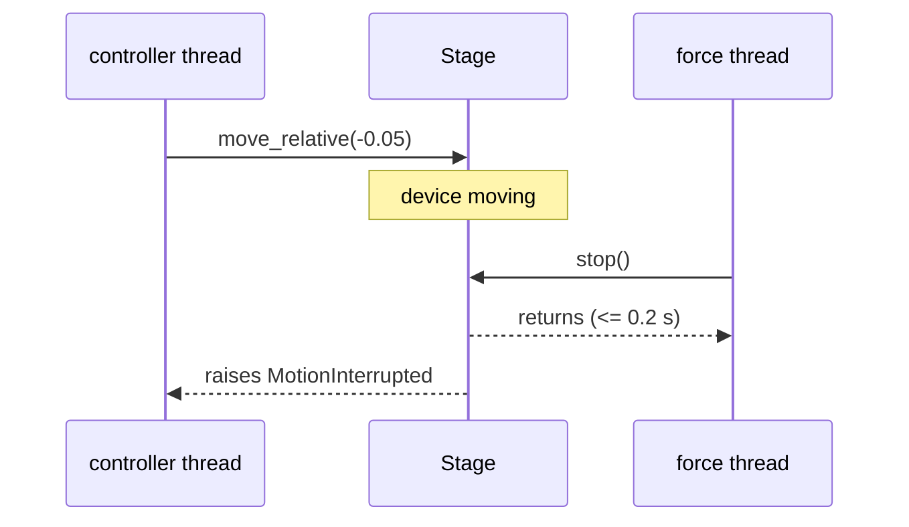
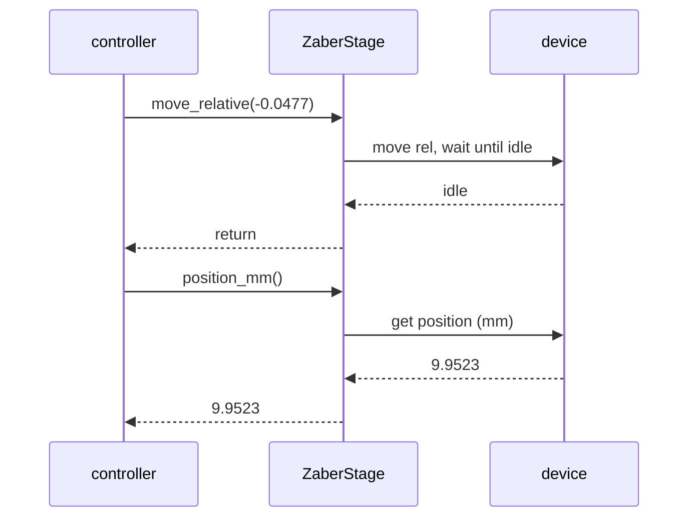
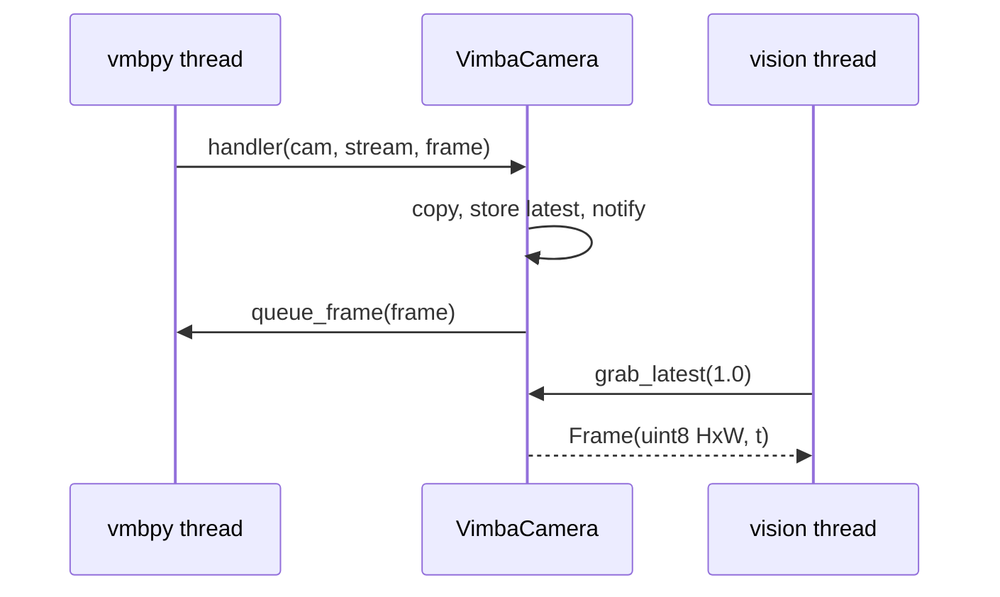
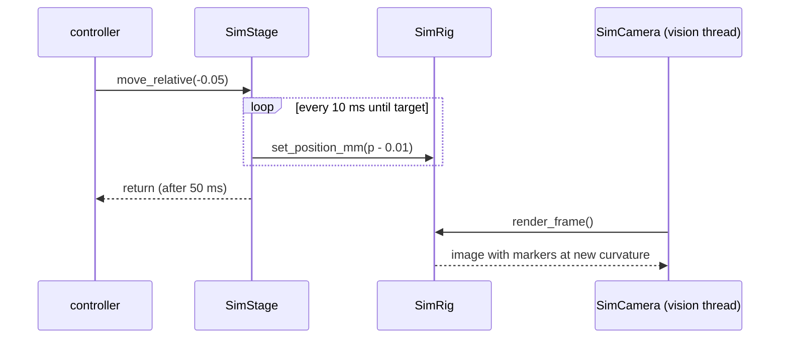

# hardware package

Module specifications for `bending_machine.hardware`. Each `##` section is one module or one part of a module; its subsections keep the usual order (responsibility, API, behaviour, errors, threading, test cases).

Contents:

- hardware.api
- hardware.zaber_stage
- hardware.futek_loadcell
- hardware.vimba_camera
- hardware.sim: SimRig
- hardware.sim: drivers
- hardware.discovery

## hardware.api

### 1. Responsibility

The three abstract device interfaces that `services` programs against. Every real and simulated driver implements exactly these. Defines IR-001 to IR-005 at the software boundary.

Imports `core.models` (`Frame`) and `core.errors` only.

### 2. Public API

```python
class Stage(ABC):
    @abstractmethod
    def connect(self, port: str) -> None:
        """Open the port and verify one stage answers. Idempotent if already connected to
        the same port. Raises StageError (port missing, no device, wrong baud)."""
    @abstractmethod
    def disconnect(self) -> None:
        """Release the port. Never raises; safe if not connected."""
    @property
    @abstractmethod
    def is_connected(self) -> bool: ...
    @abstractmethod
    def position_mm(self) -> float:
        """Current position in mm. Raises StageError."""
    @abstractmethod
    def move_relative(self, delta_mm: float) -> None:
        """Move by delta_mm and return when the stage is idle.
        Raises MotionInterrupted if stop() ended the move; StageError otherwise
        (not connected, out of travel, communication failure)."""
    @abstractmethod
    def move_absolute(self, target_mm: float) -> None:
        """Move to target_mm and return when idle. Same errors as move_relative."""
    @abstractmethod
    def stop(self) -> None:
        """Stop motion now. Callable from ANY thread, including while another thread is
        blocked in a move. Returns within 0.2 s. Never raises; logs failures."""

class LoadCell(ABC):
    @abstractmethod
    def connect(self) -> None:
        """Attach to the first detected device. Raises LoadCellError if none."""
    @abstractmethod
    def disconnect(self) -> None: ...            # never raises
    @property
    @abstractmethod
    def is_connected(self) -> bool: ...
    @abstractmethod
    def read_raw(self) -> float:
        """Channel 0 reading in device units, untouched (no sign change, no tare).
        Returns within 0.1 s. Raises LoadCellError."""

class Camera(ABC):
    @abstractmethod
    def connect(self, camera_id: str) -> None:
        """Open the camera and start continuous acquisition. Raises CameraError."""
    @abstractmethod
    def disconnect(self) -> None: ...            # never raises
    @property
    @abstractmethod
    def is_connected(self) -> bool: ...
    @abstractmethod
    def grab_latest(self, timeout_s: float = 1.0) -> Frame:
        """Newest complete frame as uint8 (H, W) as delivered by the camera, with
        Frame.timestamp = time.monotonic() at reception. Never returns the same frame
        twice: blocks until a frame newer than the last returned one exists.
        Raises CameraTimeout after timeout_s; CameraError on other failures."""
```

### 3. Contract details

| Point | Rule |
|---|---|
| Units | Stage in mm. Load cell in device units. Frames 8-bit mono |
| Blocking moves | `move_*` returns only when the device reports idle (IR-002) |
| Move timeout | A move that has not finished after `10 s + abs(distance) / 0.1 mm/s` raises `StageError("move timed out")` after calling the device stop |
| Ownership | Each device is called from one owning thread (stage: controller; load cell: force; camera: vision). The single exception is `Stage.stop()` |
| Errors | Only `core.errors` types leave a driver. `disconnect()` and `stop()` never raise |
| After an error | The driver stays usable for `disconnect()` and a later `connect()` |
| Not connected | Any call other than `connect`, `disconnect`, `stop`, `is_connected` raises the device's error type with message `"not connected"` |

### 4. Behaviour



### 5. Error cases

See §2 and §3. Cancellation of a move is `stop()` from another thread.

### 6. Threading

As in the ownership row of §3.

### 7. Test cases

One shared contract test suite, run against every implementation (simulated drivers in CI; real drivers on the bench).

| # | Input | Expected | Req |
|---|---|---|---|
| H1 | `stage.connect(port)`; `p0 = position_mm()`; `move_relative(0.05)` | `position_mm() == p0 + 0.05` within 0.001 mm; call returned after motion ended | IR-001, IR-002 |
| H2 | `move_absolute(p0)` | `position_mm() == p0` within 0.001 mm | IR-001 |
| H3 | thread A `move_relative(5.0)`; thread B `stop()` after 0.2 s | B returns within 0.2 s; A raises `MotionInterrupted`; position between start and target | IR-001 |
| H4 | `position_mm()` before `connect` | `StageError("not connected")` | FR-103 |
| H5 | `loadcell.connect()`; 100 × `read_raw()` | each returns a finite float within 0.1 s | IR-003 |
| H6 | `camera.connect(id)`; 30 × `grab_latest()` | uint8 2-D frames; timestamps strictly increasing; mean rate ≥ 15 /s | IR-004 |
| H7 | `disconnect()` twice on each device | no exception | FR-005 |
| H8 | `connect` with a non-existent port or camera id | `StageError` / `CameraError` naming the device | FR-002 |

## hardware.zaber_stage

### 1. Responsibility

Real `Stage` driver for the Zaber stage on a serial port, using the current vendor library `zaber-motion` with the ASCII protocol. The rig's device is a current model that works with this library (README Open questions Q1, Q2); the legacy Binary protocol is not supported. Implements IR-001 and IR-002 and the stage side of FR-001.

Replaces the NI instrument-driver VIs `Initialize.vi`, `Move.vi`, `Read Current Position.vi`, `Stop.vi`, `Close.vi` (inventory §5.2). The legacy `Microstep Size = 0.05` input is not needed: the vendor library converts millimetres using the device's own configuration.

Stage coordinates are the device's own: position 0 is the home end, and positions increase away from home. Moving toward home (negative `delta_mm`) moves the sample up (`core.md` (core.models) §5).

### 2. Public API

```python
class ZaberStage(Stage):
    def __init__(self, baud: int = 115200, device_address: int = 1, axis: int = 1) -> None:
        """Values come from ProtectedSettings (zaber_baud, zaber_device_address, zaber_axis)."""
    # Stage methods as in hardware.md` (hardware.api)
```

### 3. Device calls

Checked against `zaber-motion` 10.3.0 (`from zaber_motion import Units`; `from zaber_motion.ascii import Connection`):

| Stage method | zaber-motion calls |
|---|---|
| `connect(port)` | `connection = Connection.open_serial_port(port, baud_rate=baud)`; `connection.detect_devices()`; `device = connection.get_device(device_address)`; `axis = device.get_axis(axis)`; read position once to confirm |
| `position_mm()` | `axis.get_position(Units.LENGTH_MILLIMETRES)` |
| `move_relative(d)` | `axis.move_relative(d, Units.LENGTH_MILLIMETRES, wait_until_idle=True)` |
| `move_absolute(t)` | `axis.move_absolute(t, Units.LENGTH_MILLIMETRES, wait_until_idle=True)` |
| `stop()` | `axis.stop(wait_until_idle=False)` |
| `disconnect()` | `connection.close()` |

Library exceptions used: `zaber_motion.exceptions.MovementInterruptedException` (a blocked move ended by a stop), `NoDeviceFoundException`, `ConnectionFailedException`, `ConnectionClosedException`, `RequestTimeoutException`. Any other `zaber_motion` exception becomes `StageError` with its message.

Not used: homing, speed or acceleration settings, multiple axes. The stage runs with the speed stored in the device (see README Open questions on speed).

### 4. Behaviour

- `connect` opens the port, expects at least one device, and fails with `StageError("no Zaber device at address 1 on COM3")` otherwise.
- Moves block the calling thread until the device reports idle.
- A move that the library reports as interrupted (`MovementInterruptedException`, raised when `stop()` from another thread ends it) raises `MotionInterrupted`. If the library returns normally after an external stop, the driver detects it by a `_stop_requested` flag set in `stop()` and cleared at the start of each move, and raises `MotionInterrupted`.
- Move timeout: `10 s + abs(distance_mm) / 0.1` seconds, enforced by a watchdog timer that calls `stop()`; the move then raises `StageError("move timed out")`.
- `stop()` uses the same connection object while another thread is blocked in a move. `zaber-motion` connections are thread-safe and support this; bench test Z4 confirms it on the rig.



### 5. Error cases

| Case | Behaviour |
|---|---|
| Port does not exist or is in use | `StageError` with the OS message |
| No device answers within the library's default timeout | `StageError("no Zaber device ...")` |
| Wrong baud | Appears as "no device"; message adds `"check zaber_baud in rig.json"` |
| Move rejected by the device (out of travel) | `StageError` with the device's reason |
| Cable pulled during a move or query | `StageError`; `is_connected` becomes `False` |
| `stop()` when not connected or on failure | No exception; logged at WARNING |
| Move cancelled by `stop()` | `MotionInterrupted` |

### 6. Threading

All methods on the controller thread except `stop()`, which any thread may call. `connect` and `disconnect` are called by `services.rig` on the controller thread's behalf before it starts and after it ends.

### 7. Simulated counterpart

See `hardware.md` (hardware.sim) (`SimStage`).

### 8. Test cases

Bench tests on the real stage (no sample mounted), plus the contract suite H1–H4, H7, H8 from `hardware.md` (hardware.api).

| # | Input | Expected | Req |
|---|---|---|---|
| Z1 | `connect` on the stage's port | succeeds; `position_mm()` equals the position shown by the vendor's own tool within 0.001 mm | IR-001 |
| Z2 | `move_relative(0.05)` ten times | position increases by 0.5 mm ± 0.002 mm; each call returns only after motion stops (position stable when re-read 50 ms later) | IR-001, IR-002 |
| Z3 | `connect` on a port with no stage | `StageError` within 5 s | FR-002 |
| Z4 | `move_relative(20.0)`, `stop()` from a second thread after 0.5 s | stage halts; mover raises `MotionInterrupted`; no hang | IR-001 |
| Z5 | unplug USB/serial during `position_mm()` polling | `StageError`; later `connect` works after re-plugging | FR-103 |
| Z6 | `disconnect()`, then open the port in the vendor tool | port opens | FR-005 |
| Z7 | `move_absolute(1e6)` | `StageError`; stage does not move | IR-001 |

## hardware.futek_loadcell

### 1. Responsibility

Real `LoadCell` driver for the FUTEK USB225 through the vendor .NET assembly `FUTEK.Devices.dll` (version 1.11.5.0, .NET Framework 4.8), loaded with pythonnet. Implements IR-003.

Replaces the .NET nodes in `Flex Main Program - GM.vi` and `LoadReadSafe.vi` (inventory §5.1). The sign change, tare and overload test are not here; they are in `core.measurement`.

### 2. Public API

```python
class FutekLoadCell(LoadCell):
    def __init__(self, dll_path: str, channel: int = 0, device_index: int = 0) -> None:
        """dll_path from ProtectedSettings.futek_dll_path (the file shipped with the
        legacy source at Software/DLL/x64/net48/FUTEK.Devices.dll)."""
    # LoadCell methods as in hardware.md` (hardware.api)
```

### 3. DLL calls

Runtime set-up, once per process, before the first import of `clr`:

```python
from pythonnet import load
load("netfx")                      # .NET Framework, required by the net48 assembly
import clr
clr.AddReference(dll_path)         # absolute path
from FUTEK.Devices import DeviceRepository, DeviceUSB225
```

| LoadCell method | .NET calls (namespace `FUTEK.Devices`) |
|---|---|
| `connect()` | `repo = DeviceRepository()`; `devices = repo.DetectDevices()` (returns `IList<Device>`); `dev = devices[device_index]` (same as `get_Item(0)`); require `isinstance(dev, DeviceUSB225)` |
| `read_raw()` | `float(dev.GetChannelXReading(channel))` with `channel = 0` (`Int32` in, `Double` out) |
| `disconnect()` | `repo.DisconnectAllDevices()`; drop references |

No other calls are made: no sampling-rate, unit or calibration configuration, as in the legacy program.

### 4. Behaviour

- `connect()` with zero detected devices raises `LoadCellError("no FUTEK device detected")`. A detected device that is not a `DeviceUSB225` raises `LoadCellError("unexpected device type <name>")`.
- `read_raw()` returns the value exactly as the DLL gives it.
- Read-rate target: one read every 20 ms (`ProtectedSettings.force_period_s`). Confirmed: the DLL loads through pythonnet and sustains this rate (README Open questions Q4). The driver itself does not pace reads.
- A read taking longer than 0.1 s is logged at WARNING once per occurrence burst (at most one message per second).

### 5. Error cases

| Case | Behaviour |
|---|---|
| DLL file missing or cannot be loaded | `LoadCellError("cannot load FUTEK.Devices.dll: ...")` from `connect()` |
| .NET Framework 4.8 not installed | Same error, with the loader's message |
| No device detected | `LoadCellError("no FUTEK device detected")` |
| Any .NET exception during a read (device unplugged) | `LoadCellError` with the .NET message; `is_connected` becomes `False` |
| Non-finite value returned | Returned as is; `core.measurement.is_overload` treats NaN as overload |
| `disconnect()` failure | Swallowed and logged |
| Cancellation | Not applicable; reads are short |

### 6. Threading

`read_raw` on the force thread only. `connect` and `disconnect` are called from `services.rig` while the force thread is not running. The assembly is loaded once; `connect` after `disconnect` creates a new `DeviceRepository`.

### 7. Simulated counterpart

See `hardware.md` (hardware.sim) (`SimLoadCell`).

### 8. Test cases

Bench tests with the real load cell, plus contract tests H5, H7 from `hardware.md` (hardware.api).

| # | Input | Expected | Req |
|---|---|---|---|
| U1 | `connect()` with the USB225 plugged in | succeeds | IR-003 |
| U2 | `read_raw()` unloaded, then with a known mass | second reading differs from the first by the mass in device units ± 2 %, with the sign the legacy program showed before its negation (i.e. opposite to the legacy display) | IR-003, FR-045 |
| U3 | 500 reads in a loop paced at 20 ms | no exception; 99 % of reads complete within 20 ms; report the maximum | NFR-004 |
| U4 | `connect()` with the device unplugged | `LoadCellError("no FUTEK device detected")` | FR-002 |
| U5 | unplug during reads | `LoadCellError` on the next read, within 1 s | FR-103 |
| U6 | `disconnect()`, then start the legacy `test_futek.vi` or FUTEK's own tool | the other program can open the device | FR-005 |
| U7 | `dll_path` pointing to a missing file | `LoadCellError("cannot load ...")` | FR-002 |

## hardware.vimba_camera

### 1. Responsibility

Real `Camera` driver: continuous acquisition of 8-bit monochrome frames from the rig's Allied Vision GigE (Ethernet) camera through Vimba X, using the vendor library `vmbpy`. Implements IR-004 and IR-005 and the camera side of FR-001.

Replaces `IMAQdx Open Camera.vi`, `IMAQdx Configure Grab.vi`, `IMAQdx Grab.vi`, `IMAQ Cast Image` and `IMAQdx Close Camera.vi` (inventory §5.3). There is no image rotation anywhere in the application: the camera is mounted so that the sample lies horizontally in the image (README Open questions Q5).

`vmbpy` is imported inside `connect` and `list_camera_ids`, never at module import. It finds the GigE transport layer installed by the Vimba X SDK; no producer path is configured in the application. `vmbpy` publishes wheels for Windows and Linux only, so it is a platform-conditional dependency; simulated mode does not need it.

### 2. Public API

```python
class VimbaCamera(Camera):
    def __init__(self) -> None: ...
    # Camera methods as in hardware.md` (hardware.api)

def list_camera_ids() -> list[str]:
    """IDs of cameras visible through Vimba X; used by hardware.discovery."""
```

### 3. Library calls

Checked against `vmbpy` 1.2.3.

| Camera method | vmbpy operations |
|---|---|
| `connect(camera_id)` | `system = vmbpy.VmbSystem.get_instance()`; enter it (`system.__enter__()`); `cam = system.get_camera_by_id(camera_id)`; enter the camera (`cam.__enter__()`); for a GigE camera run the stream feature `GVSPAdjustPacketSize` once and wait until it reports done (transport setting, not an imaging setting); read pixel format with `cam.get_pixel_format()`; `cam.start_streaming(handler, buffer_count=3)` |
| frame handler (vmbpy thread) | if `frame.get_status() == vmbpy.FrameStatus.Complete`: copy `frame.as_numpy_ndarray()` (shape `(H, W, 1)`) to a 2-D uint8 array (conversion below), stamp `time.monotonic()`, store it as the latest frame and notify a `threading.Condition`; always `cam.queue_frame(frame)` |
| `grab_latest(timeout_s)` | wait on the condition until a frame newer than the last one returned is stored, or `timeout_s` passes; return it |
| `disconnect()` | `cam.stop_streaming()`; exit the camera context; exit the system context |
| `list_camera_ids` | `with vmbpy.VmbSystem.get_instance() as vmb: return sorted(c.get_id() for c in vmb.get_all_cameras())` |

The context managers are entered and exited explicitly because `connect` and `disconnect` are separate calls; `disconnect` exits them in reverse order even if an earlier step failed.

Pixel format handling:

| Camera pixel format | Conversion |
|---|---|
| `Mono8` | none |
| `Mono10`, `Mono12`, `Mono16` | right-shift to 8 bits |
| anything else | `CameraError("unsupported pixel format <name>")` at `connect` |

Camera settings (IR-005): the driver does not write exposure, gain, frame rate, pixel format or trigger settings. It uses whatever is stored in the camera (set with the Vimba X Viewer). For reference, the legacy settings file records free-run acquisition at 17.7765 frames/s and a 5000 ms grab timeout (inventory §5.3, §7). At `connect` the driver reads and logs `AcquisitionFrameRate` (or `AcquisitionFrameRateAbs`), `PixelFormat`, `Width` and `Height` if present.

### 4. Behaviour

- `grab_latest` returns the newest frame and never an older one than it returned before. Frames that arrive between two calls are dropped; only the newest is kept.
- Default timeout 1.0 s (the legacy 5000 ms is not kept; at ≥ 15 frames/s a 1 s gap is already a fault symptom).
- Frame size is whatever the camera delivers; it is logged at connect. The design figure is 1280 × 960 (README Open questions Q16).



### 5. Error cases

| Case | Behaviour |
|---|---|
| `vmbpy` or Vimba X not installed | `CameraError("Vimba X / vmbpy not available: <reason>")` at `connect`; `list_camera_ids` raises the same, which discovery turns into `[]` |
| `camera_id` not found (`VmbCameraError` from `get_camera_by_id`) | `CameraError("camera '<id>' not found; available: [...]")` |
| No frame within `timeout_s` | `CameraTimeout` |
| Incomplete or invalid frame (`FrameStatus` not `Complete`) | Dropped in the handler; `grab_latest` keeps waiting within its timeout |
| Camera unplugged or link lost | No new frames, so `CameraTimeout`; repeated timeouts count as device loss (`services.md` (services.workers)). `is_connected` becomes `False` once streaming has stopped |
| `disconnect()` failure | Swallowed and logged |
| Cancellation | A grab cannot be cancelled; it ends by timeout (≤ 1.0 s) |

### 6. Threading

`grab_latest` on the vision thread only. The frame handler runs on a vmbpy thread; it touches only the latest-frame slot under the condition's lock. `connect`, `disconnect` from `services.rig` while the vision thread is not running. `list_camera_ids` on the thread that calls discovery (a short-lived worker started by the UI bridge, never the GUI thread), and only while the camera is disconnected.

### 7. Simulated counterpart

See `hardware.md` (hardware.sim) (`SimCamera`).

### 8. Test cases

Bench tests with the real camera, plus contract tests H6, H7, H8.

| # | Input | Expected | Req |
|---|---|---|---|
| G1 | `list_camera_ids()` with the camera attached | list contains the camera's id | FR-001 |
| G2 | `connect(id)`; 100 × `grab_latest()` | uint8 2-D frames of constant shape; mean rate ≥ 15 frames/s | IR-004 |
| G3 | sleep 1 s between two grabs while a clock is in view | second frame shows the clock within 0.2 s of grab time (newest frame, not a queued one) | IR-004, NFR-002 |
| G4 | compare exposure and frame rate read from the camera before `connect` and after `disconnect` | unchanged | IR-005 |
| G5 | unplug the camera cable during acquisition | `CameraTimeout` or `CameraError` within 1.2 s | FR-103 |
| G6 | `connect("nope")` | `CameraError` listing available ids | FR-002 |
| G7 | `disconnect()`, then open the camera in the Vimba X Viewer | viewer acquires | FR-005 |

## hardware.sim: SimRig

### 1. Responsibility

`SimRig`: one in-memory model of the physical rig shared by the three simulated drivers, so that moving the simulated stage changes what the simulated camera and load cell report. Lets the whole application and its acceptance tests run with no hardware (NFR-013).

Imports numpy and OpenCV (for drawing) and `core.models`. No Qt.

### 2. Public API

```python
@dataclass(slots=True)
class SimRigConfig:
    start_position_mm: float = 10.0
    travel_min_mm: float = 0.0
    travel_max_mm: float = 25.0
    stage_speed_mm_s: float = 1.0
    k_per_mm: float = 0.08            # 1/mm of curvature per mm of stage travel
    force_per_k: float = 3.5          # displayed force units per 1/mm of curvature
    force_noise: float = 0.005        # std dev, device units
    marker_noise_px: float = 0.05     # std dev of marker centre jitter
    image_width: int = 1280
    image_height: int = 960
    resolution_mm_per_px: float = 0.0111
    marker_xs: tuple[float, ...] = (220.0, 310.0, 500.0, 712.0, 873.0, 1080.0)
    marker_radius_px: int = 12        # area about 452 px²
    baseline_y: float = 600.0
    centre_x: float = 650.0
    background_grey: int = 200
    marker_grey: int = 20
    frame_rate: float = 17.78
    seed: int = 1

class SimRig:
    def __init__(self, config: SimRigConfig = SimRigConfig()) -> None: ...

    # state used by the simulated drivers
    def position_mm(self) -> float: ...
    def set_position_mm(self, value: float) -> None: ...     # clamps to travel limits
    def curvature(self) -> float: ...        # k_per_mm * (position - start_position), 1/mm
    def raw_force(self) -> float: ...        # see behaviour
    def render_frame(self) -> np.ndarray: ... # uint8 image, image_height x image_width
    def marker_centres(self) -> list[tuple[float, float]]: ...  # ground truth, image coordinates

    # fault injection for tests
    def set_force_offset(self, raw_offset: float) -> None:   # added to raw_force()
    def hide_marker(self, index: int | None) -> None:        # None restores all
    def fail(self, device: str | None) -> None:              # "stage" | "load cell" | "camera" | None
    def failed(self, device: str) -> bool: ...
```

### 3. Behaviour

All formulas use the current stage position `p`.

- Curvature: `k = k_per_mm × (p − start_position_mm)`. With the defaults, moving 1.5 mm in the negative direction (up, toward home) gives `k = −0.12` 1/mm. This matches `stage_up_sign = loading_stage_sign = −1`.
- Marker centres (image coordinates): for each `x_i` in `marker_xs`, `y_i = baseline_y + a × (x_i − centre_x)²` with `a = k × resolution_mm_per_px / 2`. Gaussian jitter `marker_noise_px` is added to x and y per frame. (At the evaluation marker the slope is small, so the application's computed curvature is within 2 % of `k` for `|k| ≤ 0.2`.)
- Image: `image_height × image_width` filled with `background_grey`, plus uniform noise ±3 grey levels; each visible marker drawn as a filled anti-aliased disc of `marker_grey`. No rotation.
- Raw force: `raw = force_per_k × k + offset + N(0, force_noise)`. With `force_sign = −1` the displayed force is `−force_per_k × k`: positive when dK is negative (the sample pushes the probe while loading), as in the legacy results files.
- Hidden marker: not drawn.
- All random numbers come from one `numpy.random.Generator(seed)`.

With default application settings (thresholds 2–60, area 200–15000, N = 6, resolution 0.0111) the simulated scene yields six valid markers.

### 4. Data models

`SimRigConfig` above.

### 5. Error cases

| Case | Behaviour |
|---|---|
| `set_position_mm` outside travel | Clamped; the simulated stage driver raises `StageError` before calling it (see `hardware.md` (hardware.sim)) |
| `hide_marker` index out of range | `IndexError` |
| `fail(name)` | Makes the named simulated driver raise its device error on the next call |

### 6. Threading

Thread-safe: one internal `threading.Lock` guards all state. Called from the controller thread (stage), force thread, vision thread and test code.

### 7. Test cases

| # | Input | Expected | Req |
|---|---|---|---|
| S1 | default rig; `curvature()` | `0.0` | NFR-013 |
| S2 | `set_position_mm(8.5)` | `curvature() == -0.12` within 1e-12 | NFR-013 |
| S3 | S2; `render_frame()` → `prepare()` → `binarise(2, 60)` → `find_markers(min 200, max 15000, expected 6)` → `compute_curvature(res 0.0111)` | 6 valid markers; centres within 1 px of `marker_centres()`; curvature within 2 % of −0.12 | NFR-013, FR-040 |
| S4 | `raw_force()` averaged over 1000 calls at position 8.5 | `−0.42 ± 0.002` (so displayed force ≈ +0.42) | NFR-013 |
| S5 | `set_force_offset(30)`; `raw_force()` | > 25 | FR-100 |
| S6 | `hide_marker(2)`; pipeline as S3 | 5 markers, `valid False` | FR-030 |
| S7 | two rigs with the same seed, same call sequence | identical frames and forces | NFR-013 |

## hardware.sim: drivers

The architecture lists these three modules in one row; they are specified together because each is a thin adapter over `SimRig`.

### 1. Responsibility

Simulated implementations of `Stage`, `LoadCell` and `Camera` that reproduce the observable behaviour of the real drivers, including blocking moves, interruption, timing and failures. Implements NFR-013 and lets the contract tests of `hardware.md` (hardware.api) run in CI.

### 2. Public API

```python
class SimStage(Stage):
    def __init__(self, rig: SimRig) -> None: ...
class SimLoadCell(LoadCell):
    def __init__(self, rig: SimRig) -> None: ...
class SimCamera(Camera):
    def __init__(self, rig: SimRig) -> None: ...
```

Accepted identifiers: `SimStage.connect` accepts only the port `"SIM"`; `SimCamera.connect` accepts only the id `"SIM-CAM"`. Anything else raises the device error, as a wrong port would on the real rig.

### 3. Behaviour to reproduce

#### SimStage

| Method | Behaviour |
|---|---|
| `connect("SIM")` | Marks connected |
| `position_mm()` | `rig.position_mm()` |
| `move_relative(d)` / `move_absolute(t)` | Target outside `[travel_min_mm, travel_max_mm]` raises `StageError("target out of travel")` without moving. Otherwise advances the rig position toward the target in 10 ms slices at `stage_speed_mm_s`, sleeping between slices, and returns when the target is reached. A 0.05 mm step therefore takes 50 ms |
| `stop()` | Sets an internal `threading.Event`; the moving thread sees it within one 10 ms slice, leaves the position where it is and raises `MotionInterrupted`. Returns immediately |
| `rig.failed("stage")` | Every method except `stop`, `disconnect`, `is_connected` raises `StageError("simulated failure")` and `is_connected` becomes `False` |

#### SimLoadCell

| Method | Behaviour |
|---|---|
| `connect()` | Marks connected; raises `LoadCellError("no FUTEK device detected")` if `rig.failed("load cell")` |
| `read_raw()` | Sleeps 2 ms, returns `rig.raw_force()` |
| failure | `LoadCellError("simulated failure")` |

#### SimCamera

| Method | Behaviour |
|---|---|
| `connect("SIM-CAM")` | Marks connected; records the time of the "last frame" |
| `grab_latest(timeout_s)` | Sleeps until the next frame instant (`1 / frame_rate` after the previous frame; 56.2 ms at the default 17.78 frames/s), then returns `Frame(rig.render_frame(), time.monotonic())`. If the caller was late, returns at once with a fresh frame |
| failure | Sleeps `timeout_s`, then raises `CameraTimeout` |



### 4. Data models

None of their own.

### 5. Error cases

Covered in §3. All three follow the "not connected" rule of `hardware.md` (hardware.api).

### 6. Threading

Same ownership rules as the real drivers. `SimStage.stop()` is callable from any thread.

### 7. Test cases

Contract tests H1–H8 from `hardware.md` (hardware.api) run against these classes, plus:

| # | Input | Expected | Req |
|---|---|---|---|
| D1 | `SimStage.move_relative(0.05)` timed | returns after 40–120 ms; position changed by 0.05 | IR-002, NFR-013 |
| D2 | `move_relative(5.0)` in thread A, `stop()` in B after 0.2 s | A raises `MotionInterrupted` within 30 ms of the stop; position ≈ start + 0.2 mm ± 0.05 | NFR-013 |
| D3 | `move_absolute(30.0)` with travel max 25 | `StageError("target out of travel")`; position unchanged | IR-001 |
| D4 | `SimCamera`: 50 × `grab_latest()` | mean interval 56 ms ± 10 ms; timestamps strictly increasing | IR-004, NFR-013 |
| D5 | `rig.fail("camera")`; `grab_latest(0.5)` | `CameraTimeout` after 0.5 s ± 0.1 | FR-103 |
| D6 | `rig.fail("load cell")`; `read_raw()` | `LoadCellError` | FR-103 |
| D7 | `SimStage.connect("COM3")`; `SimCamera.connect("x")` | `StageError`; `CameraError` | FR-002 |
| D8 | stage moved to 8.5; camera frame through the vision pipeline; load cell read | curvature ≈ −0.12; raw force ≈ +0.42 | NFR-013 |

## hardware.discovery

### 1. Responsibility

Enumerate the stage ports and cameras the operator can choose from (FR-001). Two functions, no state.

### 2. Public API

```python
def list_stage_ports(simulated: bool) -> list[str]:
    """Serial port names available for the stage, sorted.
    simulated=True returns ["SIM"]."""

def list_cameras(simulated: bool) -> list[str]:
    """Camera ids, sorted. simulated=True returns ["SIM-CAM"].
    Otherwise delegates to hardware.vimba_camera.list_camera_ids()."""
```

Real enumeration:

| Function | Source |
|---|---|
| `list_stage_ports(False)` | `zaber_motion.Tools.list_serial_ports()` (checked against `zaber-motion` 10.3.0; lists the PC's serial ports, for example `["COM3", "COM5"]`; it does not probe for a stage) |
| `list_cameras(False)` | `hardware.vimba_camera.list_camera_ids()` |

### 3. Data models

None.

### 4. Behaviour

Both functions return within 3 s. They do not open the stage port and do not start camera acquisition, so they are safe to call while disconnected only; calling `list_cameras` while the camera is connected is not allowed (Vimba X may be in use) and the UI disables the refresh button in that state.

### 5. Error cases

| Case | Behaviour |
|---|---|
| Port enumeration fails | Returns `[]`; logs WARNING |
| `vmbpy` or Vimba X not installed | Returns `[]`; logs WARNING `"Vimba X / vmbpy not available"` |
| No devices | `[]` |
| Timeout, cancellation | Not applicable |

The functions never raise.

### 6. Threading

`app.main` binds these functions' simulation argument and injects
the resulting zero-argument callables into `ui.bridge`. They run on the bridge's
short-lived discovery thread (enumeration can take seconds), never on the GUI thread.
The bridge does not import this module.

### 7. Test cases

| # | Input | Expected | Req |
|---|---|---|---|
| Y1 | `list_stage_ports(True)` | `["SIM"]` | FR-001, NFR-013 |
| Y2 | `list_cameras(True)` | `["SIM-CAM"]` | FR-001, NFR-013 |
| Y3 | `list_cameras(False)` with `vmbpy` import monkeypatched to fail | `[]`, one WARNING logged | FR-001 |
| Y4 | bench: `list_stage_ports(False)` with the stage adapter plugged in | list contains its COM port | FR-001 |
| Y5 | bench: `list_cameras(False)` | list contains the rig camera's id | FR-001 |
| Y6 | monkeypatch the vendor call to raise | `[]`, no exception | FR-001 |
