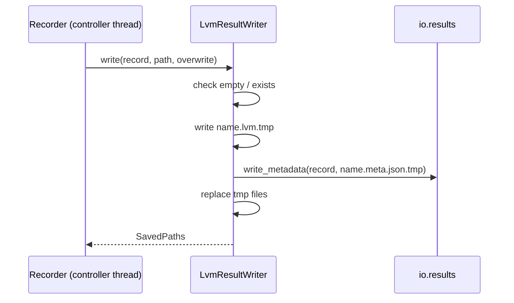

# io package

Module specifications for `bending_machine.io`. Each `##` section is one module or one part of a module; its subsections keep the usual order (responsibility, API, behaviour, errors, threading, test cases).

Contents:

- io.api
- io.settings_store
- io.results: results file
- io.results: metadata file
- io.session_log

## io.api

### 1. Responsibility

The two protocols through which `services` reaches the file system, so services can be tested with in-memory fakes. No behaviour of its own.

### 2. Public API

```python
class SettingsStore(Protocol):
    def load(self) -> Settings:
        """Stored settings, or defaults for anything missing or invalid. Never raises."""
    def save(self, settings: Settings) -> None:
        """Persist. Raises SaveError on failure."""
    def load_protected(self) -> ProtectedSettings:
        """Protected rig settings, or defaults if the file is absent.
        Raises ValueError if the file exists but is invalid (start-up must stop)."""

@dataclass(frozen=True, slots=True)
class SavedPaths:
    results: Path
    metadata: Path

class ResultWriter(Protocol):
    def exists(self, results_path: Path) -> bool:
        """True if results_path or its metadata file already exists."""
    def write(self, record: TestRecord, results_path: Path, overwrite: bool) -> SavedPaths:
        """Write results and metadata. Raises SaveError if a target exists and
        overwrite is False, the folder is not writable, or the record has no samples.
        Temporary files are cleaned up where possible on failure. Final files already
        replaced may remain; the caller must retain the record for retry. This is not
        an atomic transaction across results and metadata."""
```

Implementations: `io.settings_store.JsonSettingsStore`, `io.results.LvmResultWriter`.

### 3. Data models

`SavedPaths` above. Uses `Settings`, `ProtectedSettings`, `TestRecord` from `core.models`.

### 4. Behaviour

None.

### 5. Error cases

As stated per method. `SaveError` is defined in `core.errors`.

### 6. Threading

`SettingsStore`: GUI-independent; `load` and `load_protected` at start-up on the main thread before the GUI starts; `save` on the controller thread (on `ApplySettings`) and on the main thread at exit, serialised by a lock inside the implementation.
`ResultWriter`: called synchronously on the controller thread by `services.recorder`.

### 7. Test cases

A fake pair (`MemorySettingsStore`, `MemoryResultWriter`) is provided in the test helpers and must pass the same behavioural tests as the real ones where applicable.

| # | Input | Expected | Req |
|---|---|---|---|
| A1 | `MemoryResultWriter.write(record, p, overwrite=False)` twice | second call raises `SaveError` | FR-092 |
| A2 | `MemorySettingsStore.save(s)`; `load()` | equal to `s` except `tracking` is `False` | FR-006 |

## io.settings_store

### 1. Responsibility

Persist operator settings between sessions (FR-006) and read the protected rig settings, including the overload limit (FR-102). Implements `io.api.SettingsStore`.

Replaces the legacy mechanism of front-panel defaults saved inside the VI and "Reinit All to Default" at start (inventory §4.1, §6.1).

### 2. Public API

```python
class JsonSettingsStore(SettingsStore):
    def __init__(self, folder: Path | None = None) -> None:
        """folder: where the files live. Default: Path(os.environ["APPDATA"]) / "bending_machine".
        Created on first save."""
    @property
    def settings_path(self) -> Path: ...     # folder / "settings.json"
    @property
    def protected_path(self) -> Path: ...    # folder / "rig.json"
    def load(self) -> Settings: ...
    def save(self, settings: Settings) -> None: ...
    def load_protected(self) -> ProtectedSettings: ...
```

### 3. File formats

#### 3.1 `settings.json`

UTF-8 JSON, one object, two-space indent, keys exactly the `Settings` field names (see `core.md` (core.models) §4) plus `"schema": 1`. Enums as their string values. `roi` is `null` or an object with `left`, `top`, `right`, `bottom`.

```json
{
  "schema": 1,
  "stage_port": "COM3",
  "camera_id": "DEV_000F314C1234",
  "roi": {"left": 150, "top": 300, "right": 1150, "bottom": 720},
  "threshold_lower": 2,
  "threshold_upper": 60,
  "invert": false,
  "min_area_px": 200,
  "max_area_px": 15000,
  "marker_count": 6,
  "tracking": false,
  "resolution_mm_per_px": 0.0111,
  "fit_subset": "all",
  "jog_step_mm": 0.0612244898,
  "test_step_mm": 0.0477,
  "settle_s": 0.4,
  "k_limit": -0.12,
  "pc_amplitude": 0.05,
  "pc_cycles": 3,
  "pc_dwell_s": 3.0
}
```

#### 3.2 `rig.json`

UTF-8 JSON, keys exactly the `ProtectedSettings` field names (see `core.md` (core.models) §5). Any subset may be present; missing keys take defaults. The application never writes this file.

```json
{
  "overload_limit_raw": 25.0,
  "force_sign": -1,
  "stage_up_sign": -1,
  "loading_stage_sign": -1,
  "zaber_baud": 115200
}
```

### 4. Behaviour

`load()`:

1. File absent: return `Settings()` (defaults).
2. File unreadable or not valid JSON: log WARNING, return `Settings()`. The bad file is renamed to `settings.json.bad` so it is not lost.
3. Unknown keys are ignored. Each known key is validated on its own; an invalid or missing value falls back to that field's default with a WARNING naming the key. If the combination then fails a cross-field rule, both fields involved fall back to defaults.
4. `tracking` is always returned as `False`, whatever was stored.

`save()`: serialise, write to `settings.json.tmp` in the same folder, flush, then `os.replace` onto `settings.json`. Guarded by an internal lock.

`load_protected()`: absent file returns `ProtectedSettings()`. A present but invalid file (bad JSON, value out of range) raises `ValueError` naming the key; the application refuses to start rather than run with an unintended overload limit.

### 5. Error cases

| Case | Behaviour |
|---|---|
| `APPDATA` not set and no folder given | Uses `Path.home() / ".bendtest"` |
| Folder not writable on `save` | `SaveError(path, message)`; previous file untouched |
| Corrupt `settings.json` | Defaults, file kept as `.bad` |
| Invalid `rig.json` | `ValueError` |
| Timeout, disconnect, cancellation | Not applicable |

### 6. Threading

See `io.md` (io.api) §6. `save` is serialised by a lock; `load*` are called before worker threads start.

### 7. Test cases

All in a temporary folder.

| # | Input | Expected | Req |
|---|---|---|---|
| J1 | no files; `load()` | equals `Settings()` | FR-006 |
| J2 | `save(s)` with every field changed from default; new store instance `load()` | equal to `s` except `tracking is False` | FR-006 |
| J3 | `settings.json` containing `{"marker_count": 2, "settle_s": 1.5}` | `marker_count == 6` (default, WARNING logged), `settle_s == 1.5` | FR-006 |
| J4 | `settings.json` containing `not json` | defaults; `settings.json.bad` exists | FR-006 |
| J5 | `save` into a read-only folder | `SaveError`; no `.tmp` file left | FR-006 |
| J6 | no `rig.json`; `load_protected()` | `overload_limit_raw == 25.0` | FR-102 |
| J7 | `rig.json` `{"overload_limit_raw": 40.0}` | `40.0`; other fields default | FR-102 |
| J8 | after any sequence of `save()` calls | `rig.json` byte-identical to before (never written) | FR-102 |
| J9 | `rig.json` `{"overload_limit_raw": -1}` | `ValueError` mentioning `overload_limit_raw` | FR-102 |
| J10 | stored `"tracking": true` | loaded `tracking is False` | FR-029 |

## io.results: results file

### 1. Responsibility

Write a finished test to disk in the legacy results layout and trigger the metadata files that go with it. Implements `io.api.ResultWriter`; covers FR-090, FR-092 and IR-010.

Replaces the Express VI `Write To Measurement File` (inventory §6.2).

### 2. Public API

```python
class LvmResultWriter(ResultWriter):
    def __init__(self, software_version: str) -> None: ...
    def exists(self, results_path: Path) -> bool: ...
    def write(self, record: TestRecord, results_path: Path, overwrite: bool) -> SavedPaths: ...

def format_value(value: float) -> str:
    """One number in the legacy text form (see §3.2)."""

def format_row(sample: Sample) -> str:
    """One line without the line terminator (see §3.1)."""
```

`results_path` must have the suffix `.lvm` (case-insensitive); `write` appends `.lvm` if the suffix is missing.

### 3. File format (IR-010)

#### 3.1 Structure

- Encoding ASCII. Line terminator CR LF after every line, including the last. No header, no blank lines.
- One line per `Sample`, in recording order.
- Line = TAB, then `2N + 2` values separated by single TABs, where N = number of markers:

| Position | Field | Unit |
|---|---|---|
| 1 … N | `X1 … XN` (`sample.xs`, left to right) | px |
| N+1 … 2N | `Y1 … YN` (`sample.ys`, same marker order) | px |
| 2N+1 | `K` (`sample.dk`) | 1/mm |
| 2N+2 | `F` (`sample.force`, tared, display sign) | device units |

The leading TAB means a reader splitting on TAB sees an empty first field followed by `2N + 2` values.

#### 3.2 Number format

- Decimal separator `.`; no thousands separator; no plus sign.
- If `value == 0` or `abs(value) >= 1e-4`: fixed notation with exactly six decimals (`"%.6f"`), for example `219.797256`, `-0.000491`, `0.000105`.
- If `0 < abs(value) < 1e-4`: mantissa with six decimals, the letter `E`, and the exponent without padding or plus sign, for example `6.283017E-5`, `-3.100000E-6`.
- Non-finite values are written as `NaN`, `Inf`, `-Inf` (they should not occur; the recorder only stores usable samples).

#### 3.3 Example (N = 6, first three lines of a legacy file)

Shown with `→` for TAB and `¶` for CR LF:

```
→219.797256→309.985138→501.126495→712.639465→872.888733→1079.694458→634.939148→629.354980→622.956726→616.226379→614.695496→612.509033→0.000105→6.283017E-5¶
→219.818619→310.029297→501.255554→712.920776→873.490845→1079.855835→612.901733→607.659851→601.666443→595.122131→593.637756→590.513733→-0.000491→-0.006024¶
→219.886398→310.030121→501.390198→713.121948→873.633789→1080.076782→590.792847→586.285400→580.263794→573.578308→572.023437→568.513000→-0.000847→-0.002812¶
```

### 4. Behaviour

`write(record, results_path, overwrite)`:

1. Refuse an empty record: `SaveError(path, "no samples")`.
2. Compute the metadata path: same folder and stem, suffix `.meta.json` (`name.lvm` → `name.meta.json`).
3. If `not overwrite` and (`results_path` or the metadata path exists): `SaveError(path, "file exists")`.
4. Write the results text to `name.lvm.tmp` in the target folder; flush and close.
5. Call `io.results.write_metadata(record, metadata_path + ".tmp", software_version)`.
6. `os.replace` both temporary files onto their final names (results first).
7. Return `SavedPaths`.

On any exception in steps 4–6: attempt to delete remaining temporary files, then raise
`SaveError(path, message)` for the original failure; cleanup errors are logged and do
not mask it. Final files already replaced are left in place. For example, failure of
the second replacement in step 6 leaves the new results file and any previous metadata
file. No multi-file atomicity or rollback is promised. The recorder
retains the complete pending record on all failures. Retrying at the same path requires
overwrite confirmation if either final file exists; choosing another path is also valid.

`exists(results_path)` returns `True` if either the results or the metadata file exists.



### 5. Error cases

| Case | Behaviour |
|---|---|
| Empty record | `SaveError`, nothing written |
| Target exists, `overwrite False` | `SaveError("file exists")`, nothing written |
| Folder missing or read-only, disk full | `SaveError` with the OS message; temporary-file cleanup attempted; already-published final files remain |
| Samples with differing marker counts | `SaveError("inconsistent marker count")`; cannot occur through the recorder |
| Timeout, disconnect | Not applicable |
| Cancellation | Not supported; a save runs to completion (typical duration < 0.2 s for 10 000 samples) |

### 6. Threading

Runs synchronously on the controller thread through `services.recorder`. Stateless
apart from the version string. GUI, vision and force threads do not wait for file I/O.

### 7. Test cases

| # | Input | Expected | Req |
|---|---|---|---|
| L1 | `format_value` of `219.797256`, `-0.000491`, `0.000105`, `0.0`, `6.283017e-5`, `-3.1e-6` | `"219.797256"`, `"-0.000491"`, `"0.000105"`, `"0.000000"`, `"6.283017E-5"`, `"-3.100000E-6"` | IR-010 |
| L2 | record built from the numeric content of the three example lines in §3.3 | file bytes equal those three lines exactly, CR LF included | IR-010 |
| L3 | record with N = 6, 100 samples; read the file back splitting on TAB | 100 lines; 15 fields each; first field empty | IR-010, FR-074 |
| L4 | round-trip an existing legacy file: parse `tests/Cristian/5.Testing load cell/Test 16-07/PCL 100%/1/Test 1.lvm` into samples, write, compare | byte-identical to the original | IR-010, FR-090 |
| L5 | `write(..., overwrite=False)` onto an existing `.lvm` | `SaveError`; existing file unchanged | FR-092 |
| L6 | same with `overwrite=True` | replaced; metadata replaced | FR-092 |
| L7 | only `name.meta.json` exists, `overwrite=False` | `SaveError`; `exists()` was `True` | FR-092 |
| L8 | read-only folder | `SaveError`; no `.tmp` files remain | FR-093 |
| L9 | empty record | `SaveError("no samples")` | FR-090 |
| L10 | path `C:/x/test1` (no suffix) | writes `test1.lvm` and `test1.meta.json` | FR-090, FR-091 |
| L11 | two tests saved as `a.lvm` and `b.lvm` in one folder | four files: `a.lvm`, `a.meta.json`, `b.lvm`, `b.meta.json` | FR-091 |
| L12 | 10 000 samples, timed | completes in < 1 s | NFR-006 |
| L13 | inject failure of metadata replacement after results replacement | `SaveError`; new results remain, previous metadata (if any) unchanged; remaining temporary files removed when possible | FR-093 |

## io.results: metadata file

### 1. Responsibility

Write the per-test metadata file (IR-011, FR-091). Called by `io.results`; not used directly by services.

Replaces `Write Delimited Spreadsheet.vi` and the `Config_File.xls` logic (inventory §6.3), fixing the defect that saved the resolution as `0`. The legacy `Config_File.xls` is no longer written: nothing needs it (IR-012 dropped, decision D7).

### 2. Public API

```python
def write_metadata(record: TestRecord, path: Path, software_version: str) -> None:
    """Write TestMetadata.from_record(record, software_version) as JSON to path.
    Raises OSError on failure (the caller converts to SaveError)."""

def metadata_path_for(results_path: Path) -> Path:
    """name.lvm -> name.meta.json in the same folder."""
```

### 3. File formats

#### 3.1 Metadata file `name.meta.json` (IR-011)

UTF-8 JSON, one object, two-space indent, LF line endings, keys in this order:

| Key | Type | Unit / format | Example |
|---|---|---|---|
| `schema` | int | constant `1` | `1` |
| `results_file` | string | file name of the results file, no folder | `"Test 1.lvm"` |
| `start_date` | string | `YYYY-MM-DD` | `"2026-07-16"` |
| `start_time` | string | `HH:MM:SS`, 24-hour local time | `"16:28:05"` |
| `marker_count` | int | | `6` |
| `resolution_mm_per_px` | number | mm/px, full precision (`repr`) | `0.0111` |
| `k_limit` | number | 1/mm | `-0.12` |
| `test_step_mm` | number | mm | `0.0477` |
| `settle_s` | number | s | `0.4` |
| `fit_subset` | string | `"all"` or `"exclude_outer"` | `"all"` |
| `k_ref` | number or null | 1/mm, absolute curvature at tare | `-0.0031` |
| `f_ref` | number or null | device units, display sign | `-0.5297` |
| `tare_overridden` | bool | | `false` |
| `end_reason` | string | `completed`, `stopped`, `overload`, `fault` | `"completed"` |
| `sample_count` | int | | `13` |
| `start_position_mm` | number | mm | `10.0` |
| `software_version` | string | | `"1.0.0"` |

```json
{
  "schema": 1,
  "results_file": "Test 1.lvm",
  "start_date": "2026-07-16",
  "start_time": "16:28:05",
  "marker_count": 6,
  "resolution_mm_per_px": 0.0111,
  "k_limit": -0.12,
  "test_step_mm": 0.0477,
  "settle_s": 0.4,
  "fit_subset": "all",
  "k_ref": -0.0031,
  "f_ref": -0.5297,
  "tare_overridden": false,
  "end_reason": "completed",
  "sample_count": 13,
  "start_position_mm": 10.0,
  "software_version": "1.0.0"
}
```

`results_file` is derived from `path` by replacing the `.meta.json` (or `.meta.json.tmp`) suffix with `.lvm`.

### 4. Behaviour

The writer creates or replaces the target file in one write.

### 5. Error cases

| Case | Behaviour |
|---|---|
| Folder missing or not writable | `OSError` propagates to `io.results`, which raises `SaveError` |
| `record.end_reason is None` | `ValueError("record not finished")` |
| Timeout, disconnect, cancellation | Not applicable |

### 6. Threading

Controller thread, synchronously via `LvmResultWriter.write`.

### 7. Test cases

| # | Input | Expected | Req |
|---|---|---|---|
| N1 | record started 2026-07-16 16:28:05, resolution 0.0111, defaults otherwise | JSON parses; keys in the order of §3.1; values as in the example | IR-011 |
| N2 | N1 | `resolution_mm_per_px` parses to exactly `0.0111` | FR-091 |
| N3 | tare with `k_ref=None` and `overridden=True` | `"k_ref": null`, `"tare_overridden": true` | IR-011 |
| N4 | `end_reason=OVERLOAD` | `"end_reason": "overload"` | IR-011, FR-101 |
| N5 | `metadata_path_for(Path("C:/d/Test 1.lvm"))` | `C:/d/Test 1.meta.json` | FR-091 |
| N9 | unfinished record | `ValueError` | IR-011 |

## io.session_log

### 1. Responsibility

Configure Python's standard `logging` for one application session: a timestamped log file plus console output. Implements NFR-008. The legacy program had no log.

### 2. Public API

```python
def configure(log_folder: Path | None = None, console_level: int = logging.INFO) -> Path:
    """Set up logging and return the path of this session's log file.
    log_folder default: Path(os.environ["APPDATA"]) / "bending_machine" / "logs".
    Call once, first thing in app.main. Calling again replaces the handlers."""

def prune(log_folder: Path, keep: int = 200) -> int:
    """Delete the oldest session files so that at most `keep` remain. Returns the number deleted."""
```

### 3. File format

- File name: `bendtest_YYYYMMDD_HHMMSS.log` (local time at start).
- UTF-8 text, one record per line (tracebacks continue on following lines).
- Line layout: `YYYY-MM-DD HH:MM:SS.mmm LEVEL  thread  logger: message`

```
2026-11-13 14:02:11.482 INFO  MainThread  bending_machine.app: session start, version 1.0.0, simulated=False
2026-11-13 14:02:13.020 INFO  controller  bending_machine.services.rig: connect stage COM3: ok
2026-11-13 14:02:13.411 ERROR controller  bending_machine.services.rig: connect load cell: load cell: no FUTEK device detected
2026-11-13 14:05:40.006 INFO  controller  bending_machine.services.controller: command StartTest accepted
2026-11-13 14:05:40.508 INFO  controller  bending_machine.services.controller: step -0.0477 mm -> 9.9523 mm
2026-11-13 14:06:31.900 INFO  controller  bending_machine.services.controller: test ended: completed, 42 samples
2026-11-13 14:06:40.115 INFO  controller  bending_machine.services.recorder: saved C:\data\Test 1.lvm
```

`logging.Formatter("%(asctime)s.%(msecs)03d %(levelname)-5s %(threadName)-10s %(name)s: %(message)s", "%Y-%m-%d %H:%M:%S")`.

### 4. Behaviour

- Root logger level DEBUG; file handler level INFO; console handler at `console_level`.
- Size cap: `RotatingFileHandler` with `maxBytes = 20_000_000`, `backupCount = 5`, so an 8-hour session cannot fill the disk (NFR-006).
- `prune(log_folder, 200)` is called by `configure` after creating the new file.
- What each module must log is specified in that module's file; the required events are those of architecture §7.2: connections and results, operator commands, mode and phase changes, each stage command with resulting position, each recorded sample (index, time, stage position), end reason, save path, warnings, errors with traceback.
- Thread names are set by the services: `controller`, `vision`, `force`. Save messages
  come from `controller`; no separate save thread exists.

### 5. Error cases

| Case | Behaviour |
|---|---|
| Log folder cannot be created or written | Fall back to console-only logging; print one warning to stderr; return a path under `tempfile.gettempdir()` if that is writable, else the intended path |
| Disk full during a session | The logging module swallows handler errors (`logging.raiseExceptions = False`) so logging never stops the application |
| Timeout, disconnect, cancellation | Not applicable |

### 6. Threading

`configure` on the main thread before any other thread starts. Logging calls are thread-safe.

### 7. Test cases

| # | Input | Expected | Req |
|---|---|---|---|
| G1 | `configure(tmp)`; log one INFO from a thread named `controller` | file exists, name matches `bendtest_\d{8}_\d{6}\.log`; line matches the layout of §3 | NFR-008 |
| G2 | log DEBUG | not in the file | NFR-008 |
| G3 | `logger.exception` inside an `except` | file contains the message and a traceback | NFR-008 |
| G4 | 205 old files in the folder; `configure` | 200 files remain, the newest kept | NFR-006 |
| G5 | unwritable folder | no exception; logging to console works | NFR-008 |
| G6 | simulated full test run (see `app.md` (app.main) test X3) | log contains, in order: `command StartTest accepted`, a `phase` line for loading and unloading, at least one `step` line, `test ended: completed`, `saved` with the path | NFR-008 |
