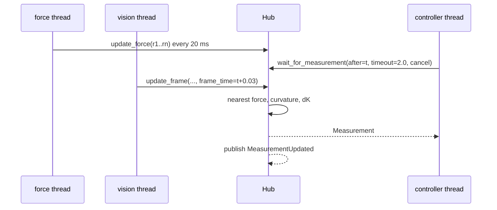
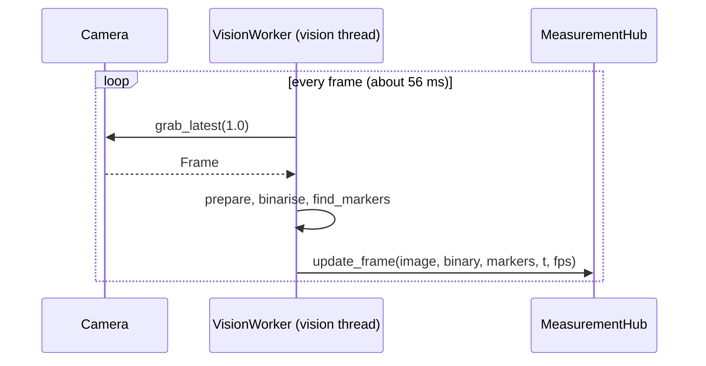
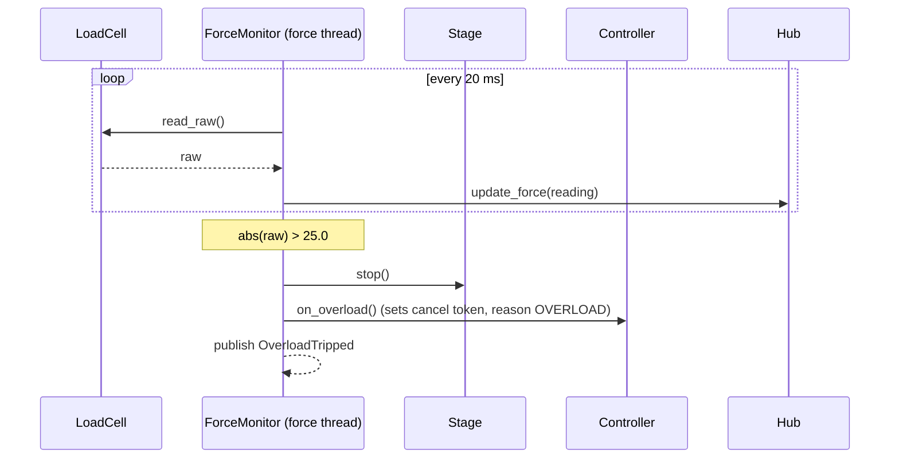
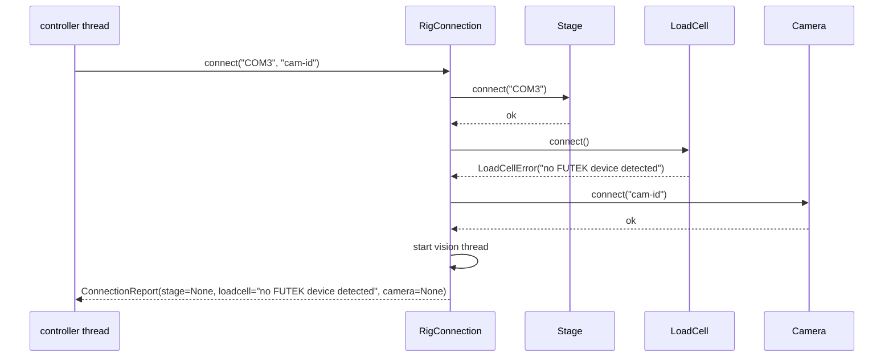
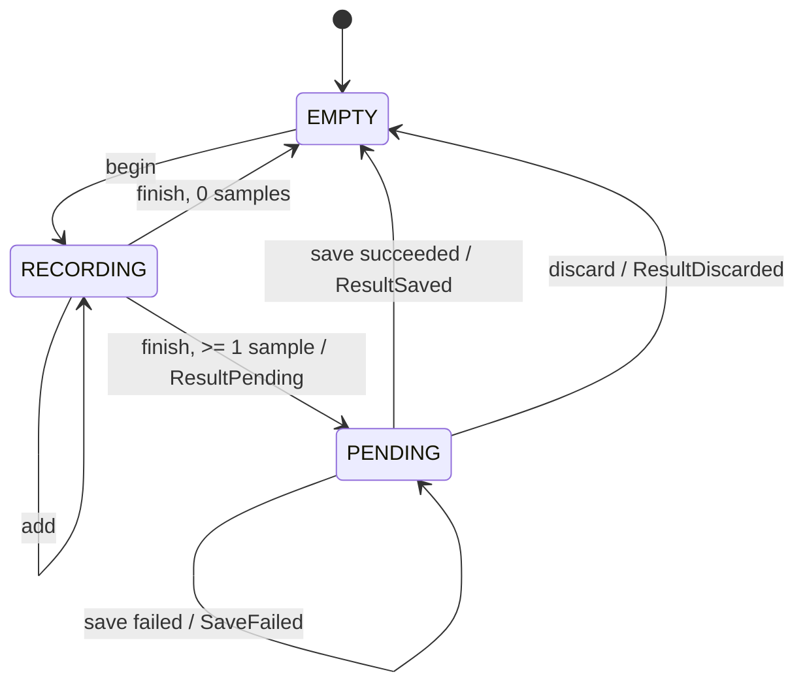
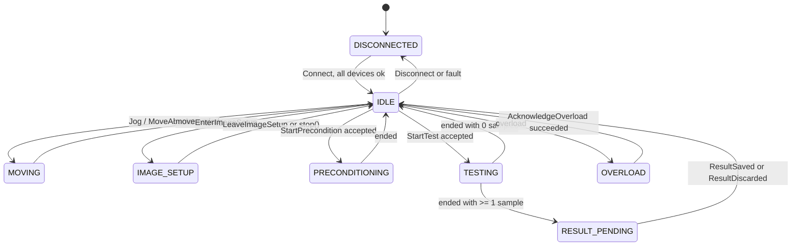
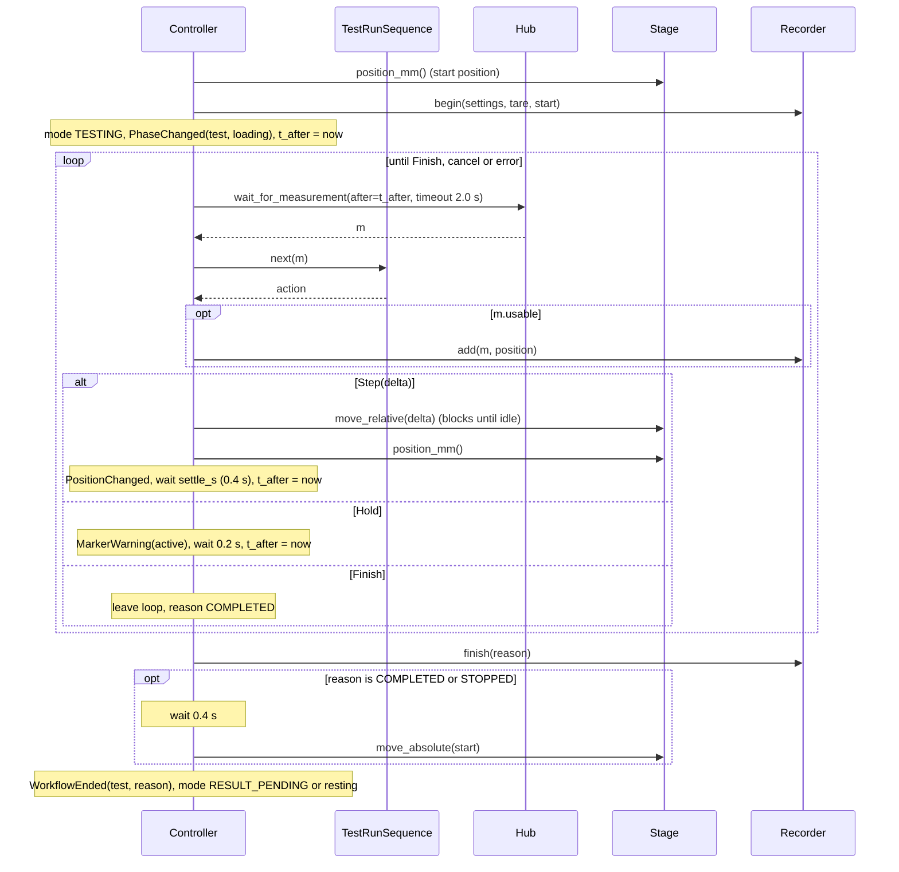

# services package

Module specifications for `bending_machine.services`. Each `##` section is one module or one part of a module; its subsections keep the usual order (responsibility, API, behaviour, errors, threading, test cases).

Contents:

- services.events
- services.hub: cancel token
- services.hub: MeasurementHub
- services.workers: VisionWorker
- services.workers: ForceMonitor
- services.rig
- services.recorder
- services.controller

## services.events

### 1. Responsibility

The event types that services publish and a small thread-safe publisher. This is the only channel from worker threads to the GUI (through `ui.bridge`) and to the log. Supports FR-103 and NFR-008; every other service module depends on it.

No Qt. Imports `core.models` only.

### 2. Public API

```python
class Publisher:
    def subscribe(self, callback: Callable[[Event], None]) -> Callable[[], None]:
        """Register callback; returns an unsubscribe function. Thread-safe."""
    def publish(self, event: Event) -> None:
        """Call every subscriber synchronously on the calling thread, in subscription
        order. An exception in a subscriber is logged (ERROR, with traceback) and does
        not stop delivery to the others or propagate to the publisher's caller."""
```

Subscribers must return quickly (< 1 ms) and must not call back into services; `ui.bridge` only stores the event or emits a queued Qt signal.

### 3. Events

All are `@dataclass(frozen=True, slots=True)`; `Event` is their union type.

| Event | Fields | Published by | When |
|---|---|---|---|
| `ConnectionReport` | `stage: str \| None`, `loadcell: str \| None`, `camera: str \| None` (`None` = connected, text = error message); property `all_ok` | rig | After each connect attempt |
| `ModeChanged` | `mode: Mode`, `previous: Mode` | controller | Every mode transition |
| `PhaseChanged` | `workflow: str` (`"test"` or `"precondition"`), `phase: str` (enum value) | controller | Each phase change, and at workflow start |
| `PositionChanged` | `position_mm: float` | controller | After connect and after every move, completed or interrupted |
| `CycleCounted` | `done: int`, `total: int` | controller | At preconditioning start (0) and each increment |
| `MeasurementUpdated` | `measurement: Measurement`, `fps: float` | hub | Once per processed camera frame |
| `SampleRecorded` | `index: int` (0-based), `sample: Sample` | recorder | Each sample added |
| `TareChanged` | `tare: TareState` | hub | After a tare or override |
| `WorkflowEnded` | `workflow: str`, `reason: EndReason` | controller | When a test or preconditioning run ends, after any return move |
| `ResultPending` | `sample_count: int`, `reason: EndReason`, `suggested_name: str` | recorder | Test finished with ≥ 1 sample |
| `ResultSaved` | `paths: SavedPaths` | recorder | Save succeeded |
| `SaveFailed` | `path: str`, `message: str` | recorder | Save failed; result still pending |
| `ResultDiscarded` | | recorder | Operator discarded |
| `OverloadTripped` | `raw: float`, `limit: float` | force_monitor | Once per trip (latched) |
| `OverloadCleared` | | controller | After a successful acknowledge |
| `Fault` | `device: str`, `message: str` | rig, vision_worker, force_monitor, controller | Device error; exactly once per failure |
| `CommandRejected` | `command: str` (class name), `reason: RejectReason`, `message: str` | controller | A command was refused |
| `MarkerWarning` | `active: bool`, `found: int`, `expected: int` | controller | When a workflow starts holding for a wrong marker count, and when it resumes |

```python
class RejectReason(Enum):
    WRONG_MODE = "wrong_mode"; NOT_CONNECTED = "not_connected"
    NOT_TRACKING = "not_tracking"; NOT_TARED = "not_tared"
    OVERLOAD_LATCHED = "overload_latched"; INVALID_SETTINGS = "invalid_settings"
    RESULT_PENDING = "result_pending"; NO_MEASUREMENT = "no_measurement"
```

`CommandRejected.message` is operator-readable English text; the texts for `NOT_TRACKING` are fixed in `services.md` (services.controller) (FR-029).

### 4. Behaviour

Delivery is synchronous and in order per publishing thread. There is no queue and no replay: a subscriber added later does not receive earlier events. `ui.bridge` therefore subscribes before `RigConnection.connect` is first called.

### 5. Error cases

| Case | Behaviour |
|---|---|
| Subscriber raises | Logged; other subscribers still called |
| Publish with no subscribers | No-op |
| Unsubscribe twice | No-op |
| Timeout, disconnect, cancellation | Not applicable |

### 6. Threading

`subscribe`, the returned unsubscribe function and `publish` are thread-safe (the subscriber list is copied under a lock before delivery). Callbacks run on whichever thread published.

### 7. Test cases

| # | Input | Expected | Req |
|---|---|---|---|
| EV1 | two subscribers; publish `Fault("camera", "x")` | both called once, in order, with the same object | FR-103 |
| EV2 | first subscriber raises | second still called; one ERROR logged; `publish` returns normally | NFR-009 |
| EV3 | unsubscribe then publish | callback not called | NFR-008 |
| EV4 | 4 threads each publishing 1000 events to one counting subscriber | 4000 received, no exception | NFR-006 |
| EV5 | `ConnectionReport(None, "no FUTEK device detected", None).all_ok` | `False` | FR-002 |

## services.hub: cancel token

### 1. Responsibility

`CancelToken`: the one mechanism by which a running workflow is told to stop, and by which every wait inside a workflow is made interruptible. Supports FR-004 and NFR-003.

Replaces the legacy `Wait (ms)` primitives, which could not be interrupted (inventory §7).

### 2. Public API

```python
class Cancelled(Exception):
    """Raised inside a workflow when its token has been set."""

class CancelToken:
    def __init__(self) -> None: ...
    def set(self, reason: EndReason = EndReason.STOPPED) -> None:
        """Request cancellation. The first call wins: later calls do not change reason.
        Thread-safe; never blocks."""
    def is_set(self) -> bool: ...
    @property
    def reason(self) -> EndReason | None:
        """Reason given to the first set(), or None if not set."""
    def wait(self, seconds: float) -> bool:
        """Sleep up to `seconds`. Return True at once if the token is or becomes set,
        False if the full time elapsed. seconds <= 0 returns is_set() immediately."""
    def raise_if_cancelled(self) -> None:
        """Raise Cancelled if set."""
    def sleep(self, seconds: float) -> None:
        """wait(seconds), then raise Cancelled if set."""
```

Implemented with one `threading.Event`.

### 3. Data models

None.

### 4. Behaviour

- A token is single-use: created by the controller at the start of each workflow or move, never reset.
- Who sets it and with which reason:

| Setter | Reason |
|---|---|
| Operator stop (`Controller.stop()`) | `STOPPED` |
| Force overload (`ForceMonitor`) | `OVERLOAD` |
| Device fault (any worker) | `FAULT` |
| Application shutdown | `STOPPED` |

- `wait` wakes within 5 ms of `set()`.

### 5. Error cases

| Case | Behaviour |
|---|---|
| `set()` called repeatedly or from several threads | First reason kept |
| `wait` with negative seconds | Treated as 0 |
| Timeout | `wait` returning `False` is the normal "time elapsed" result |

### 6. Threading

All methods are thread-safe. `wait`, `sleep`, `raise_if_cancelled` are called on the controller thread; `set` from any thread.

### 7. Test cases

| # | Input | Expected | Req |
|---|---|---|---|
| K1 | `wait(0.2)` on a fresh token | returns `False` after 0.2 s ± 0.03 | NFR-003 |
| K2 | thread B calls `set()` 0.1 s into `wait(3.0)` | returns `True` within 0.12 s of the start | FR-004, NFR-003 |
| K3 | `set(OVERLOAD)` then `set(STOPPED)` | `reason is EndReason.OVERLOAD` | FR-101 |
| K4 | `sleep(1.0)` on a set token | raises `Cancelled` immediately | FR-004 |
| K5 | `raise_if_cancelled()` on a fresh token | no exception | FR-004 |
| K6 | `wait(-1)` | returns `False` immediately | NFR-003 |

## services.hub: MeasurementHub

### 1. Responsibility

`MeasurementHub`: the single place where the latest image, markers, force and curvature come together. It owns the tare state, computes curvature and dK for each frame, pairs each frame with the force reading nearest in time, and lets the controller wait for a measurement newer than a given instant. Implements FR-040 to FR-047 at run time, the pairing rule of FR-074 and NFR-005; feeds FR-049.

Replaces the per-iteration wiring between `Imaging -- Find Marker.vi`, `Imaging -- Find K and F.vi`, `LoadReadSafe.vi` and the `input cluster` shift register (inventory §4.3).

### 2. Public API

```python
class MeasurementHub:
    def __init__(self, publisher: Publisher, protected: ProtectedSettings,
                 settings: Settings) -> None: ...

    # --- producers ---
    def update_force(self, reading: ForceReading) -> None:        # force thread
    def update_frame(self, image: np.ndarray, binary: np.ndarray,
                     markers: MarkerSet | None, frame_time: float, fps: float) -> None:
        """Vision thread. Builds a Measurement, stores it with the images, wakes
        waiters, publishes MeasurementUpdated(measurement, fps)."""
    def update_settings(self, settings: Settings) -> None:        # controller thread
        """Resolution and fit subset used from the next frame on."""

    # --- consumers ---
    def latest(self) -> Measurement | None: ...
    def latest_images(self) -> tuple[np.ndarray, np.ndarray, MarkerSet | None] | None:
        """(image, binary, markers) of the newest frame; arrays must not be modified."""
    def wait_for_measurement(self, after: float, timeout: float,
                             cancel: CancelToken) -> Measurement:
        """Block until a Measurement with frame_time > after exists, then return it.
        Raises TimeoutError after `timeout` seconds; Cancelled if `cancel` is set
        (checked every 20 ms)."""

    # --- tare ---
    @property
    def tare(self) -> TareState: ...
    def tare_curvature(self) -> bool:
        """Set k_ref to the latest measurement's absolute curvature. Returns False,
        changing nothing, if there is no measurement or its curvature is None."""
    def tare_force(self) -> bool:
        """Set f_ref to force_sign * latest raw. Returns False if no reading yet."""
    def force_missing_refs_to_zero(self) -> TareState:
        """For FR-048 override: any reference that is None becomes 0.0 and
        overridden becomes True. Returns the new state."""
    def reset_tare(self) -> None:
        """Both references back to None (called on disconnect)."""
```

Each successful tare, override or reset publishes `TareChanged(tare)`.

### 3. Data models

Uses `Measurement`, `MarkerSet`, `ForceReading`, `TareState`.

Internal state: force history `deque(maxlen=200)` (4 s at 20 ms); latest frame triple; latest `Measurement`; `TareState`; current resolution and fit subset.

### 4. Behaviour

Building a `Measurement` in `update_frame`:

1. Force pairing: choose the reading in the history whose `timestamp` is nearest to `frame_time`. If the history is empty, use `raw = nan`, `force_time = frame_time`. If the nearest reading is more than 0.1 s from `frame_time`, log WARNING `force/frame skew <ms>` at most once per second.
2. `force = apply_tare(raw, force_sign, tare.f_ref)`.
3. Curvature: if `markers` is not `None` and `markers.valid`: `curvature = compute_curvature(markers.xs, markers.ys, resolution, fit_subset)`; if that raises `ValueError`, `curvature = None`. Otherwise `None`.
4. `dk = curvature − tare.k_ref` if both exist, else `None`.
5. Store, `notify_all` on the condition variable, publish.

Immediately after `tare_curvature()` the stored latest measurement is rebuilt with the new reference so `latest().dk == 0.0`; likewise `tare_force()` makes `latest().force == 0.0` for the same raw value.



### 5. Error cases

| Case | Behaviour |
|---|---|
| No force reading yet | `force_raw` NaN; `Measurement.usable` unaffected (it concerns markers and dK); the recorder refuses NaN force (see `services.md` (services.recorder)) |
| `compute_curvature` raises `ValueError` | `curvature None`; logged at DEBUG |
| `wait_for_measurement` timeout | `TimeoutError`; the controller treats it as a camera fault |
| `wait_for_measurement` cancelled | `Cancelled` within 20 ms of the token being set |
| Tare with no usable data | Returns `False`; nothing published |
| Camera stops | `latest()` keeps the last value; staleness is visible through `frame_time` |

### 6. Threading

One `threading.Condition` (with its lock) guards all state.

| Method | Thread |
|---|---|
| `update_force` | force |
| `update_frame` | vision |
| `update_settings`, `tare_*`, `force_missing_refs_to_zero`, `reset_tare`, `wait_for_measurement` | controller |
| `latest`, `latest_images`, `tare` | any (GUI thread through `ui.bridge`) |

`publish` is called after releasing the lock. Image arrays are replaced, never mutated, so readers may keep references.

### 7. Test cases

Direct calls with synthetic inputs; `markers6(a)` builds a valid 6-marker set on `y = a·x² + 600`.

| # | Input | Expected | Req |
|---|---|---|---|
| B1 | `update_force` raw 3.2; `update_frame(markers=None)` | `latest().force == -3.2`, `curvature is None`, `dk is None` | FR-045 |
| B2 | `update_frame(markers6(1e-3))`, resolution 0.01, no tare | `curvature` equals `compute_curvature(...)`; `dk is None` | FR-040, FR-044 |
| B3 | B2, `tare_curvature()` | returns `True`; `latest().dk == 0.0`; `TareChanged` published with `k_set` | FR-044, FR-047 |
| B4 | B3, then `update_frame(markers6(1.1e-3))` | `dk == curvature − k_ref`, non-zero | FR-044 |
| B5 | `tare_curvature()` with markers `None` | `False`; tare unchanged | FR-044 |
| B6 | raw 3.2, `tare_force()`, same raw again | `latest().force == 0.0`; then raw 5.0 gives `-1.8` | FR-046, FR-047 |
| B7 | `update_settings` with resolution doubled; same markers | curvature halved | FR-043 |
| B8 | `update_settings(fit_subset=EXCLUDE_OUTER)`; markers whose outer two are displaced | curvature equals the inner-four value | FR-042 |
| B9 | force readings at t = 1.00, 1.02, 1.04; frame at 1.031 | paired reading is the one at 1.04; `abs(force_time − frame_time) <= 0.1` | FR-074, NFR-005 |
| B10 | only reading at t = 1.0; frame at 1.5 | measurement built; one skew WARNING | NFR-005 |
| B11 | `wait_for_measurement(after=now, timeout=2.0)` in thread A; frame arrives 0.1 s later | returns that measurement, `frame_time > after` | FR-072, FR-074 |
| B12 | same, no frame | `TimeoutError` after 2.0 s ± 0.1 | FR-103 |
| B13 | same, token set after 0.1 s | `Cancelled` within 0.15 s | FR-004 |
| B14 | invalid marker set (5 of 6) | `curvature None`, `dk None`, `usable False` | FR-030 |
| B15 | `force_missing_refs_to_zero()` with nothing tared | `k_ref == 0.0`, `f_ref == 0.0`, `overridden True` | FR-048 |
| B16 | each `update_frame` | exactly one `MeasurementUpdated` published | FR-049, NFR-001 |

## services.workers: VisionWorker

### 1. Responsibility

The camera thread. Grabs the newest frame, runs the image chain from `core.vision`, and hands the image, binary image and marker set to `MeasurementHub`. Runs continuously in every mode while the camera is connected. Implements FR-020, FR-031 and the execution of FR-021 to FR-027; supports NFR-001 and NFR-002.

Replaces the three copies of the legacy image chain (inventory §4.4).

### 2. Public API

```python
class VisionWorker:
    def __init__(self, camera: Camera, hub: MeasurementHub, publisher: Publisher,
                 on_fault: Callable[[str, str], None]) -> None:
        """on_fault(device, message): called once when the worker gives up
        (wired to Controller.notify_fault)."""
    def start(self) -> None:          # starts thread "vision"; no-op if running
    def stop(self) -> None:           # ask the loop to end; returns immediately
    def join(self, timeout: float = 2.0) -> bool:   # True if the thread ended
    @property
    def running(self) -> bool: ...
    def update_settings(self, settings: Settings) -> None:
        """Swap the settings snapshot used from the next frame on. Thread-safe."""
    @property
    def fps(self) -> float:           # most recent frame-rate estimate, 0.0 until known
```

### 3. Data models

Uses `Settings`, `Frame`, `MarkerSet`.

### 4. Behaviour

Loop, once per frame:

1. `frame = camera.grab_latest(timeout_s=1.0)`.
2. `s = current settings snapshot`.
3. `image = prepare(frame.image)`.
4. `binary = binarise(image, s.threshold_lower, s.threshold_upper, s.invert)`.
5. If `s.tracking`: `markers = find_markers(binary, s.roi, s.min_area_px, s.max_area_px, s.marker_count, frame.timestamp)`; else `markers = None`.
6. Update the frame-rate estimate.
7. `hub.update_frame(image, binary, markers, frame.timestamp, fps)`.

Frame rate: exponential moving average of `1 / (t_n − t_{n−1})` with smoothing factor 0.1, reset after a timeout.

Timing: with the camera at 17.78 frames/s the loop period is about 56 ms; steps 3–7 must take ≤ 30 ms so no frame is skipped by the worker itself.



### 5. Error cases

| Case | Behaviour |
|---|---|
| `CameraTimeout` | Count consecutive timeouts. First and second: log WARNING and continue. Third in a row (3 s without a frame): treat as device loss |
| Other `CameraError` | Device loss immediately |
| Device loss | Log ERROR; publish `Fault("camera", message)`; call `on_fault("camera", message)`; end the loop. Published exactly once |
| `ValueError` from `core.vision` (for example a frame with an unexpected dtype) | Log ERROR with traceback, skip the frame; after 10 consecutive such frames treat as device loss with message `"invalid frames"` |
| Any other exception | Same as device loss, message `"internal error: <text>"`, traceback logged |
| `stop()` during a grab | Loop ends after the current grab returns (≤ 1.0 s) |
| ROI outside the image (camera frame size changed) | `find_markers` clips or returns an empty set; no error |

### 6. Threading

| Method | Thread |
|---|---|
| loop | `vision` thread (daemon) |
| `start`, `stop`, `join` | controller or main thread (via `RigConnection`) |
| `update_settings` | controller thread |
| `fps` | any |

The settings snapshot is a single attribute replaced atomically; no lock is needed.

### 7. Test cases

With `SimCamera` unless stated; `hub` replaced by a recording fake where useful.

| # | Input | Expected | Req |
|---|---|---|---|
| W1 | start; run 2 s | `hub.update_frame` called 30–40 times; images are uint8 of shape (960, 1280) | FR-020 |
| W2 | W1 with `tracking=False` | `markers is None` on every call | FR-029 |
| W3 | `tracking=True`, default settings | `markers.valid` and 6 markers on every call | FR-027 |
| W4 | change `threshold_upper` to 10 via `update_settings` | within 2 frames `markers` is empty and the binary image has no 255 pixels in marker areas | FR-023 |
| W5 | run 5 s | `fps` within 10 % of 17.78 | FR-031 |
| W6 | `rig.fail("camera")` | exactly one `Fault("camera", ...)` and one `on_fault` call, 3.0 s ± 0.5 after the failure; thread ends | FR-103 |
| W7 | fake camera raising `CameraError("link lost")` | `Fault` at once; thread ends | FR-103 |
| W8 | fake camera returning frames every 56 ms; measure time from frame timestamp to `update_frame` call | ≤ 30 ms mean | NFR-001, NFR-002 |
| W9 | `stop()` then `join(2.0)` | returns `True` | FR-005 |

## services.workers: ForceMonitor

### 1. Responsibility

The force thread. Reads the load cell at a fixed rate, passes every reading to `MeasurementHub`, and checks every reading against the overload limit. On overload it stops the stage itself and latches. Implements FR-100, FR-101 (detection and stop) and NFR-004; executes FR-045.

Replaces the once-per-loop call of `LoadReadSafe.vi` and the legacy behaviour of ending the program on overload (inventory §4.2, §4.6).

### 2. Public API

```python
class ForceMonitor:
    def __init__(self, loadcell: LoadCell, stage: Stage, hub: MeasurementHub,
                 publisher: Publisher, protected: ProtectedSettings,
                 on_overload: Callable[[], None],
                 on_fault: Callable[[str, str], None]) -> None:
        """on_overload: called once per trip, after stage.stop()
        (wired to Controller.notify_overload).
        on_fault(device, message): wired to Controller.notify_fault."""
    def start(self) -> None:          # starts thread "force"
    def stop(self) -> None
    def join(self, timeout: float = 2.0) -> bool
    @property
    def running(self) -> bool: ...
    @property
    def overload_latched(self) -> bool: ...
    def acknowledge(self) -> bool:
        """Clear the latch if the most recent reading is within the limit
        (abs(raw) <= limit). Returns True if cleared, False if still overloaded
        or no reading is available."""
```

### 3. Data models

Uses `ForceReading`, `ProtectedSettings` (`overload_limit_raw` default 25.0, `force_period_s` default 0.02).

### 4. Behaviour

Loop with period `force_period_s` (20 ms), scheduled against `time.monotonic()` so read time does not accumulate as drift:

1. `raw = loadcell.read_raw()`; `reading = ForceReading(raw, time.monotonic())`.
2. `hub.update_force(reading)`.
3. If `core.measurement.is_overload(raw, limit)` and the latch is not set:
   1. `stage.stop()`.
   2. Set the latch.
   3. `on_overload()`.
   4. Publish `OverloadTripped(raw, limit)`; log WARNING `overload: raw=<raw> limit=<limit>`.
4. Sleep until the next period boundary. If a read overran the period, start the next read immediately and count the overrun; more than 50 overruns in any 10 s window logs one WARNING.

While the latch is set, step 3 is skipped (no repeated events), but readings continue to flow to the hub so the operator sees the force.



Latency budget (NFR-004): one period (20 ms) + one read (≤ 20 ms) + `stage.stop()` (≤ 200 ms by contract) = ≤ 240 ms from the reading crossing the limit to the stop command having been issued.

### 5. Error cases

| Case | Behaviour |
|---|---|
| `LoadCellError` on a read | Count consecutive errors. First two: log WARNING, continue. Third in a row: device loss |
| Device loss | `stage.stop()` (force can no longer be supervised); publish `Fault("load cell", message)`; `on_fault("load cell", message)`; end the loop. Exactly once |
| Reading is NaN | `is_overload` is `True`: handled as overload |
| `stage.stop()` raises (should not, by contract) | Logged; latch and events still happen |
| `acknowledge()` while still over the limit | Returns `False`; latch stays |
| `stop()` | Loop ends within one period |
| Any other exception | Device loss path with message `"internal error: <text>"` |

### 6. Threading

| Method | Thread |
|---|---|
| loop | `force` thread (daemon) |
| `start`, `stop`, `join` | controller or main thread (via `RigConnection`) |
| `acknowledge` | controller thread |
| `overload_latched` | any (backed by `threading.Event`) |

`stage.stop()` here is the single cross-thread device call permitted by `hardware.md` (hardware.api).

### 7. Test cases

With `SimLoadCell`, `SimStage`, recording fakes for hub and callbacks.

| # | Input | Expected | Req |
|---|---|---|---|
| O1 | run 2 s | 90–105 calls to `hub.update_force`; intervals 20 ms ± 10 ms for 95 % | NFR-004 |
| O2 | `rig.set_force_offset(30)` | within 250 ms: `stage.stop()` called once, `on_overload` once, one `OverloadTripped(raw > 25, 25.0)`; `overload_latched True` | FR-100, FR-101, NFR-004 |
| O3 | O2 while a second thread is blocked in `SimStage.move_relative(5.0)` | the mover raises `MotionInterrupted` within 250 ms of the offset being applied | FR-101, NFR-004 |
| O4 | offset left at 30 for 1 s | still exactly one `OverloadTripped`; hub keeps receiving readings | FR-101 |
| O5 | `acknowledge()` with offset 30 | `False`; latch set | FR-101 |
| O6 | offset back to 0, wait 50 ms, `acknowledge()` | `True`; latch clear; a later offset of 30 trips again | FR-101 |
| O7 | raw exactly 25.0 (fake load cell) | no trip | FR-100 |
| O8 | raw −25.01 (fake load cell) | trip | FR-100 |
| O9 | `rig.fail("load cell")` | after 3 failed reads: one `Fault("load cell", ...)`, `stage.stop()` called, thread ends | FR-103 |
| O10 | fake load cell returning 3.2 | hub receives `ForceReading(raw=3.2)` unchanged (sign applied later) | FR-045 |
| O11 | fake load cell whose reads take 30 ms | loop keeps running; one overrun WARNING within 10 s | NFR-004 |

## services.rig

### 1. Responsibility

`RigConnection`: connect and disconnect the three devices, report the outcome per device by name, and start and stop the vision and force worker threads. Implements FR-001 (connecting on the chosen port and camera), FR-002, FR-005 and the device-loss reporting of FR-103.

Replaces the Init and Cleanup frames of `Flex Main Program - GM.vi` (inventory §4.1), which opened everything in a fixed chain and reported failures only through a generic error dialog at exit.

### 2. Public API

```python
class RigConnection:
    def __init__(self, stage: Stage, loadcell: LoadCell, camera: Camera,
                 vision: VisionWorker, force: ForceMonitor, publisher: Publisher) -> None: ...

    def connect(self, stage_port: str, camera_id: str) -> ConnectionReport:
        """Connect every device that is not already connected, in the order stage,
        load cell, camera. A failure of one does not prevent attempting the others.
        Starts the force thread if the load cell connected and the vision thread if the
        camera connected. Publishes and returns the ConnectionReport. Never raises."""

    def disconnect(self) -> None:
        """Stop stage motion, stop and join the worker threads (timeout 2.0 s each),
        then disconnect stage, load cell, camera in that order. Each step runs even if
        an earlier one failed. Never raises. Idempotent."""

    def drop(self, device: str) -> None:
        """Handle the loss of one device ("stage", "load cell", "camera"): stop its
        worker thread if it has one and call its disconnect(). Called by the controller
        after a Fault. Never raises."""

    @property
    def all_connected(self) -> bool: ...
    def status(self) -> ConnectionReport:
        """Current state without attempting anything (None = connected,
        "not connected" otherwise)."""
```

### 3. Data models

`ConnectionReport` (see `services.md` (services.events)).

### 4. Behaviour



- Empty `stage_port` or `camera_id`: that device is reported as `"not selected"` without a connection attempt.
- Each attempt and its result is logged at INFO (success) or ERROR (failure), in the form `connect <device> <id>: ok` / `connect <device>: <message>`.
- Reconnecting: `connect` may be called again at any time while not all devices are connected; already-connected devices are left alone.
- Connection attempts are bounded by the drivers (stage ≤ 5 s, camera ≤ 5 s, load cell ≤ 5 s), so `connect` returns within 15 s.
- `disconnect` order of operations: `stage.stop()`; `vision.stop()`; `force.stop()`; join both; `stage.disconnect()`; `loadcell.disconnect()`; `camera.disconnect()`.

### 5. Error cases

| Case | Behaviour |
|---|---|
| Device connect raises `DeviceError` | Message goes into the report; other devices still attempted |
| Driver raises an unexpected exception type | Caught, logged with traceback, reported as `"unexpected error: <text>"` |
| Worker thread does not stop within 2.0 s on disconnect | Logged at ERROR; disconnect continues (threads are daemon threads) |
| `connect` while a workflow runs | Cannot happen: the controller only calls it in `DISCONNECTED` |
| Cancellation | A connection attempt is not cancellable; it ends by the driver's timeout |

### 6. Threading

`connect`, `drop` and `status` run on the controller thread (as the `Connect` command and fault handling). `disconnect` runs on the main thread during shutdown, after the controller thread has been joined, or on the controller thread for the `Disconnect` command. An internal lock makes `connect`, `disconnect` and `drop` mutually exclusive.

### 7. Test cases

With simulated drivers and a recording subscriber.

| # | Input | Expected | Req |
|---|---|---|---|
| R1 | `connect("SIM", "SIM-CAM")` | report all `None`; `all_connected`; vision and force threads alive; one `ConnectionReport` published | FR-002 |
| R2 | `rig.fail("load cell")` then `connect` | `loadcell == "no FUTEK device detected"`; stage and camera `None`; `all_connected False`; force thread not started | FR-002 |
| R3 | `connect("COM9", "SIM-CAM")` with `SimStage` | `stage` text mentions the port; camera connected | FR-001, FR-002 |
| R4 | `connect("", "SIM-CAM")` | `stage == "not selected"`; `SimStage.connect` never called | FR-001 |
| R5 | R2, then clear the failure, `connect` again | all `None`; stage and camera not reconnected (connect call count stays 1) | FR-002 |
| R6 | R1 then `disconnect()` | both threads dead within 2 s; `is_connected False` on all three; second `disconnect()` no error | FR-005 |
| R7 | `stage.disconnect` patched to raise | `disconnect()` returns normally; load cell and camera still disconnected | FR-005 |
| R8 | R1, `drop("camera")` | vision thread stopped; camera disconnected; stage and load cell untouched | FR-103 |

## services.recorder

### 1. Responsibility

`Recorder`: collect the samples of the running test, hold the finished record until the operator saves or discards it, and perform the save. Implements FR-074 (sample content), FR-075, FR-077, FR-078, FR-093 and NFR-009; executes FR-090 to FR-092 through `io.api.ResultWriter`.

Replaces the `Output Array` shift register, the `date string` / `time string` indicators and the Save Data state (inventory §4.3, §6).

### 2. Public API

```python
class Recorder:
    def __init__(self, writer: ResultWriter, publisher: Publisher) -> None: ...

    # --- during a test (controller thread) ---
    def begin(self, settings: Settings, tare: TareState, start_position_mm: float) -> None:
        """Start a new record. started = datetime.now(); t0 = time.monotonic().
        Raises RuntimeError if a record is being recorded or a result is pending."""
    def add(self, m: Measurement, stage_mm: float) -> Sample:
        """Append one sample built from a usable measurement:
        xs, ys from m.markers; dk = m.dk; force = m.force; t = m.frame_time - t0.
        Publishes SampleRecorded. Raises ValueError if not m.usable or force is not
        finite; RuntimeError if not recording."""
    def finish(self, reason: EndReason) -> bool:
        """Close the record. If it has >= 1 sample it becomes pending, ResultPending is
        published and True is returned. If it has none it is dropped and False is
        returned."""
    @property
    def recording(self) -> bool: ...
    @property
    def sample_count(self) -> int: ...

    # --- after a test ---
    @property
    def pending(self) -> TestRecord | None: ...
    def save(self, results_path: Path, overwrite: bool) -> None:
        """Write synchronously on the controller thread.
        On success: clear pending, publish ResultSaved(paths).
        On SaveError: keep pending, publish SaveFailed(path, message).
        Raises RuntimeError if nothing is pending."""
    def discard(self) -> None:
        """Drop the pending record and publish ResultDiscarded.
        Raises RuntimeError if nothing is pending."""
```

`ResultPending.suggested_name` is `"Test_YYYYMMDD_HHMMSS.lvm"` from `record.started`.

### 3. Data models

Uses `TestRecord`, `Sample`, `Settings`, `TareState`, `EndReason`, `SavedPaths`.

### 4. Behaviour



- The record holds the `Settings` snapshot and `TareState` passed to `begin`; later changes to settings do not alter it.
- `finish` is called by the controller for every end reason, including `OVERLOAD` and `FAULT`, before any error is shown to the operator (NFR-009).
- The pending record lives only in memory. It survives failed saves, device faults and overload; it does not survive the process ending. `app.main` blocks window close while a record is pending (see `ui.md` (ui.main_window)).
- Each `add` is logged at INFO: `sample <index> t=<s> stage=<mm> dk=<value> force=<value> skew_ms=<abs(frame_time - force_time) in ms>`.
- `save` calls `writer.write(record, results_path, overwrite)` synchronously. Pending
  remains set throughout the write and is cleared only on success. `ResultSaved` or
  `SaveFailed` is published before `save` returns, on the controller thread. No save
  worker or separate `SAVING` state is needed; the controller serialises commands.
- A failed writer may have already replaced some final files. Keep the full pending
  record regardless; a retry may use another path, or the same path with operator
  overwrite confirmation. Do not delete or roll back already-published final files.

Capacity: no fixed limit. 10 000 samples with N = 6 occupy about 2 MB (NFR-006).

### 5. Error cases

| Case | Behaviour |
|---|---|
| `add` with an unusable measurement | `ValueError`; the controller never does this (it checks `usable`) |
| `add` with NaN or infinite force | `ValueError`; the controller logs and skips the sample |
| `begin` while pending | `RuntimeError`; the controller rejects `StartTest` with `RESULT_PENDING` before reaching here |
| `SaveError` (exists and not overwrite, read-only folder, disk full) | Record stays pending; `SaveFailed` published; the operator can retry with another path |
| Unexpected exception in the writer | Treated as `SaveFailed` with the exception text; traceback logged; pending record unchanged |
| Device fault or overload during recording | Not the recorder's concern: the controller calls `finish(FAULT)` or `finish(OVERLOAD)` |
| Cancellation of a save | Not supported |

### 6. Threading

| Method | Thread |
|---|---|
| `begin`, `add`, `finish` | controller |
| `save`, `discard` | controller (as `SaveResult` / `DiscardResult` commands) |
| the write itself | controller |
| `pending`, `recording`, `sample_count` | any |

Only the controller mutates recorder state. A short lock protects snapshots read by
properties from other threads; do not hold it during file I/O or event publication.
All recorder events are published on the controller thread. A slow writer delays later
controller commands and fault cleanup, while GUI, vision and force threads continue.
Emergency stopping never waits for the writer or recorder lock.

### 7. Test cases

With `MemoryResultWriter` unless stated.

| # | Input | Expected | Req |
|---|---|---|---|
| Q1 | `begin`; `add` a usable measurement with 6 markers | `Sample` has 6 xs, 6 ys, `dk`, `force` equal to the measurement's; `SampleRecorded(0, ...)` | FR-074 |
| Q2 | `begin` at a known clock time | `record.started` within 2 s of `datetime.now()` | FR-075 |
| Q3 | 3 adds, `finish(COMPLETED)` | returns `True`; `pending` has 3 samples; `ResultPending(3, COMPLETED, "Test_....lvm")` | FR-077 |
| Q4 | 2 adds, `finish(STOPPED)`, `save(path, False)` | writer runs on the calling controller thread; received 2 samples with `end_reason STOPPED`; `ResultSaved` and `pending is None` before return; no save thread created | FR-078 |
| Q5 | `finish` with 0 samples | `False`; no event; `pending is None` | FR-077 |
| Q6 | writer raising `SaveError`; `save` | `SaveFailed`; `pending` unchanged; a second `save` to another path succeeds | FR-093, NFR-009 |
| Q7 | `save(existing_path, overwrite=False)` with `LvmResultWriter` | `SaveFailed("file exists")`; existing file untouched | FR-092 |
| Q8 | `discard()` | `ResultDiscarded`; `pending is None` | FR-077 |
| Q9 | `finish(OVERLOAD)` after 5 adds | pending with 5 samples, `end_reason OVERLOAD` | FR-101, NFR-009 |
| Q10 | `add` with `usable False` | `ValueError`; sample count unchanged | FR-030 |
| Q11 | `begin` while pending | `RuntimeError` | FR-093 |
| Q12 | settings changed after `begin` (new snapshot elsewhere) | `pending.settings` is the snapshot given to `begin` | FR-091 |
| Q13 | 10 000 adds | completes in < 2 s; memory growth < 20 MB | NFR-006 |
| Q14 | `save` with real `LvmResultWriter` into a temp folder | `.lvm` and `.meta.json` exist; row count equals sample count | FR-090, FR-091 |
| Q15 | writer replaces results then raises `SaveError` before metadata replacement | `SaveFailed` before return; full pending record retained; confirmed overwrite retry or new-path retry succeeds | FR-093, NFR-009 |

## services.controller

### 1. Responsibility

`Controller`: the workflow thread and the application's mode state machine. It executes operator commands one at a time, owns all stage motion except the emergency stop, enforces start preconditions, and drives the pure sequences in `core.sequences` with real timing. Implements FR-003, FR-004, FR-010 to FR-013, FR-029, FR-030 (pause behaviour), FR-048, FR-060, FR-063, FR-065, FR-070, FR-072, FR-076, FR-103; executes FR-061, FR-062, FR-064, FR-071, FR-073; supports NFR-003 and IR-002.

Replaces the while loop + case structure state machine of `Flex Main Program - GM.vi` and its nested blocking loops (inventory §4.2, §4.3).

### 2. Public API

```python
class Controller:
    def __init__(self, stage: Stage, rig: RigConnection, hub: MeasurementHub,
                 vision: VisionWorker, force: ForceMonitor, recorder: Recorder,
                 settings_store: SettingsStore, publisher: Publisher,
                 settings: Settings, protected: ProtectedSettings) -> None: ...

    def start(self) -> None:                 # starts thread "controller"
    def shutdown(self, timeout: float = 5.0) -> bool:
        """Cancel anything running, stop the stage, end the thread. True if it ended."""

    # thread-safe, non-blocking; callable from the GUI thread
    def submit(self, command: Command) -> None:        # enqueue
    def stop(self) -> None:                            # see 4.6
    @property
    def mode(self) -> Mode: ...
    @property
    def settings(self) -> Settings: ...                # current snapshot

    # callbacks from other worker threads; thread-safe, non-blocking
    def notify_overload(self) -> None
    def notify_fault(self, device: str, message: str) -> None
```

#### Commands

Frozen dataclasses; `Command` is their union.

| Command | Fields | Accepted in modes |
|---|---|---|
| `Connect` | `stage_port: str`, `camera_id: str` | `DISCONNECTED` |
| `Disconnect` | | `IDLE`, `OVERLOAD`, `DISCONNECTED` |
| `ApplySettings` | `settings: Settings` | `DISCONNECTED`, `IDLE`, `IMAGE_SETUP`, `RESULT_PENDING`, `OVERLOAD` |
| `Jog` | `direction: int` (+1 up, −1 down) | `IDLE` |
| `MoveAbsolute` | `target_mm: float` | `IDLE` |
| `EnterImageSetup` / `LeaveImageSetup` | | `IDLE` / `IMAGE_SETUP` |
| `TareCurvature`, `TareForce` | | `IDLE` |
| `StartPrecondition` | | `IDLE` |
| `StartTest` | `override_tare: bool = False` | `IDLE` |
| `SaveResult` | `path: Path`, `overwrite: bool` | `RESULT_PENDING` |
| `DiscardResult` | | `RESULT_PENDING` |
| `AcknowledgeOverload` | | `OVERLOAD` |

A command arriving in any other mode is answered with `CommandRejected(name, WRONG_MODE, "Not available while <mode text>.")` and has no effect. While a workflow (`PRECONDITIONING`, `TESTING`) or a move (`MOVING`) is running, the queue is drained at every loop iteration and after the move, and every drained command is rejected in this way; nothing is deferred.

### 3. Data models

Constants (module level):

| Name | Value | Origin |
|---|---|---|
| `MEASUREMENT_TIMEOUT_S` | 2.0 | design |
| `HOLD_RETRY_S` | 0.2 | design |
| `PRE_RETURN_WAIT_S` | 0.4 | legacy 400 ms before the return move |
| `PC_START_WAIT_S` | 0.4 | legacy 400 ms at preconditioning start |
| `PC_LIMIT_PAUSE_S` | 0.4 | legacy 400 ms when a limit is recorded |

Settings used: `jog_step_mm`, `test_step_mm`, `settle_s` (0.4 s), `k_limit`, `pc_amplitude`, `pc_cycles`, `pc_dwell_s` (3.0 s), `tracking`. Protected: `stage_up_sign`, `loading_stage_sign`.

### 4. Behaviour

#### 4.1 Mode machine



Wherever the diagram shows `IDLE` as the destination, the controller actually enters the **resting mode**: `DISCONNECTED` if `not rig.all_connected`, else `OVERLOAD` if `force.overload_latched`, else `IDLE`. `RESULT_PENDING` takes priority: it is left only when the recorder has no pending record, and then the resting mode is entered. Every change publishes `ModeChanged` and is logged at INFO.

#### 4.2 Simple commands

| Command | Actions |
|---|---|
| `Connect` | `report = rig.connect(port, id)`; if `report.all_ok`: publish `PositionChanged(stage.position_mm())`, enter resting mode. Otherwise stay `DISCONNECTED` |
| `Disconnect` | `rig.disconnect()`; `hub.reset_tare()`; mode `DISCONNECTED` |
| `ApplySettings` | Store snapshot; `vision.update_settings`; `hub.update_settings`; `settings_store.save` (a `SaveError` is logged at WARNING, not shown) |
| `Jog(direction)` | `delta = direction × stage_up_sign × jog_step_mm`; mode `MOVING`; `stage.move_relative(delta)`; publish `PositionChanged`; resting mode |
| `MoveAbsolute(t)` | mode `MOVING`; `stage.move_absolute(t)`; publish `PositionChanged`; resting mode |
| `EnterImageSetup` / `LeaveImageSetup` | Mode change only. The mode exists so no motion or workflow can start while the operator draws the ROI |
| `TareCurvature` | `hub.tare_curvature()`; on `False`: `CommandRejected(..., NO_MEASUREMENT, "Curvature cannot be tared: not all markers are detected.")` |
| `TareForce` | `hub.tare_force()`; on `False`: `CommandRejected(..., NO_MEASUREMENT, "No force reading available.")` |
| `SaveResult(path, overwrite)` | Call `recorder.save(path, overwrite)` synchronously; process queued fault/overload notices, then enter resting mode only if pending was cleared. On failure remain `RESULT_PENDING`. No publisher subscription or save-completion notice is needed |
| `DiscardResult` | `recorder.discard()`; resting mode |
| `AcknowledgeOverload` | If `force.acknowledge()`: publish `OverloadCleared`, resting mode. Else `CommandRejected(..., OVERLOAD_LATCHED, "Force is still above the limit.")` |

Every accepted command is logged at INFO as `command <Name> accepted`; every rejection at WARNING.

While a save runs, subsequent commands remain queued and mode stays `RESULT_PENDING`.
GUI, camera and force acquisition continue. Overload still calls `stage.stop()` directly;
fault callbacks also stop motion before enqueuing cleanup. These paths must not acquire
a lock held across file I/O. Process their notices before later operator commands or
choosing the resting mode after saving. File I/O is not cancellable; shutdown may time
out waiting for it, as for a blocked driver call.

#### 4.3 Start checks

Checked in this order; the first failure rejects the command.

| Check | `StartPrecondition` | `StartTest` | Reason and message |
|---|---|---|---|
| Mode is `IDLE` | yes | yes | `WRONG_MODE` |
| `settings.tracking` | yes | yes | `NOT_TRACKING`: "The markers are not being tracked. To precondition the sample, switch on object tracking." / "The markers are not being tracked. To run a test, switch on object tracking." (FR-029) |
| Latest measurement has valid markers | yes | yes | `NO_MEASUREMENT`: "Not all markers are detected (found X of N)." |
| Curvature tared | yes (no override) | yes unless override | `NOT_TARED`: "Tare curvature before preconditioning." / "Curvature and force must be tared before a test." |
| Force tared | no | yes unless override | `NOT_TARED` (same test message) |
| `pc_amplitude > 0` | yes | | `INVALID_SETTINGS`: "Set a curvature amplitude greater than 0." |

`StartTest(override_tare=True)` skips the two tare checks and calls `hub.force_missing_refs_to_zero()` (FR-048).

#### 4.4 Test run



Details:

- A new `CancelToken` is created at start and is the "current token" until the loop ends.
- The first measurement (before any step) is recorded as sample 0.
- A sample is recorded for every usable measurement the loop receives, including the one on which the sequence finishes.
- `PhaseChanged("test", phase)` is published whenever `seq.phase` changes. `MarkerWarning(True, found, expected)` is published on entering `PAUSED` and `MarkerWarning(False, ...)` on leaving it; both are logged at WARNING / INFO once.
- Each step is logged: `step <delta> mm -> <position> mm`.
- Minimum time between samples is `settle_s` plus move time (FR-072).
- End reason: `COMPLETED` from the sequence; otherwise the token's reason (`STOPPED`, `OVERLOAD`, `FAULT`).
- `recorder.finish(reason)` is called before the return move, so data is safe whatever happens next (NFR-009).
- The return move uses a fresh token and is interruptible (4.6). If it is interrupted or fails, the reason already recorded does not change.

#### 4.5 Preconditioning

1. Mode `PRECONDITIONING`; `start = stage.position_mm()`; publish `CycleCounted(0, pc_cycles)` and `PhaseChanged("precondition", "seek_first")`; wait `PC_START_WAIT_S` (0.4 s).
2. `seq = PreconditionSequence(pc_amplitude, pc_cycles, jog_step_mm, loading_stage_sign)`.
3. Loop: `m = hub.wait_for_measurement(after=t_after, 2.0 s)`; `action = seq.next(m, position)`:

| Action | Controller does |
|---|---|
| `Step(d)` | `move_relative(d)`; read position; `PositionChanged`; `t_after = now` (no settle wait) |
| `Hold` | `MarkerWarning(True, ...)`; wait 0.2 s; `t_after = now` |
| `MoveTo(t)` | wait `pc_dwell_s` (3.0 s default); `move_absolute(t)`; read position; `PositionChanged`; `t_after = now` |
| `Finish` | leave the loop, reason `COMPLETED` |

4. After each call, if `seq.phase` changed: publish `PhaseChanged`; if a limit was just recorded (`limit_a_mm` or `limit_b_mm` newly set): wait `PC_LIMIT_PAUSE_S` (0.4 s) before acting. If `seq.cycles_done` changed: publish `CycleCounted(done, total)`.
5. End: for `COMPLETED` or `STOPPED`, wait 0.4 s and `move_absolute(start)` (FR-065). Publish `WorkflowEnded("precondition", reason)`; enter resting mode. No data is recorded.

#### 4.6 Stop, overload, fault

`stop()` (GUI thread, non-blocking):

| Mode | Effect |
|---|---|
| `MOVING` | `stage.stop()`; the move raises `MotionInterrupted`; position published; resting mode |
| `IMAGE_SETUP` | enqueue `LeaveImageSetup` |
| `PRECONDITIONING`, `TESTING` (loop running) | current token `.set(STOPPED)`. Waits end at once; a step in progress finishes; a dwell-then-move in preconditioning is abandoned before the move |
| `PRECONDITIONING`, `TESTING` (return move in progress) | `stage.stop()`; the stage stays where it is |
| other | nothing |

`notify_overload()` (force thread): current token `.set(OVERLOAD)` if there is one; enqueue an internal notice so that an idle controller enters `OVERLOAD`. The stage has already been stopped by `ForceMonitor`. In `OVERLOAD` every motion command is rejected (`WRONG_MODE`), until `AcknowledgeOverload` succeeds.

`notify_fault(device, message)` (any worker thread): current token `.set(FAULT)`; `stage.stop()`; enqueue an internal notice. When the controller thread handles it: `rig.drop(device)`; enter resting mode (which is `DISCONNECTED`, after `RESULT_PENDING` if a record exists).

Errors raised on the controller thread itself:

| Exception | Where | Handling |
|---|---|---|
| `MotionInterrupted` | any move | Normal end of the move; reason from the token (default `STOPPED`) |
| `StageError` | any move or position read | Publish `Fault("stage", message)`; `rig.drop("stage")`; workflow reason `FAULT` |
| `TimeoutError` | `wait_for_measurement` | Publish `Fault("camera", "no new image for 2.0 s")`; `rig.drop("camera")`; reason `FAULT` |
| `Cancelled` | any wait | Reason from the token |
| any other exception | anywhere in a command | Log ERROR with traceback; publish `Fault("application", text)`; `stage.stop()`; end the workflow with `FAULT`; the thread keeps running |

#### 4.7 Shutdown

`shutdown()`: set the current token (`STOPPED`), `stage.stop()`, enqueue a sentinel; the thread skips any return move, calls `recorder.finish(STOPPED)` if recording, and exits. Returns whether the thread ended within `timeout`.

### 5. Error cases (summary)

| Case | Behaviour |
|---|---|
| Timeout waiting for an image | Camera fault, workflow ends `FAULT`, data kept |
| Device disconnect | `Fault` event naming the device; motion stopped; mode `DISCONNECTED` after any pending result |
| Invalid input | Commands carry validated `Settings`; out-of-travel targets surface as `StageError` from the driver, which for `Jog` and `MoveAbsolute` is reported as `CommandRejected(..., INVALID_SETTINGS, <driver message>)` and is **not** a fault when the message is "target out of travel" |
| Cancelled operation | Workflow ends `STOPPED`; return move performed; samples kept |

### 6. Threading

| Method | Thread |
|---|---|
| command execution, workflows, all stage calls except stop | `controller` (daemon) |
| `submit`, `stop`, `mode`, `settings` | any (GUI) |
| `notify_overload` | force |
| `notify_fault` | vision, force |
| `start`, `shutdown` | main |

The command queue is a `queue.Queue`. `mode` is read without a lock (single attribute assignment).

### 7. Test cases

All with simulated drivers (`SimRig` defaults), `MemoryResultWriter`, a recording subscriber, and settings: `tracking=True`, `test_step_mm=0.25`, `settle_s=0.05`, `k_limit=-0.05`, `pc_amplitude=0.03`, `pc_dwell_s=0.2`, `jog_step_mm=0.05` unless stated. "Tared" means `TareCurvature` and `TareForce` were accepted.

| # | Input | Expected | Req |
|---|---|---|---|
| CT1 | `Connect("SIM","SIM-CAM")` | `ModeChanged(IDLE)`; `PositionChanged(10.0)` | FR-002 |
| CT2 | `Jog(+1)` | position 9.95 ± 0.001 (up is negative); modes `MOVING` then `IDLE` | FR-010, FR-011 |
| CT3 | `Jog(-1)` | position back to 10.0 | FR-010 |
| CT4 | `MoveAbsolute(12.0)` | `PositionChanged(12.0)` | FR-012, FR-013 |
| CT5 | `MoveAbsolute(99.0)` | `CommandRejected(INVALID_SETTINGS)`; position unchanged; mode `IDLE`; no `Fault` | FR-012 |
| CT6 | during a test: `Jog`, `StartPrecondition`, `EnterImageSetup`, `TareForce` | each `CommandRejected(WRONG_MODE)`; test unaffected | FR-003 |
| CT7 | `EnterImageSetup`; `Jog(+1)` | rejected; `stop()` returns to `IDLE` | FR-003, FR-004 |
| CT8 | `tracking=False`; `StartTest` | `CommandRejected(NOT_TRACKING)` with the test message; stage position unchanged | FR-029 |
| CT9 | `tracking=False`; `StartPrecondition` | `CommandRejected(NOT_TRACKING)` with the precondition message | FR-029 |
| CT10 | not tared; `StartTest()` | `CommandRejected(NOT_TARED)`; no motion | FR-048 |
| CT11 | not tared; `StartTest(override_tare=True)` | test runs; `TareChanged` with `overridden True` | FR-048 |
| CT12 | tared; `StartTest` | `PhaseChanged` loading then unloading; `WorkflowEnded(test, COMPLETED)`; mode `RESULT_PENDING`; final position 10.0 ± 0.001; dK in the record falls to ≤ −0.05 then returns to ≥ 0 | FR-070, FR-071, FR-076 |
| CT13 | CT12 | every commanded step is ±0.25 mm (from the log and position deltas) | FR-073 |
| CT14 | CT12 with `settle_s=0.4` | consecutive `Sample.t` differ by ≥ 0.4 s | FR-072 |
| CT15 | CT12 | each sample's marker count is 6 and `stage_mm` equals the position at that sample | FR-074 |
| CT16 | `stop()` 1 s into a test | `WorkflowEnded(test, STOPPED)` within 1 s plus move time; position returns to 10.0; `RESULT_PENDING` with the samples so far | FR-004, FR-076, FR-078, NFR-003 |
| CT17 | `rig.hide_marker(2)` during loading | `MarkerWarning(True, 5, 6)`; no `PositionChanged` and no `SampleRecorded` while hidden; after `hide_marker(None)`: `MarkerWarning(False, ...)` and the test continues to completion | FR-030 |
| CT18 | `rig.set_force_offset(30)` during a test | `WorkflowEnded(test, OVERLOAD)`; no move after the trip (position differs from 10.0); mode `RESULT_PENDING`; after `DiscardResult` mode `OVERLOAD` | FR-101 |
| CT19 | in `OVERLOAD`: `Jog(+1)` | rejected. Offset back to 0; `AcknowledgeOverload` → `OverloadCleared`, mode `IDLE`; `Jog` works | FR-101 |
| CT20 | `rig.fail("camera")` during a test | `Fault("camera", ...)`; `WorkflowEnded(test, FAULT)`; samples pending; after discard, mode `DISCONNECTED` | FR-103, NFR-009 |
| CT21 | `rig.fail("stage")` during a test | `Fault("stage", ...)`; reason `FAULT`; data pending | FR-103 |
| CT22 | tared, `pc_cycles=3`; `StartPrecondition` | phases seek_first, seek_second, cycling; `CycleCounted` 0, 1, 2, 3; `WorkflowEnded(precondition, COMPLETED)`; final position 10.0; no `ResultPending` | FR-060, FR-061, FR-062, FR-064, FR-065 |
| CT23 | CT22: positions | first reversal where dK ≤ −0.03, second where dK ≥ +0.03; from cycle 2 on the stage alternates between exactly those two positions | FR-061, FR-062 |
| CT24 | CT22 with `pc_dwell_s=1.0` | time between successive arrivals in cycling ≥ 1.0 s | FR-063 |
| CT25 | `stop()` during a 3 s dwell (`pc_dwell_s=3.0`) | workflow ends within 1 s; stage returns to 10.0 | FR-004, FR-065, NFR-003 |
| CT26 | `pc_amplitude=0`; `StartPrecondition` | `CommandRejected(INVALID_SETTINGS)` | FR-060 |
| CT27 | `SimStage` with a 300 ms move time; one test step | the measurement used after the step has `frame_time` later than the move's return time | IR-002, FR-072 |
| CT28 | `ApplySettings` in `IDLE` with a new `k_limit` | `controller.settings.k_limit` updated; store saved; in `TESTING` the same command is rejected | FR-006, FR-003 |
| CT29 | `shutdown()` during a test | returns `True` within 5 s; stage stopped; no return move | FR-005 |
| CT30 | result pending; `StartTest` | cannot be issued in `RESULT_PENDING` (`WRONG_MODE`); after `SaveResult` → `ResultSaved` → mode `IDLE` | FR-077, FR-093 |
| CT31 | `stop()` during the return move of CT12 (slow sim stage) | stage halts where it is; `WorkflowEnded(test, COMPLETED)` unchanged | FR-004 |
| CT32 | result pending; delayed writer blocks `SaveResult`; trip overload, then release writer | force monitor calls stage stop within 250 ms; GUI/images continue; after successful save controller enters `OVERLOAD` before accepting motion; no save thread | FR-101, NFR-002, NFR-004 |
| CT33 | result pending; delayed writer blocks `SaveResult`; camera fault, then release writer | fault callback stops motion immediately; after save, camera cleanup precedes further operator commands; resting mode `DISCONNECTED`; failed save would retain `RESULT_PENDING` | FR-103, NFR-009 |
