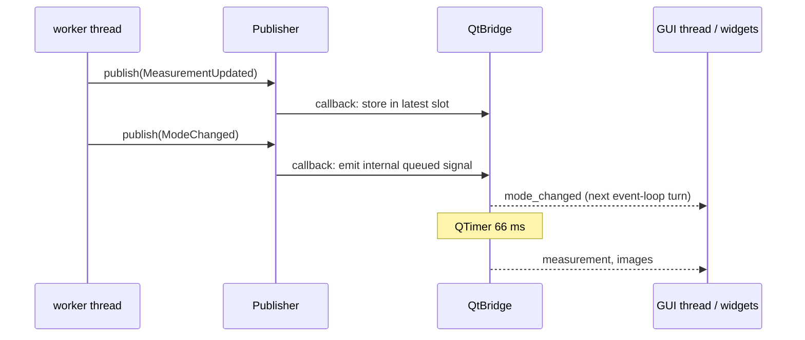
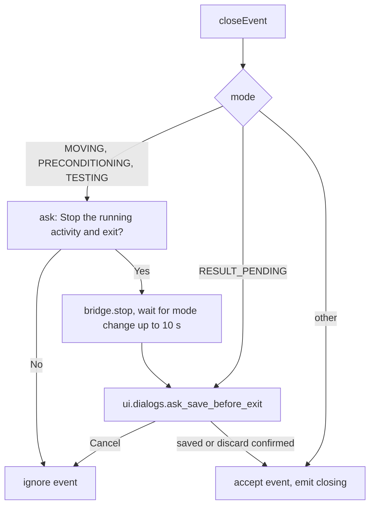
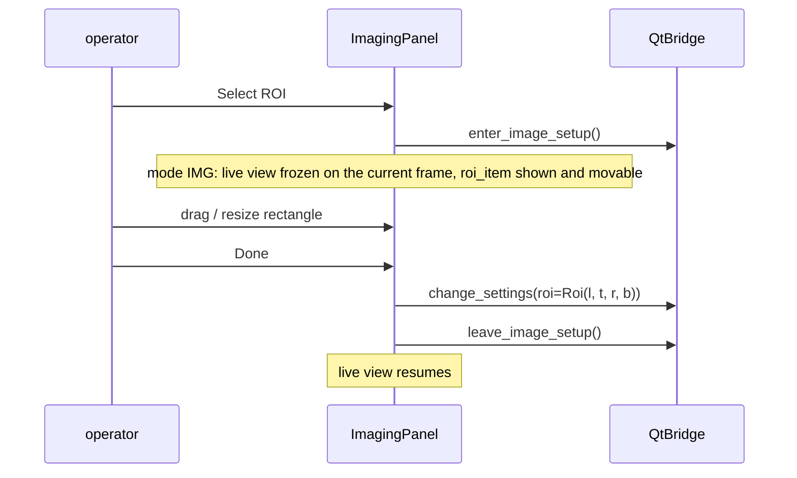
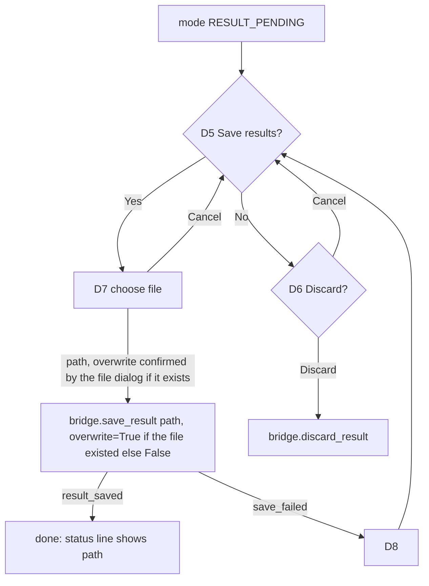

# ui package

Module specifications for `bending_machine.ui`. Each `##` section is one module or one part of a module; its subsections keep the usual order (responsibility, API, behaviour, errors, threading, test cases).

Contents:

- ui.bridge
- ui.main_window
- ui.panels: ConnectionPanel
- ui.panels: StagePanel
- ui.panels: ImagingPanel
- ui.panels: MeasurePanel
- ui.panels: PreconditionPanel
- ui.panels: TestPanel
- ui.chart
- ui.dialogs

## ui.bridge

### 1. Responsibility

`QtBridge`: the only object through which widgets talk to services. It turns service events (delivered on worker threads) into Qt signals on the GUI thread, throttles image and measurement updates to the display rate, validates setting edits, and forwards operator actions as controller commands. Supports NFR-001, NFR-002, NFR-003; no widget ever calls a service or device directly.

Imports `PyQt6.QtCore` only (no widgets), `services`, `core.models`, and standard-library
types. Discovery functions are injected by `app.main`; there is no hardware import.

### 2. Public API

```python
class QtBridge(QObject):
    # --- signals (all emitted on the GUI thread) ---
    connection_report = pyqtSignal(object)            # ConnectionReport
    devices_listed    = pyqtSignal(list, list)        # stage ports, camera ids
    mode_changed      = pyqtSignal(object, object)    # Mode new, Mode previous
    settings_changed  = pyqtSignal(object)            # Settings (after every accepted change)
    setting_invalid   = pyqtSignal(str, str)          # field name, message
    position_changed  = pyqtSignal(float)             # mm
    measurement       = pyqtSignal(object, float)     # Measurement, fps   (<= 15 Hz)
    images            = pyqtSignal(object, object, object)  # image, binary, MarkerSet|None (<= 15 Hz)
    tare_changed      = pyqtSignal(object)            # TareState
    phase_changed     = pyqtSignal(str, str)          # workflow, phase
    cycle_counted     = pyqtSignal(int, int)          # done, total
    marker_warning    = pyqtSignal(bool, int, int)    # active, found, expected
    sample_recorded   = pyqtSignal(int)               # index
    workflow_ended    = pyqtSignal(str, object)       # workflow, EndReason
    result_pending    = pyqtSignal(int, object, str)  # count, EndReason, suggested name
    result_saved      = pyqtSignal(object)            # SavedPaths
    save_failed       = pyqtSignal(str, str)          # path, message
    result_discarded  = pyqtSignal()
    overload_tripped  = pyqtSignal(float, float)      # raw, limit
    overload_cleared  = pyqtSignal()
    fault             = pyqtSignal(str, str)          # device, message
    command_rejected  = pyqtSignal(str, object, str)  # command, RejectReason, message

    def __init__(self, controller: Controller, hub: MeasurementHub, publisher: Publisher,
                 simulated: bool, protected: ProtectedSettings,
                 list_stage_ports: Callable[[], list[str]],
                 list_cameras: Callable[[], list[str]],
                 parent: QObject | None = None) -> None: ...

    # --- state readable by widgets ---
    @property
    def mode(self) -> Mode: ...
    @property
    def settings(self) -> Settings: ...
    @property
    def tare(self) -> TareState: ...
    @property
    def overload_limit(self) -> float: ...

    # --- actions (GUI thread, non-blocking) ---
    def refresh_devices(self) -> None            # runs discovery on a worker thread
    def connect_devices(self) -> None            # Connect(settings.stage_port, settings.camera_id)
    def disconnect_devices(self) -> None
    def change_settings(self, **changes: object) -> bool
    def jog(self, direction: int) -> None
    def move_absolute(self, target_mm: float) -> None
    def enter_image_setup(self) -> None
    def leave_image_setup(self) -> None
    def tare_curvature(self) -> None
    def tare_force(self) -> None
    def start_precondition(self) -> None
    def start_test(self, override_tare: bool = False) -> None
    def stop(self) -> None
    def save_result(self, path: Path, overwrite: bool) -> None
    def discard_result(self) -> None
    def acknowledge_overload(self) -> None
    def shutdown(self) -> None                   # stops the timer, unsubscribes
```

### 3. Data models

Holds a GUI-side copy of `Settings`, `Mode` and `TareState`, updated from events.

### 4. Behaviour

Event transport:

- The bridge subscribes one callback to the `Publisher`. On a worker thread the callback only (a) for `MeasurementUpdated`: stores the event in a one-slot "latest" attribute; (b) for everything else: emits an internal signal connected with `Qt.ConnectionType.QueuedConnection`, so the handler runs on the GUI thread, updates the bridge's state and emits the public signal.
- A `QTimer` with interval 66 ms (15 Hz) runs on the GUI thread. On each tick, if a new `MeasurementUpdated` is in the slot it emits `measurement`; if `hub.latest_images()` returns a frame newer than the last one shown it emits `images`. Intermediate frames are dropped, never queued (NFR-002).

`change_settings(**changes)`:

1. Build `Settings.model_validate({**current.model_dump(), **changes})`.
2. On `ValidationError`: emit `setting_invalid(field, message)` for the first error and return `False`; nothing is sent.
3. Otherwise store the new snapshot, emit `settings_changed`, submit `ApplySettings(new)`, return `True`.
4. If a `CommandRejected("ApplySettings", ...)` arrives, revert to `controller.settings` and emit `settings_changed` again.

`refresh_devices()` starts a daemon thread that calls the injected `list_stage_ports()`
and `list_cameras()` and emits `devices_listed` through a queued signal. `app.main`
binds the simulation argument before injection. The bridge does
not know which hardware functions implement discovery. The existing disconnected-only
refresh rule and simulated preselection are unchanged.



### 5. Error cases

| Case | Behaviour |
|---|---|
| Invalid setting | `setting_invalid`; widget restores the previous value |
| Command rejected | `command_rejected`; panels show the message in the status line or a dialog (see `ui.md` (ui.dialogs)) |
| Discovery fails | `devices_listed([], [])` |
| GUI thread busy for a long time | Events queue in Qt's event queue (small, bounded by event rate); measurements coalesce to the newest |
| Bridge destroyed while events arrive | `shutdown()` unsubscribes first; late queued signals are ignored |

### 6. Threading

| Part | Thread |
|---|---|
| Publisher callback | worker threads (vision, force, controller) |
| Signal handlers, timer, all public methods | GUI |
| Discovery | short-lived daemon thread |

No public method blocks: each only validates and enqueues.

### 7. Test cases

`pytest-qt`-style tests with a real `QCoreApplication`, simulated services.

| # | Input | Expected | Req |
|---|---|---|---|
| BR1 | publish `ModeChanged` from a worker thread | `mode_changed` received on the GUI thread (`QThread.currentThread()` is the app thread) | NFR-003 |
| BR2 | simulated rig running 3 s | `measurement` emitted 30–50 times (≥ 5 Hz, ≤ 15 Hz) | NFR-001 |
| BR3 | block the GUI thread for 1 s, then let it run | next `images` carries a frame with `frame_time` within 0.2 s of now, not a backlog | NFR-002 |
| BR4 | `change_settings(marker_count=2)` | returns `False`; `setting_invalid("marker_count", ...)`; no command submitted | FR-026 |
| BR5 | `change_settings(k_limit=-0.2)` in `IDLE` | `settings_changed`; controller receives `ApplySettings` | FR-070 |
| BR6 | BR5 during `TESTING` | `settings_changed` twice, the second restoring the old value | FR-003 |
| BR7 | every action method timed with a slow fake controller | each returns in < 5 ms | NFR-003 |
| BR8 | inject discovery functions returning `["SIM"]`, `["SIM-CAM"]`; `refresh_devices()` | each function runs off the GUI thread; `devices_listed(["SIM"], ["SIM-CAM"])` received on the GUI thread | FR-001 |

## ui.main_window

### 1. Responsibility

`MainWindow`: the single application window. Lays out the panels, shows the current mode and status messages, enables panels according to mode, and handles window close. Implements the visible side of FR-003, FR-005 and NFR-012.

Replaces the front panel of `Flex Main Program - GM.vi` as a whole (inventory §2.1; screenshots `tests/Capture3.PNG`–`Capture5.PNG`), including its END PROGRAM button and the block of instruction text.

### 2. Public API

```python
class MainWindow(QMainWindow):
    def __init__(self, bridge: QtBridge, simulated: bool) -> None: ...
    def closeEvent(self, event: QCloseEvent) -> None: ...
    closing = pyqtSignal()          # emitted once close has been accepted
```

### 3. Layout

Minimum size 1280 × 700; all controls visible at 1366 × 768 without scrolling.

```
+-------------------------------------------------------------------------------------+
| Bending test  [SIMULATED]                                              Mode: Idle   |
+----------------------+------------------------------+-------------------------------+
| ConnectionPanel      | ImagingPanel                 | MeasurePanel                  |
|                      |  +----------+ +----------+   |                               |
+----------------------+  | Live     | | Binary   |   +-------------------------------+
| StagePanel           |  | view     | | view     |   | PreconditionPanel             |
|                      |  +----------+ +----------+   |                               |
|                      |  imaging controls            +-------------------------------+
|                      |                              | TestPanel                     |
+----------------------+------------------------------+-------------------------------+
| LiveChart (force and dK against time)                                               |
+-------------------------------------------------------------------------------------+
| status line: last message                                         [ STOP ] (large)  |
+-------------------------------------------------------------------------------------+
```

Column widths 260 / stretch / 320 px; chart height 220 px.

### 4. Widgets

| Name | Type | Bound to | Behaviour | Enabled |
|---|---|---|---|---|
| `mode_label` | `QLabel` | `bridge.mode_changed` | Text per mode: "Not connected", "Idle", "Moving", "Image setup", "Preconditioning", "Test running", "Result not saved", "FORCE LIMIT EXCEEDED" (red background for the last) | always |
| `sim_badge` | `QLabel` | `simulated` | "SIMULATED", orange; hidden when not simulated | always |
| `status_line` | `QLabel` in the status bar | `command_rejected`, `workflow_ended`, `result_saved`, `phase_changed`, `marker_warning` | Shows the latest message; rejections stay 8 s | always |
| `stop_button` | `QPushButton` "STOP" (red, 120 × 48 px), shortcut Esc | `bridge.stop()` | One button stops whatever is running | `MOVING`, `IMAGE_SETUP`, `PRECONDITIONING`, `TESTING` |
| panels | see their files | | Each panel enables itself from `mode_changed` | per panel |

Mode text and panel enabling give the operator the "only one activity at a time" rule of FR-003 visibly; the controller enforces it regardless.

Status messages:

| Event | Text |
|---|---|
| `command_rejected` | the event's message |
| `phase_changed("test", p)` | "Test: loading" / "Test: unloading" / "Test: paused (markers)" |
| `phase_changed("precondition", p)` | "Preconditioning: finding first limit" / "… second limit" / "… cycling" |
| `workflow_ended(w, r)` | "Test completed" / "Test stopped" / "Preconditioning completed" / "… stopped" / "… ended: force limit" / "… ended: device fault" |
| `result_saved` | "Saved <results path>" |
| `marker_warning(True, f, e)` | "Markers: found f of e. Motion paused." |

### 5. Behaviour

Close (window X, Alt+F4, or File → Exit):



`closing` is connected in `app.main` to the ordered shutdown (FR-005). The window never calls services itself.

### 6. Error cases

| Case | Behaviour |
|---|---|
| Activity does not stop within 10 s on close | Message "The stage did not stop. Exit anyway?"; Yes accepts the close |
| Save fails during close | `ui.dialogs` shows the error and offers save again; close stays cancelled until resolved |
| Screen smaller than 1280 × 700 | Window opens maximised; central area gets a scroll area |

### 7. Threading

GUI thread only.

### 8. Test cases

GUI tests with simulated services (`--sim`).

| # | Input | Expected | Req |
|---|---|---|---|
| MW1 | window shown at 1366 × 768 | every widget of every panel is fully inside the visible window; no scroll bars | NFR-012 |
| MW2 | start a test | `mode_label` "Test running"; Stage, Connection, Precondition panels' action buttons disabled; `stop_button` enabled | FR-003 |
| MW3 | click `stop_button` during a test | `bridge.stop()` called; mode leaves `TESTING` | FR-004 |
| MW4 | close in `IDLE` | `closing` emitted once | FR-005 |
| MW5 | close in `RESULT_PENDING`, choose Cancel | window stays open; record still pending | FR-093 |
| MW6 | close in `TESTING`, answer No | window stays; test continues | FR-005 |
| MW7 | overload event | `mode_label` shows "FORCE LIMIT EXCEEDED" in red | FR-101 |
| MW8 | `command_rejected(..., "Not available while test running.")` | text appears in `status_line` | FR-003 |

## ui.panels: ConnectionPanel

### 1. Responsibility

`ConnectionPanel`: choose the stage port and camera, connect and disconnect, and show each device's status by name. Implements the UI of FR-001 and FR-002.

Replaces the legacy controls "Stage COM Port" (`Motor COM port`) and "Camera Name" (inventory §2.1). The legacy panel had no connect button (devices opened when the VI was run) and no status display.

### 2. Public API

```python
class ConnectionPanel(QGroupBox):          # title "Devices"
    def __init__(self, bridge: QtBridge) -> None: ...
```

### 3. Layout

```
+- Devices --------------------------+
| Stage port  [ COM3        v] [↻]   |
| Camera      [ DEV_000F..  v]       |
| [ Connect ]   [ Disconnect ]       |
| ● Stage      connected             |
| ● Load cell  no FUTEK device ...   |
| ● Camera     connected             |
+------------------------------------+
```

### 4. Widgets

Mode abbreviations: DIS = `DISCONNECTED`, IDLE, MOV = `MOVING`, IMG = `IMAGE_SETUP`, PRE = `PRECONDITIONING`, TEST = `TESTING`, PEND = `RESULT_PENDING`, OVL = `OVERLOAD`.

| Name | Type | Bound field | Validation | Enabled in |
|---|---|---|---|---|
| `port_combo` | `QComboBox` | `Settings.stage_port` | Items from `devices_listed`; the stored value is kept as an item even if absent, marked "(not found)" | DIS |
| `camera_combo` | `QComboBox` | `Settings.camera_id` | as above | DIS |
| `refresh_button` | `QToolButton` "↻" | `bridge.refresh_devices()` | | DIS |
| `connect_button` | `QPushButton` "Connect" | `bridge.connect_devices()` | Disabled if either combo is empty | DIS |
| `disconnect_button` | `QPushButton` "Disconnect" | `bridge.disconnect_devices()` | | IDLE, OVL |
| `stage_status`, `loadcell_status`, `camera_status` | `QLabel` with coloured dot | `connection_report`, `fault` | Green "connected"; red with the error text (elided, full text in tooltip); grey "not connected" | always |

### 5. Behaviour

- On construction: fill from `bridge.settings`, call `bridge.refresh_devices()`.
- Selecting an item calls `bridge.change_settings(stage_port=...)` / `(camera_id=...)`.
- `Connect`: button text becomes "Connecting…" and the panel is disabled until `connection_report` arrives (up to 15 s).
- `connection_report`: update the three status labels. If not `all_ok`, also show the dialog of `ui.dialogs.show_connection_failure(report)`, which names each failed device (FR-002).
- `fault(device, message)`: set that device's label red with the message.
- After a fault or a partial connection, mode is DIS and `Connect` retries only the missing devices.

### 6. Error cases

| Case | Behaviour |
|---|---|
| No ports or cameras found | Combos show "none found"; `Connect` disabled |
| Stored port no longer present | Shown as "COM3 (not found)"; connecting reports the stage error |
| Connection fails for one device | Other devices stay connected; mode stays DIS; no test function is available |

### 7. Threading

GUI thread only; discovery and connection run elsewhere via the bridge.

### 8. Test cases

| # | Input | Expected | Req |
|---|---|---|---|
| CP1 | simulated start | combos contain "SIM" and "SIM-CAM" | FR-001 |
| CP2 | select both, click Connect | three green labels; mode Idle; combos disabled | FR-001, FR-002 |
| CP3 | simulated load-cell failure, Connect | load-cell label red with "no FUTEK device detected"; dialog names "load cell"; Test and Precondition start buttons remain disabled | FR-002 |
| CP4 | stage combo set to a wrong port | stage label red naming the port; camera and load cell green | FR-001 |
| CP5 | `fault("camera", "link lost")` while idle | camera label red; mode Not connected; Connect enabled again | FR-103 |
| CP6 | Disconnect in Idle | three grey labels; combos enabled | FR-005 |
| CP7 | during a test | Connect, Disconnect and combos disabled | FR-003 |

## ui.panels: StagePanel

### 1. Responsibility

`StagePanel`: manual stage positioning and position display. Implements the UI of FR-010, FR-011, FR-012 and FR-013.

Replaces the legacy "Motor Controls" group: `Units`, `Movement Type`, the `Move Distance` slider (captioned "Motor Speed (mm/s)"), START/STOP Stage Adjust, Up and Down (inventory §2.1). Dropped: the unit selector and the relative/absolute selector (requirements FR-901). The START/STOP Stage Adjust pair is not needed: jog buttons work directly in Idle.

### 2. Public API

```python
class StagePanel(QGroupBox):               # title "Stage"
    def __init__(self, bridge: QtBridge) -> None: ...
```

### 3. Layout

```
+- Stage ----------------------------+
| Position     10.000 mm             |
| Step     [ 0.0612 ] mm             |
|        [  ▲ Up  ]                  |
|        [ ▼ Down ]                  |
| Go to    [ 10.000 ] mm  [ Go ]     |
+------------------------------------+
```

### 4. Widgets

| Name | Type | Bound field | Validation | Enabled in |
|---|---|---|---|---|
| `position_label` | `QLabel` | `position_changed` | Format `%.3f mm`; "—" when DIS | always |
| `step_spin` | `QDoubleSpinBox` | `Settings.jog_step_mm` | 0.0001–5.0, 4 decimals, single step 0.01, suffix " mm" | DIS, IDLE, OVL, PEND |
| `up_button` | `QPushButton` "▲ Up" | `bridge.jog(+1)` | | IDLE |
| `down_button` | `QPushButton` "▼ Down" | `bridge.jog(-1)` | | IDLE |
| `goto_spin` | `QDoubleSpinBox` | (local) | −1000.0–1000.0, 3 decimals, suffix " mm"; initial value = current position | IDLE |
| `goto_button` | `QPushButton` "Go" | `bridge.move_absolute(goto_spin.value())` | | IDLE |

### 5. Behaviour

- One click = one jog command = one relative move of `jog_step_mm`. Holding a button does not auto-repeat.
- While a move runs the mode is MOV, so the buttons are disabled until it ends; the main STOP button interrupts it.
- "Up" moves the sample toward the stage's home position (negative Zaber coordinate with `stage_up_sign = -1`), as "Up" on the legacy panel.
- `step_spin` edits call `bridge.change_settings(jog_step_mm=...)` on `editingFinished`. The same value is the step used by preconditioning (FR-061); the tooltip says so.
- A rejected `Go` (target out of travel) appears in the status line; the position is unchanged.

### 6. Error cases

| Case | Behaviour |
|---|---|
| Invalid step typed | Spin box clamps to its range; `setting_invalid` restores the previous value |
| Target out of travel | `command_rejected` message in the status line |
| Stage fault during a move | Position shows "—"; handled by the connection panel and dialogs |
| Overload latched | Buttons disabled (mode OVL) |

### 7. Threading

GUI thread only.

### 8. Test cases

| # | Input | Expected | Req |
|---|---|---|---|
| SP1 | Idle, step 0.05, click Up | `position_label` changes from "10.000 mm" to "9.950 mm" | FR-010, FR-013 |
| SP2 | click Down | back to "10.000 mm" | FR-010 |
| SP3 | inspect panel | step field has suffix " mm"; no unit selector exists | FR-011 |
| SP4 | Go to 12.000 | label "12.000 mm" | FR-012, FR-013 |
| SP5 | Go to 999 | status line shows the out-of-travel message; label unchanged | FR-012 |
| SP6 | during a test | Up, Down, Go disabled; `position_label` keeps updating at each step | FR-003, FR-013 |
| SP7 | change step to 0.1, restart the application | step shows 0.1000 | FR-006 |

## ui.panels: ImagingPanel

### 1. Responsibility

`ImagingPanel`: the live view, the binary (threshold and tracking) view with marker overlays, ROI drawing, and all detection settings. Implements the UI of FR-020 to FR-031.

Replaces the legacy "Live View" and "Threshold and Marker Tracking View" image displays and the "Imaging Controls" group: Number Objects, Min Size, Max Size, START/STOP Image Setup, Image Threshold lower/upper sliders, INVERT Image, START Object Tracking, Frame Rate (inventory §2.1). Dropped: the separate integer `Threshold` control (requirements FR-902). No rotation control: the image is shown as the camera delivers it (FR-021 dropped). New: fit-subset choice, marker-count warning.

### 2. Public API

```python
class ImagingPanel(QWidget):
    def __init__(self, bridge: QtBridge) -> None: ...
```

### 3. Layout

```
+----------------------------+ +----------------------------+
| Live view                  | | Threshold and tracking     |
| (pyqtgraph ImageItem,      | | (binary image, ROI outline,|
|  ROI rectangle overlay)    | |  marker dots and indices)  |
+----------------------------+ +----------------------------+
 17.8 fps                        Markers: 6 of 6  ✔
+--------------------------------------------------------------------+
| [ Select ROI ] [ Done ] [ Clear ROI ]                              |
| Lower [====|------] [  2]   Upper [--|=======] [ 60]  [ ] Invert   |
| Markers [ 6 ]  Min area [ 200 ] px²  Max area [ 15000 ] px²        |
| Fit [ All markers v ]                  [ Start tracking ]          |
+--------------------------------------------------------------------+
```

Both views keep the image aspect ratio, origin top-left, no axes, mouse zoom and pan disabled.

### 4. Widgets

Mode abbreviations as in `ui.md` (ui.panels). "Editable" = IDLE, IMG, PEND, OVL, DIS.

| Name | Type | Bound field | Validation | Enabled in |
|---|---|---|---|---|
| `live_view` | `pyqtgraph.GraphicsLayoutWidget` + `ImageItem` | `images` signal, first array | grey levels 0–255 fixed (no auto-level) | always |
| `binary_view` | same | `images` signal, second array | levels 0–255 | always |
| `roi_item` | `pyqtgraph.RectROI` on `live_view` | `Settings.roi` | Clamped to the image; minimum 20 × 20 px | movable only in IMG |
| `roi_outline` | rectangle on `binary_view` | `Settings.roi` | green, 1 px | always (display) |
| `marker_overlay` | `ScatterPlotItem` + `TextItem`s on `binary_view` | `images` signal, `MarkerSet` | red dot at each centre; label = 0-based index, left to right | shown when tracking |
| `fps_label` | `QLabel` | `measurement` signal, fps | `%.1f fps` | always |
| `marker_status` | `QLabel` | `measurement` | "Markers: f of N ✔" (green) when valid; "Markers: f of N" on a red background when tracking and not valid; "Tracking off" (grey) | always |
| `select_roi_button` | `QPushButton` "Select ROI" | `bridge.enter_image_setup()` | | IDLE |
| `roi_done_button` | `QPushButton` "Done" | commit ROI, `bridge.leave_image_setup()` | | IMG |
| `clear_roi_button` | `QPushButton` "Clear ROI" | `change_settings(roi=None)` | | IDLE, IMG |
| `lower_slider` + `lower_spin` | `QSlider` 0–255 + `QSpinBox` | `Settings.threshold_lower` | 0–255; if moved above upper, upper follows | Editable |
| `upper_slider` + `upper_spin` | same | `Settings.threshold_upper` | 0–255; if moved below lower, lower follows | Editable |
| `invert_check` | `QCheckBox` "Invert" | `Settings.invert` | | Editable |
| `count_spin` | `QSpinBox` | `Settings.marker_count` | 3–50 | Editable |
| `min_area_spin` | `QSpinBox` | `Settings.min_area_px` | 1–10 000 000; if above max, max follows | Editable |
| `max_area_spin` | `QSpinBox` | `Settings.max_area_px` | 1–10 000 000; if below min, min follows | Editable |
| `fit_combo` | `QComboBox`: "All markers", "Exclude outer two" | `Settings.fit_subset` | "Exclude outer two" selectable only when `marker_count >= 5` | IDLE, DIS |
| `tracking_button` | checkable `QPushButton` "Start tracking" / "Stop tracking" | `Settings.tracking` | | IDLE, IMG |

During MOV, PRE and TEST every control in the bottom block is disabled; the views and status labels keep updating.

### 5. Behaviour

ROI selection (FR-022):



- While frozen, `images` updates are ignored for `live_view` only; `binary_view` stays live so threshold changes can be judged.
- The main STOP button in IMG leaves image setup without changing the ROI.
- Slider and spin-box changes call `bridge.change_settings(...)` on every value change (sliders: at most once per 50 ms); the binary view reflects the change with the next displayed frame (FR-023).
- `marker_status` turns red from the first displayed frame with a wrong count and green again when the count is right (FR-030). During a workflow the same condition also appears in the status line through `marker_warning`.
- Images are displayed without copying; arrays from the bridge are read-only by convention.

### 6. Error cases

| Case | Behaviour |
|---|---|
| No image yet / camera disconnected | Views show the last image dimmed to 50 % with the text "No image"; `fps_label` "— fps" |
| ROI outside the image after a camera change | Clipped; if smaller than 20 × 20 px it is cleared |
| `setting_invalid` | The widget is reset to `bridge.settings` |
| Tracking switched on with zero blobs | `marker_status` red "Markers: 0 of N" |

### 7. Threading

GUI thread only. Image arrays are produced on the vision thread and never modified after publication.

### 8. Test cases

GUI tests in simulated mode.

| # | Input | Expected | Req |
|---|---|---|---|
| IP1 | connected, Idle, 2 s | `live_view` image changes at ≥ 5 updates/s; also in IMG, PRE and TEST | FR-020 |
| IP3 | Select ROI, drag to (150, 300)–(1150, 720), Done | `bridge.settings.roi == Roi(150, 300, 1150, 720)`; `roi_outline` drawn there | FR-022 |
| IP4 | IP3 with an ROI excluding the right-most marker, tracking on | marker_status "Markers: 5 of 6" red | FR-022, FR-030 |
| IP5 | move `upper_slider` to 10 | within one displayed frame the binary view shows no marker blobs | FR-023 |
| IP6 | tick Invert | binary view foreground and background swap | FR-024 |
| IP7 | set Min area 500 (simulated blobs ≈ 452 px²) | markers 0 of 6 | FR-025 |
| IP8 | `count_spin` to 5 | marker_status "Markers: 6 of 5" red; setting stored | FR-026 |
| IP9 | tracking on, defaults | six red dots with labels 0–5 increasing left to right; ROI outline visible | FR-027, FR-028 |
| IP10 | tracking off; press Start test | dialog per `ui.md` (ui.dialogs) D3; `tracking_button` unchanged | FR-029 |
| IP11 | simulated `hide_marker(2)` | marker_status red "5 of 6" within 0.5 s; green again after restore | FR-030 |
| IP12 | 5 s of running | `fps_label` between 16.0 and 19.6 | FR-031 |
| IP13 | during a test | all controls in the bottom block disabled | FR-003 |
| IP14 | `marker_count=4`, open `fit_combo` | "Exclude outer two" disabled | FR-042 |

## ui.panels: MeasurePanel

### 1. Responsibility

`MeasurePanel`: numeric readouts of force and dK, the camera resolution entry, the two tare buttons and their status indicators. Implements the UI of FR-043, FR-044, FR-046 and FR-047.

Replaces, from the legacy "Run Test Controls" group: TARE Curvature, TARE Force, the `dK` and `Force` indicators, and "Camera Res. mm/pixel" (inventory §2.1). The legacy `K is set` / `F is set` flags were hidden; here they are visible.

### 2. Public API

```python
class MeasurePanel(QGroupBox):             # title "Measurement"
    def __init__(self, bridge: QtBridge) -> None: ...
```

### 3. Layout

```
+- Measurement --------------------------------+
| Curvature dK    -0.1517  1/mm   ● tared      |
|                 [ Tare curvature ]           |
| Force           -0.530   g      ● tared      |
|                 [ Tare force ]               |
| Resolution   [ 0.011100 ] mm/pixel           |
| Force limit  25.0 (untared)                  |
+----------------------------------------------+
```

### 4. Widgets

| Name | Type | Bound field | Validation / format | Enabled in |
|---|---|---|---|---|
| `dk_label` | `QLabel` (large font) | `measurement.dk` | `%.4f`; "—" when `dk is None` | always |
| `k_tare_dot` | `QLabel` | `tare_changed`, `TareState.k_set` | green "tared" / grey "not tared"; orange "untared (override)" when `overridden` and `k_ref == 0.0` | always |
| `tare_k_button` | `QPushButton` "Tare curvature" | `bridge.tare_curvature()` | | IDLE |
| `force_label` | `QLabel` (large font) | `measurement.force` | `%.3f`; "—" when not finite | always |
| `f_tare_dot` | `QLabel` | `TareState.f_set` | as `k_tare_dot` | always |
| `tare_f_button` | `QPushButton` "Tare force" | `bridge.tare_force()` | | IDLE |
| `resolution_spin` | `QDoubleSpinBox` | `Settings.resolution_mm_per_px` | 0.000001–10.0, 6 decimals, suffix " mm/pixel" | DIS, IDLE, IMG, PEND, OVL |
| `limit_label` | `QLabel` | `bridge.overload_limit` | `%.1f (untared)`; read-only (FR-102) | always |

Unit label for force is "g", as on the legacy chart axis; the load cell is configured in grams (confirmed).

### 5. Behaviour

- Readouts update on each `measurement` signal (≤ 15 Hz).
- Before the first curvature tare, `dk_label` shows "—" (FR-044); after `tare_changed` with `k_set`, it shows the value, which is 0.0000 within noise immediately after the tare.
- `tare_f_button` likewise brings the force readout to 0.000 within noise (FR-046).
- A tare refused by the controller (`command_rejected` with `NO_MEASUREMENT`) shows its message in the status line; indicators do not change.
- `resolution_spin` commits on `editingFinished` through `bridge.change_settings(resolution_mm_per_px=...)`. Changing it does not clear the curvature tare; the tooltip warns: "Changing the resolution after taring changes dK. Tare again."

### 6. Error cases

| Case | Behaviour |
|---|---|
| Tracking off or markers invalid | `dk_label` "—" |
| No force reading (load cell lost) | `force_label` "—" |
| Invalid resolution | Spin box range prevents it; `setting_invalid` restores the old value |
| Disconnect | `tare_changed` with both references cleared: both dots grey |

### 7. Threading

GUI thread only.

### 8. Test cases

| # | Input | Expected | Req |
|---|---|---|---|
| MP1 | connected, tracking on, never tared | `dk_label` "—"; both dots grey | FR-044, FR-047 |
| MP2 | click Tare curvature | dot green; `dk_label` within ±0.002 of 0 | FR-044, FR-047 |
| MP3 | simulated force offset 3.0, click Tare force | dot green; `force_label` within ±0.05 of 0 | FR-046, FR-047 |
| MP4 | static simulated scene, tared; double `resolution_spin` | the absolute curvature behind the readout halves (dK changes accordingly) | FR-043 |
| MP5 | tracking off, click Tare curvature | status line "Curvature cannot be tared: not all markers are detected."; dot stays grey | FR-044 |
| MP6 | test started with override, nothing tared | both dots orange "untared (override)" | FR-048 |
| MP7 | during a test | tare buttons disabled; readouts update | FR-003 |
| MP8 | inspect `limit_label` | shows "25.0 (untared)"; not editable | FR-102 |

## ui.panels: PreconditionPanel

### 1. Responsibility

`PreconditionPanel`: settings, start control and progress display for preconditioning. Implements the UI of FR-060, FR-063 and FR-064.

Replaces the legacy "Preconditioning Controls" group: `dK` (PC K Limit), `Cycle Set` (PC Cycle Limit), START Precondition, STOP Precondition, `Cycle Count` (inventory §2.1). STOP is the main window's STOP button. The dwell time is new (it was a fixed 3000 ms).

### 2. Public API

```python
class PreconditionPanel(QGroupBox):        # title "Preconditioning"
    def __init__(self, bridge: QtBridge) -> None: ...
```

### 3. Layout

```
+- Preconditioning ----------------------------+
| Amplitude  [ 0.0500 ] 1/mm                   |
| Cycles     [   3 ]      Dwell [ 3.0 ] s      |
| [ Start preconditioning ]                    |
| Cycle 2 of 3        Finding second limit     |
+----------------------------------------------+
```

### 4. Widgets

| Name | Type | Bound field | Validation | Enabled in |
|---|---|---|---|---|
| `amplitude_spin` | `QDoubleSpinBox` | `Settings.pc_amplitude` | 0.0–5.0, 4 decimals, step 0.01, suffix " 1/mm" | DIS, IDLE, PEND, OVL |
| `cycles_spin` | `QSpinBox` | `Settings.pc_cycles` | 1–1000 | DIS, IDLE, PEND, OVL |
| `dwell_spin` | `QDoubleSpinBox` | `Settings.pc_dwell_s` | 0.0–60.0, 1 decimal, suffix " s" | DIS, IDLE, PEND, OVL |
| `start_button` | `QPushButton` "Start preconditioning" | `bridge.start_precondition()` | Disabled when `pc_amplitude == 0` (tooltip "Set an amplitude greater than 0") | IDLE |
| `cycle_label` | `QLabel` | `cycle_counted(done, total)` | "Cycle d of t"; "—" when no run has started | always |
| `phase_label` | `QLabel` | `phase_changed("precondition", p)`, `workflow_ended` | "Finding first limit" / "Finding second limit" / "Cycling" / "Completed" / "Stopped" / "Ended: force limit" / "Ended: device fault" | always |

### 5. Behaviour

- Spin boxes commit on `editingFinished` through `bridge.change_settings(...)`.
- `Start`: calls the bridge; if the controller rejects it, the reason is shown by `ui.dialogs` (tracking off, not tared) or in the status line (other reasons).
- The step used while seeking the limits is the Stage panel's step; the panel shows it read-only in the `start_button` tooltip: "Uses the stage step (x.xxxx mm)".
- `cycle_label` shows "Cycle 0 of N" at start and counts up on each `cycle_counted` (FR-064).

### 6. Error cases

| Case | Behaviour |
|---|---|
| Amplitude 0 | Start disabled |
| Rejected start | Message shown; panel unchanged |
| Overload or fault during the run | `phase_label` shows the end reason; mode handling by the main window |

### 7. Threading

GUI thread only.

### 8. Test cases

| # | Input | Expected | Req |
|---|---|---|---|
| PP1 | Idle, tracking on, tared, amplitude 0.03, cycles 3, Start | mode Preconditioning; `cycle_label` runs "0 of 3" … "3 of 3"; `phase_label` ends "Completed" | FR-060, FR-064 |
| PP2 | amplitude 0 | `start_button` disabled | FR-060 |
| PP3 | set dwell 1.0 s, run | observed dwell at each extreme ≈ 1 s (from `position_changed` timestamps) | FR-063 |
| PP4 | tracking off, Start | dialog with the preconditioning message (`ui.md` (ui.dialogs) D3) | FR-029 |
| PP5 | during a run | spin boxes and Start disabled | FR-003 |
| PP6 | STOP during a run | `phase_label` "Stopped"; mode returns to Idle after the return move | FR-004, FR-065 |

## ui.panels: TestPanel

### 1. Responsibility

`TestPanel`: settings, start control and progress display for the test run. Implements the UI of FR-070, FR-072 and FR-073.

Replaces, from the legacy "Run Test Controls" group: `Curvature Limit` (K Limit), START Test, STOP Test (inventory §2.1). STOP is the main window's STOP button. New: the test step (legacy used 0.7794 × the jog distance, hidden) and the settle time (legacy fixed 400 ms).

### 2. Public API

```python
class TestPanel(QGroupBox):                # title "Test"
    def __init__(self, bridge: QtBridge) -> None: ...
```

### 3. Layout

```
+- Test ---------------------------------------+
| Curvature limit [ -0.1200 ] 1/mm             |
| Step  [ 0.0477 ] mm     Settle [ 0.40 ] s    |
| [ Start test ]                               |
| Loading            Samples: 17               |
+----------------------------------------------+
```

### 4. Widgets

| Name | Type | Bound field | Validation | Enabled in |
|---|---|---|---|---|
| `limit_spin` | `QDoubleSpinBox` | `Settings.k_limit` | −5.0–5.0, 4 decimals, step 0.01, suffix " 1/mm"; the value 0 is rejected (`setting_invalid`, previous value restored) | DIS, IDLE, PEND, OVL |
| `step_spin` | `QDoubleSpinBox` | `Settings.test_step_mm` | 0.0001–5.0, 4 decimals, suffix " mm" | DIS, IDLE, PEND, OVL |
| `settle_spin` | `QDoubleSpinBox` | `Settings.settle_s` | 0.05–10.0, 2 decimals, suffix " s" | DIS, IDLE, PEND, OVL |
| `start_button` | `QPushButton` "Start test" | `bridge.start_test()` | | IDLE |
| `phase_label` | `QLabel` | `phase_changed("test", p)`, `workflow_ended("test", r)` | "Loading" / "Unloading" / "Paused: markers" / "Completed" / "Stopped" / "Ended: force limit" / "Ended: device fault"; "—" initially | always |
| `samples_label` | `QLabel` | `sample_recorded(index)` | "Samples: n" (index + 1); reset to 0 at test start | always |

### 5. Behaviour

- `step_spin` shows the step that is actually commanded (FR-073): no hidden factor.
- Spin boxes commit on `editingFinished` through `bridge.change_settings(...)`.
- `Start test`:
  1. `bridge.start_test()`.
  2. If rejected with `NOT_TARED`, `ui.dialogs.ask_tare_override()` is shown; "Start anyway" calls `bridge.start_test(override_tare=True)` (FR-048).
  3. If rejected with `NOT_TRACKING`, the dialog of `ui.md` (ui.dialogs) D3 is shown.
  4. Other rejections go to the status line.
- When the mode becomes `RESULT_PENDING` the save question is shown by `ui.dialogs` (not by this panel).

### 6. Error cases

| Case | Behaviour |
|---|---|
| Limit 0 typed | Previous value restored; status line "Curvature limit must not be 0." |
| Rejected start | As in §5 |
| Overload or fault | `phase_label` shows the end reason |

### 7. Threading

GUI thread only.

### 8. Test cases

| # | Input | Expected | Req |
|---|---|---|---|
| TP1 | set limit −0.05, tared, tracking on, Start | mode Test running; `phase_label` "Loading" → "Unloading" → "Completed"; `samples_label` increases | FR-070 |
| TP2 | type 0 in `limit_spin` | value reverts; status-line message | FR-070 |
| TP3 | set step 0.25, run a test, read the log | every `step` log line shows ±0.2500 mm | FR-073 |
| TP4 | set settle 1.00, run | `samples_label` increments no faster than once per second | FR-072 |
| TP5 | not tared, Start | override dialog appears; "Cancel" starts nothing (position unchanged); "Start anyway" starts the test | FR-048 |
| TP6 | during a test | spin boxes and Start disabled | FR-003 |
| TP7 | change all three values, restart | values restored | FR-006 |

## ui.chart

### 1. Responsibility

`LiveChart`: force and dK plotted against time on one chart with two Y axes, cleared at the start of preconditioning and of a test. Implements FR-049; bounded history supports NFR-006.

Replaces the legacy `Waveform Chart` (two plots, "Force, g" left axis, "Curvature, 1/mm" right axis, X axis "Time" in samples) and the property-node history clear (inventory §2.1, §4.3).

### 2. Public API

```python
class LiveChart(pg.PlotWidget):
    MAX_POINTS = 20_000
    def __init__(self, bridge: QtBridge) -> None: ...
    def clear_history(self) -> None: ...
    def add_point(self, t: float, force: float, dk: float | None) -> None: ...
    @property
    def point_count(self) -> int: ...
```

### 3. Layout

```
 Force, g                                                  Curvature, 1/mm
   0.0 |‾‾\__                                                      | 0.00
  -0.5 |     \____      ── Force (white)                           | -0.05
  -1.0 |          \___  ── Curvature (red)                         | -0.10
       +-----------------------------------------------------------+
         0        20        40        60     Time, s
```

### 4. Widgets and items

| Name | Type | Bound to | Notes |
|---|---|---|---|
| left axis | `AxisItem` | | label "Force", units "g"; auto-range |
| right axis | `AxisItem` with a second `ViewBox` linked on X | | label "Curvature", units "1/mm"; auto-range |
| bottom axis | `AxisItem` | | label "Time", units "s" |
| `force_curve` | `PlotDataItem`, white, 1 px | `measurement` signal | |
| `dk_curve` | `PlotDataItem`, red, 1 px, in the right `ViewBox` | `measurement` signal | NaN where `dk is None` (drawn as gaps, `connect="finite"`) |
| legend | `LegendItem` top-right | | "Force", "Curvature" |

The chart has no enabled/disabled states; it is display only. Mouse zoom and pan are enabled; double-click restores auto-range.

### 5. Behaviour

- On each `bridge.measurement(m, fps)` (≤ 15 Hz): `add_point(m.frame_time − t0, m.force, m.dk)`, where `t0` is the `frame_time` of the first point since the last clear.
- A point whose force is not finite is skipped.
- Cleared when `bridge.mode_changed` enters `PRECONDITIONING` or `TESTING` (FR-049), and on disconnect. Not cleared when those modes end, so the finished curve stays visible.
- Storage: two preallocated numpy arrays of `MAX_POINTS`. When full, the oldest half is discarded (points shift down) so memory stays constant: 20 000 points is about 22 minutes at 15 Hz.
- Redraw happens once per added point (`setData`), which at 15 Hz and ≤ 20 000 points stays under 10 ms.

### 6. Error cases

| Case | Behaviour |
|---|---|
| `dk` is `None` | Gap in the curvature curve |
| Non-finite force | Point skipped |
| Camera stops | No new points; chart stays |
| More than `MAX_POINTS` | Oldest half dropped |

### 7. Threading

GUI thread only.

### 8. Test cases

| # | Input | Expected | Req |
|---|---|---|---|
| CH1 | 10 `add_point` calls | `point_count == 10`; both curves have 10 samples; axis labels "Force (g)", "Curvature (1/mm)", "Time (s)" | FR-049 |
| CH2 | mode change to `TESTING` | `point_count == 0`, then grows | FR-049 |
| CH3 | mode change to `PRECONDITIONING` | `point_count == 0` | FR-049 |
| CH4 | mode `TESTING` → `RESULT_PENDING` | points kept | FR-049 |
| CH5 | `add_point(1.0, -0.5, None)` | force curve has the point; curvature curve has NaN there | FR-044 |
| CH6 | 30 000 `add_point` calls | `point_count` ≤ 20 000; last point is the newest; memory constant | NFR-006 |
| CH7 | simulated rig, Idle, 3 s | `point_count` between 15 and 50 (≥ 5 points/s) | NFR-001 |

## ui.dialogs

### 1. Responsibility

All modal dialogs: connection failures, device faults, start refusals, the tare override, the save question with discard confirmation, the file chooser, save errors and the overload message. Implements the UI of FR-029, FR-048, FR-077, FR-090, FR-092, FR-093, FR-101, FR-103 and the reporting side of FR-002.

Replaces the legacy Express dialogs: "Display Message to User" (tracking refusal, same text for preconditioning and test), the two-button "Save results?" dialog, the Express file dialog of Write To Measurement File, the one-button "Force limit exceeded" dialog and the Simple Error Handler at exit (inventory §4.3).

### 2. Public API

```python
class DialogCoordinator(QObject):
    """Connects to bridge signals and shows the right dialog. One instance, owned by MainWindow."""
    def __init__(self, bridge: QtBridge, parent: QWidget) -> None: ...
    def ask_save_before_exit(self) -> bool:
        """Used by MainWindow.closeEvent in RESULT_PENDING. Runs the save flow (D5-D8).
        Returns True when the record has been saved or discarded, False if cancelled."""

# stateless helpers, each returns when the dialog closes
def show_connection_failure(parent: QWidget, report: ConnectionReport) -> None          # D1
def show_fault(parent: QWidget, device: str, message: str) -> None                      # D2
def show_not_tracking(parent: QWidget, message: str) -> None                            # D3
def ask_tare_override(parent: QWidget) -> bool                                          # D4
def ask_save(parent: QWidget, sample_count: int, reason: EndReason) -> bool             # D5
def confirm_discard(parent: QWidget) -> bool                                            # D6
def choose_results_path(parent: QWidget, folder: Path, suggested: str) -> Path | None   # D7
def show_save_failed(parent: QWidget, path: str, message: str) -> None                  # D8
def show_overload(parent: QWidget, raw: float, limit: float) -> bool                    # D9
```

### 3. Dialogs

| ID | Trigger | Type | Title / text | Buttons (default first) | Result |
|---|---|---|---|---|---|
| D1 | `connection_report` not `all_ok` | `QMessageBox.Warning` | "Connection failed" / one line per failed device: "Stage: <message>", "Load cell: <message>", "Camera: <message>" | OK | none |
| D2 | `fault(device, message)` | `QMessageBox.Critical` | "Device fault" / "<Device> stopped responding: <message>. Motion has been stopped. Recorded data, if any, is kept." | OK | none |
| D3 | `command_rejected` with `NOT_TRACKING` | `QMessageBox.Information` | "Markers not tracked" / the event's message (differs for preconditioning and test, FR-029) | OK | none |
| D4 | `command_rejected("StartTest", NOT_TARED)` | `QMessageBox.Question` | "Not tared" / "Curvature and force have not both been tared. Values will be recorded untared." | Cancel, Start anyway | `True` on "Start anyway" |
| D5 | `mode_changed` to `RESULT_PENDING` | `QMessageBox.Question` | "Save results?" / "The test ended (<reason text>) with <n> samples. Save results?" | Yes, No | `True` on Yes |
| D6 | D5 answered No | `QMessageBox.Warning` | "Discard results?" / "The <n> samples of this test will be lost." | Cancel, Discard | `True` on Discard |
| D7 | D5 answered Yes | `QFileDialog.getSaveFileName` | caption "Save results", filter "Results (*.lvm)", start folder = folder of the last save (else Documents), preselected name = suggested name | Save, Cancel | path or `None`. The native dialog asks for confirmation when the chosen file exists (`DontConfirmOverwrite` not set) |
| D8 | `save_failed(path, message)` | `QMessageBox.Critical` | "Save failed" / "<path> could not be written: <message>. The results are still in memory." | OK | none; flow returns to D5 |
| D9 | `overload_tripped(raw, limit)` | `QMessageBox.Critical`, non-closable by Esc | "Force limit exceeded" / "Reading <raw> is beyond the limit <limit>. The stage has been stopped. Remove the load, then acknowledge to enable motion again." | Acknowledge | `True` when pressed |

Reason texts for D5: "completed", "stopped by operator", "force limit exceeded", "device fault".

### 4. Behaviour

Save flow (FR-077, FR-090, FR-092, FR-093):



- `overwrite` passed to the bridge is `True` only when the chosen file or its metadata file already existed and the operator confirmed replacement in D7. If only the metadata file exists (D7 cannot know about it), the coordinator asks "Metadata file <name>.meta.json exists. Replace it?" before saving.
- If D5 is triggered while D9 or D2 is open, D5 waits until that dialog is closed.
- Overload flow: D9 "Acknowledge" calls `bridge.acknowledge_overload()`. If `command_rejected(..., OVERLOAD_LATCHED, ...)` comes back, D9 is shown again with the extra line "Force is still above the limit." When a test was running, D9 is shown first, then D5 (data is kept, FR-101).
- D2 for `device == "application"` uses the text "Internal error: <message>."
- At most one dialog is open at a time; triggers arriving meanwhile are queued in arrival order, except D9 which goes to the front.

### 5. Error cases

| Case | Behaviour |
|---|---|
| Operator closes D5 with the window X | Treated as "No", leading to D6 (whose X is "Cancel") |
| Save fails repeatedly | Loop D5 → D7 → D8 until saved or discarded; the record is never lost (FR-093) |
| Application exit during the flow | `ask_save_before_exit` runs the same flow and returns `False` on any Cancel |
| Rejections other than `NOT_TRACKING` / `NOT_TARED` | No dialog; status line only |

### 6. Threading

GUI thread only. Dialogs are modal to the main window; worker threads keep running while a dialog is open (live image and force continue behind it).

### 7. Test cases

GUI tests with dialog interception.

| # | Input | Expected | Req |
|---|---|---|---|
| DL1 | connection report with load cell failed | D1 text contains "Load cell:" and the message, and no line for stage or camera | FR-002 |
| DL2 | tracking off, Start test; then Start preconditioning | D3 text mentions "run a test"; second D3 mentions "precondition" | FR-029 |
| DL3 | untared Start test; Cancel | D4 shown; no test starts | FR-048 |
| DL4 | untared Start test; Start anyway | `bridge.start_test(override_tare=True)` called | FR-048 |
| DL5 | test completes | D5 appears only after the stage has returned (mode is `RESULT_PENDING`) | FR-077 |
| DL6 | D5 No, D6 Cancel | D5 shown again; record pending | FR-077 |
| DL7 | D5 No, D6 Discard | `bridge.discard_result()`; no file written | FR-077 |
| DL8 | D5 Yes, choose `t1.lvm` in an empty folder | `save_result(path, overwrite=False)`; `t1.lvm` and `t1.meta.json` exist | FR-090 |
| DL9 | D5 Yes, choose an existing file, decline the overwrite prompt | nothing written; file dialog still open | FR-092 |
| DL10 | D5 Yes, existing file, confirm | `save_result(path, overwrite=True)`; file replaced | FR-092 |
| DL11 | save into a read-only folder | D8 with the OS message; then D5 again; choosing a writable folder succeeds | FR-093 |
| DL12 | overload during a test | D9 first; after Acknowledge (force back in range) D5 offers to save the samples; application still running | FR-101 |
| DL13 | D9 Acknowledge while still overloaded | D9 shown again with "Force is still above the limit." | FR-101 |
| DL14 | simulated camera failure during a test | D2 names "Camera"; then D5 | FR-103 |
| DL15 | stopped test with 4 samples | D5 text "stopped by operator" and "4 samples"; saving works | FR-078 |
